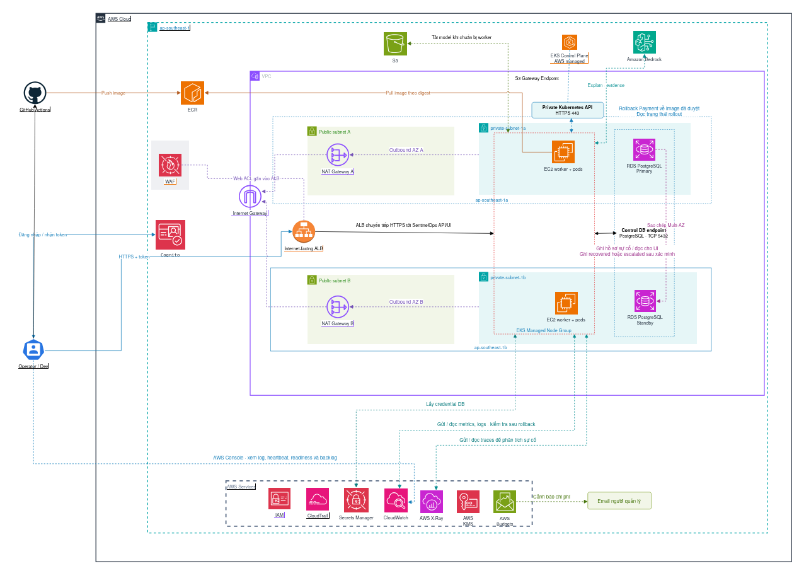

# SentinelOps

SentinelOps là hệ thống AIOps thử nghiệm cho ba microservice **Checkout, Payment và Inventory**. Hệ thống thu metrics, logs và traces, phát hiện vi phạm SLO, lưu hồ sơ sự cố có revision rồi đưa bằng chứng, giả thuyết nguyên nhân và đề xuất xử lý vào workspace của operator.

**Môi trường AWS dev đã triển khai.** Tại mốc rà soát **19/11/2026, 22:39 giờ Việt Nam**, EKS 1.34 active, **2 node Ready**, **13/13 Deployment Ready** và API `/ready` nội bộ trả 200. [Báo cáo kịch bản live](docs/delivery/DEMO_SCENARIOS_2026-11-19.md)

## Mở hệ thống

| Công cụ | Link và cách vào |
| --- | --- |
| **Incident Workspace** | [Operator UI](https://dr76usfhbe2w8.cloudfront.net/ui/). Chọn **Sign in with Cognito**, dùng tài khoản operator và hoàn tất MFA. |
| **Grafana** | [Grafana](https://dr76usfhbe2w8.cloudfront.net/grafana/) · [SLO](https://dr76usfhbe2w8.cloudfront.net/grafana/d/sentinelops-slo) · [Business health and incidents](https://dr76usfhbe2w8.cloudfront.net/grafana/d/sentinelops-incidents) · [Worker telemetry](https://dr76usfhbe2w8.cloudfront.net/grafana/d/sentinelops-workers). |
| **Fault Console** | [127.0.0.1:8765](http://127.0.0.1:8765/) sau port-forward. Bản EKS đọc fault mode của Payment và Inventory. Các nút thao tác đang khóa. · [Khởi động local trên Windows](scripts/demo_console/START.md) |
| **Prometheus và Jaeger** | [Prometheus trên 9090](http://127.0.0.1:9090/) · [Jaeger trên 16686](http://127.0.0.1:16686/) sau port-forward. |
| **Hướng dẫn demo** | [Bàn giao UI và flow demo](docs/delivery/SENTINELOPS_UI_DEMO_HANDOFF.md) · [Runbook theo từng bước](docs/runbooks/DEMO_FLOW.md). |

Bản Incident Workspace đã deploy dùng **theme trắng và tiếng Anh**. Incident queue có bộ lọc theo state/service và thông tin revision. Các tab **Overview**, **Evidence**, **Timeline**, **Explanation** và **Actions** phục vụ điều tra. **Runbook proposals** hiển thị quyết định và deadline khi có đề xuất. Hai chỉ báo workspace trên trang public có thể hiện **Unknown** vì CloudFront trả 403 cho các route readiness. Kiểm dependency qua API nội bộ.

## Kiến trúc AWS



*Sơ đồ minh họa thiết kế AWS. Bảng sau ghi cấu hình và hệ thống dev đã quan sát.*

| Thành phần | Trạng thái dev |
| --- | --- |
| **Đường truy cập** | Trình duyệt đi qua **CloudFront → VPC origin → ALB nội bộ → EKS** cho UI/API và Grafana. Cognito phục vụ đăng nhập với MFA bật ở user pool. UI public trả 200, Grafana chuyển hướng đăng nhập và API incident thiếu token trả 401. CloudFront và ALB đều chưa gắn WAF. |
| **Compute và mạng** | EKS `sentinelops-dev` ở `ap-southeast-1`. VPC có subnet ở hai AZ, hai NAT Gateway available và S3 Gateway Endpoint. Kubernetes API bật endpoint private và public có giới hạn nguồn theo cấu hình vận hành. |
| **Ứng dụng và dữ liệu** | Checkout, Payment, Inventory, PostgreSQL nghiệp vụ và bộ tạo traffic chạy trong EKS. Control plane dùng RDS PostgreSQL **16.15**, private, mã hóa lưu trữ và **single-AZ** trên dev. Hồ sơ sự cố, revision và nhật ký remediation lưu trong control DB. |
| **Image và artifact** | Hai ECR repository `sentinelops/application` và `sentinelops/control-plane` dùng tag bất biến. S3 artifact bật versioning, Block Public Access và SSE-KMS. Metadata của runtime secret tồn tại trong Secrets Manager. Các PVC cho health, incident, model, review, deployment-change, remediation và Prometheus đều Bound. |
| **Quan sát** | OTel Collector, Prometheus, Jaeger và Grafana chạy trên EKS. Prometheus có target `up`, **26/26 rule** đánh giá bình thường và request series của ba service. PVC **20 GiB**, retention cấu hình **15 ngày / 16 GB**. Jaeger API services và Grafana health trả 200. Có CloudWatch cluster log group, dashboard operations, X-Ray sampling rule và AWS Budgets. Luồng trace chính đã kiểm qua Jaeger. Delivery sang X-Ray chưa được xác minh. |
| **AI và remediation** | API nội bộ báo model Ready. Incident worker và controller mount PVC của release `de38fc6b`. Explanation mặc định dùng deterministic fallback. Adapter Bedrock có trong code, với runtime invocation cần xác minh riêng. Controller live có policy enabled. Admission về đổi image Payment đang ở **Audit/Warn**. |

Namespace `sentinelops-b-actions` có 13 Deployment gồm 3 business service, PostgreSQL nghiệp vụ, OTel Collector, Prometheus, Jaeger, Grafana, health worker, incident worker, `sentinelops-traffic`, `remediation-controller` và `fault-console`. Traffic có 2 replica. `operator-ui` là container phụ trong pod controller để dùng chung PVC cho proposal và receipt. [Runbook AWS](docs/delivery/AWS_DEMO_ACCESS_AND_FLOWS.md) · [Đánh giá bảo mật](docs/delivery/SECURITY_POSTURE_2026-11-19.md)

## Từ tín hiệu đến hồi phục

1. **Thu tín hiệu.** Checkout gọi Payment và Inventory. Collector nhận telemetry. Prometheus cung cấp request rate, lỗi 5xx và latency. Jaeger cho phép đối chiếu đường gọi và thời gian từng span.
2. **Phát hiện và ghi nhận.** Health worker đánh giá bucket có lưu lượng và dữ liệu đủ mới. Incident worker liên kết tín hiệu rồi ghi **Incident Evidence Record (IER)** và revision vào PostgreSQL. Source reference giúp lần về bằng chứng.
3. **Điều tra.** UI hiển thị mức độ, dịch vụ ảnh hưởng, trạng thái và revision. RCA xếp hạng giả thuyết dựa trên bằng chứng, giữ `UNKNOWN` hoặc abstain khi thiếu cơ sở. Explanation tóm tắt dữ liệu của revision đang xem.
4. **Quyết định.** Runtime có thể đề xuất rollback Payment khi đủ bằng chứng deployment change, known-good image và điều kiện RCA/policy. On-call kiểm revision, hai image digest, deadline và ghi lý do trước **Approve** hoặc **Reject**. Receipt xác nhận quyết định. **Actions** ghi trạng thái thực thi.
5. **Kiểm chứng hồi phục.** Đối chiếu rollout và digest nếu có đổi image. Giữ traffic để theo dõi p95, 5xx và bucket hồi phục. Kiểm revision mới, lifecycle và nguồn xác minh trước khi kết luận.

| Demo đã chạy trên EKS | Bằng chứng |
| --- | --- |
| **KB1 · Payment delay 950 ms** | p95 Payment khoảng **964 ms**, Checkout **968 ms**. Incident `high`, sau đó `recovered` / `CLOSED` ở revision 4. |
| **KB2 · Payment 503** | Breach sau khoảng **19 giây** và incident `critical` được publish sau khoảng **4,9 phút** ở lượt đo. Cùng trace ghi Payment 503 và Checkout 502. |
| **KB3 · Regression image** | Có incident. Capture thiếu receipt đổi deployment, RCA abstain, phiên kết thúc bằng khôi phục image gốc. |
| **B7 · Regression image có receipt** | Hai lượt sinh được proposal. Cả hai kết thúc bằng khôi phục image trong quy trình demo. Duyệt qua UI và rollback do executor thực hiện trên EKS vẫn chờ xác minh. |

Để trình diễn ngay, chọn **KB1** hoặc **KB2** đã ghi, mở cửa sổ thời gian tương ứng trong Grafana, đối chiếu trace nếu dữ liệu còn lưu, rồi đi qua các tab trong incident. Health breach dùng p95 **>750 ms** hoặc 5xx **>5%**. Mục tiêu dashboard SLO dùng p95 **<1.000 ms** và success **≥99,5%**. [Số đo, ID incident và trace](docs/delivery/DEMO_SCENARIOS_2026-11-19.md) · [Controlled remediation](docs/runbooks/CONTROLLED_REMEDIATION.md)

## Mở Fault Console trên EKS

Cần AWS profile `console`, kube context `sentinelops-demo` và quyền `pods/portforward`. Chạy mỗi port-forward trong một terminal riêng.

```bash
AWS_PROFILE=console kubectl --context sentinelops-demo -n sentinelops-b-actions \
  port-forward --address 127.0.0.1 deployment/fault-console 8765:8765

AWS_PROFILE=console kubectl --context sentinelops-demo -n sentinelops-b-actions \
  port-forward --address 127.0.0.1 svc/prometheus 9090:9090

AWS_PROFILE=console kubectl --context sentinelops-demo -n sentinelops-b-actions \
  port-forward --address 127.0.0.1 svc/jaeger 16686:16686

AWS_PROFILE=console kubectl --context sentinelops-demo -n sentinelops-b-actions \
  port-forward --address 127.0.0.1 deployment/remediation-controller 18000:8000
```

Mở [Fault Console](http://127.0.0.1:8765/) bằng đúng IP và cổng để khớp kiểm tra Host/Origin. [Fault status](http://127.0.0.1:8765/api/status) dự kiến trả `enabled=false`, 8 thẻ và runner `idle`. [Readiness nội bộ](http://127.0.0.1:18000/ready) trả tình trạng authentication, incident store và model. Nhấn `Ctrl+C` để đóng port-forward.

Fault mode `healthy` mô tả instance trả lời GET. **Reset fault modes** đặt delay về 0. Việc khôi phục image được theo dõi qua rollout và telemetry. Để chạy lượt fault live mới, dùng [runbook demo đầy đủ](docs/runbooks/DEMO_FLOW.md) sau khi kiểm đúng cụm, baseline và đường hồi phục.

## Chạy local từ source

Cần **Python 3.11 hoặc 3.12**. Testbed cần Docker và Compose. Bộ kiểm JavaScript cần Node.js 20+.

```bash
python3.11 -m venv .venv
. .venv/bin/activate
python -m pip install -e '.[dev]'
python scripts/validate_contracts.py
uvicorn sentinelops.main:app --app-dir src --host 127.0.0.1 --port 8000
```

API local có [liveness](http://127.0.0.1:8000/health), [OpenAPI](http://127.0.0.1:8000/docs) và [UI](http://127.0.0.1:8000/ui/). Chạy testbed với control DB và worker để đọc hoặc sinh incident từ telemetry. Khi cần inference, chọn model release theo runbook.

**Testbed cô lập.** Từ gốc repo, kiểm cấu hình rồi bật stack:

```bash
python -m scripts.lane_b config
python -m scripts.lane_b up
python -m scripts.lane_b status
```

Chạy `python -m scripts.lane_b serve` và `python -m scripts.lane_b health` ở hai terminal riêng. Dùng `stream_id` thật trong log `READY` của health worker để chạy `python -m scripts.lane_b incidents --health-stream "$STREAM_ID"`. Mở [UI testbed](http://127.0.0.1:18000/ui/) và đọc token operator local từ `artifacts/lane-b/operator-token` trên máy. Lệnh `python -m scripts.lane_b down` dừng Compose và giữ volume. [Testbed](docs/runbooks/LOCAL_TESTBED.md) · [Demo local](docs/runbooks/DEMO_LOCAL.md)

**Fault Console từ source.** Dùng cổng riêng nếu đang port-forward bản EKS:

```bash
DEMO_CONSOLE_PORT=18766 DEMO_CONSOLE_ENABLE_FAULTS=false DEMO_CONSOLE_DEPLOY_SCRIPT= \
  .venv/bin/python -B -m scripts.demo_console
```

Mở [Fault Console local](http://127.0.0.1:18766/). Đặt `DEMO_CONSOLE_PAYMENT_URL` và `DEMO_CONSOLE_INVENTORY_URL` khi có endpoint lab đã xác minh. Mặc định là loopback cổng 18081 và 18082. Nếu upstream chưa sẵn sàng, thẻ hiển thị **Unavailable**. [Hướng dẫn console](scripts/demo_console/README.md)

## Model và phạm vi nghiệm thu

- **Models.** Isolation Forest phát hiện bất thường latency. XGBoost dự báo vượt SLO 750 ms trong 300 giây. Bundle dùng chung cho ba service, huấn luyện trên **Alibaba v2022**. Rule SLO theo dõi riêng lỗi 5xx. HTTP local dùng cho evaluation và source parity. [ADR-016](docs/adr/ADR-016-public-production-training-source.md) · [ADR-019](docs/adr/ADR-019-breach-relative-retrain.md) · [Model pipeline](docs/runbooks/MODEL_PIPELINE.md)
- **Đọc inference.** Release Alibaba cần stream history. Các endpoint inference trực tiếp có thể trả `409 model_requires_stream_history`. Đọc `service_signals` trong incident theo revision cụ thể. Build release tạo artifact để review. Activation chọn riêng model store và release. [Incident API](docs/runbooks/INCIDENT_API.md)
- **Nghiệm thu.** Release `de38fc6b` có G3 có điều kiện. G4–G8 và các chỉ tiêu cần trial live có tiêu chí riêng. Ready, kết quả demo, fixture test và acceptance gate trả lời những câu hỏi khác nhau. [Gates G0–G8](docs/architecture/CONSTRAINTS_AND_GATES.md) · [Đánh giá model](docs/reports/LAYER2_LOCAL_ALIBABA_DE38FC6B.md)
- **Freshness.** Đã đọc mặc định **900 giây** từ package trong container controller đang chạy. Khi duyệt, khoảng thời gian còn dùng được còn phụ thuộc tuổi của evidence và hạn của proposal. Đây là hậu kiểm mới hơn ghi chú freshness trong bản bàn giao trước.
- **Còn mở.** B9 đang khóa, với các yêu cầu về quyền phục hồi độc quyền, watchdog và khóa qua restart chưa đạt. Chưa thấy topic SNS cảnh báo incident và Prometheus không có series worker heartbeat tại mốc rà soát. [Bàn giao việc còn mở](docs/delivery/SENTINELOPS_UI_DEMO_HANDOFF.md#việc-còn-mở)
- **Code và artifact.** Bản UI EKS hiện hành được đóng gói từ workspace sau commit nền `160e335` bằng lớp assets riêng. Dùng digest trong handoff để xác định đúng bản chạy. Bản theme trắng của Fault Console đã kiểm local. EKS vẫn phục vụ image console chỉ đọc của lượt rollout đầu. [Digest và hậu kiểm](docs/delivery/SENTINELOPS_UI_DEMO_HANDOFF.md#những-gì-đã-làm)

## Kiểm thử và cấu trúc repo

```bash
python scripts/validate_contracts.py
python -m pytest -q
npm run test:ui
```

GitHub Actions chạy bộ nền tảng Python, contract/package checks và các job integration, UI, observability và IaC theo phạm vi thay đổi. Cài extras `.[ml]` cho train/evaluation và `.[ui-test]` cùng Chromium cho Playwright. Dữ liệu thô, model binary, credential, state và output vận hành lưu ngoài Git. [CI](.github/workflows/ci.yml) · [Mục lục tài liệu](docs/README.md)

| Đường dẫn | Nội dung |
| --- | --- |
| [`src/sentinelops/`](src/sentinelops/) | FastAPI, identity/OIDC, telemetry, health/incident workers, ML, explanations, remediation và assets Operator UI. |
| [`services/`](services/) | Checkout, Payment, Inventory và contract fault dùng chung. |
| [`contracts/`](contracts/) · [`configs/`](configs/) | JSON Schemas, policy, topology, model và experiment configuration. |
| [`observability/`](observability/) | OTel Collector, Prometheus rules và Grafana dashboards. |
| [`infra/`](infra/) · [`docker/`](docker/) | Terraform AWS, Kubernetes, SQL bootstrap và container packaging. |
| [`scripts/`](scripts/) · [`tests/`](tests/) | Lệnh chạy testbed, renderer, pipeline model, demo console, kiểm tra và regression tests. |
| [`docs/`](docs/) | Đặc tả, ADR, runbook, handoff và báo cáo theo mốc. |

[Team handoff](docs/TEAM_HANDOFF.md) · [Technical spec](docs/architecture/TECHNICAL_SPEC.md) · [AWS baseline](docs/runbooks/AWS_BASELINE.md) · [License](LICENSE)
