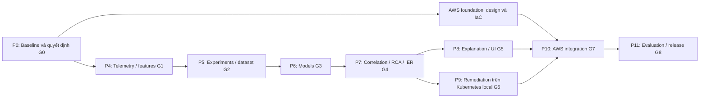

# SentinelOps — Kế hoạch triển khai và bàn giao

| Thuộc tính | Giá trị |
| --- | --- |
| Phiên bản | 1.1 — Delivery baseline |
| Ngày lập | 2026-10-25 |
| Baseline đã đọc | `main`, commit `20edcae` |
| Phạm vi | Hoàn thiện MVP từ testbed local tới demo closed-loop trên AWS |
| Trạng thái bằng chứng | Đã đọc source/config/test; chưa chạy lại unit, smoke hoặc AWS trong đợt lập kế hoạch này |
| Người phụ trách cụ thể | Chưa được gán; dùng vai trò Platform và AI/Data bên dưới |

## 1. Cách dùng bộ tài liệu

- [PRODUCT_SPEC.md](PRODUCT_SPEC.md) và các [ADR đã Accepted](adr/README.md) giữ vai trò baseline sản phẩm/kiến trúc.
- [TECHNICAL_SPEC.md](TECHNICAL_SPEC.md) cụ thể hóa thiết kế triển khai, hợp đồng và hành vi lỗi.
- [CONSTRAINTS_AND_GATES.md](CONSTRAINTS_AND_GATES.md) định nghĩa ràng buộc, metric, gate nghiệm thu và quyết định còn mở.
- Tài liệu này xác định thứ tự công việc, phụ thuộc, người chịu trách nhiệm theo vai trò và bằng chứng phải bàn giao.

Kiến trúc triển khai đã được repository owner chấp nhận ngày 2026-10-26 qua ADR-006…009. Lộ trình và công sức là delivery baseline cần cập nhật theo evidence. Các mục ghi **đề xuất** chưa phải ADR Accepted, kết quả đo hoặc yêu cầu chính thức của cuộc thi. Không chuyển một gate sang PASS chỉ vì đã có code hay checklist.

## 2. Điểm xuất phát đã quan sát

Bảng dưới là snapshot baseline `20edcae`, không phải trạng thái mới nhất. Kết quả runtime và phần đã triển khai tiếp được cập nhật tại [PROJECT_STATUS.md](PROJECT_STATUS.md).

| Thành phần | Hiện trạng trong repo | Bằng chứng hiện có | Việc cần làm để xác nhận |
| --- | --- | --- | --- |
| Step 1 — Foundation | FastAPI skeleton, 7 JSON Schema, 3 sample, validator/replay JSONL | `src/sentinelops/`, `contracts/`, `samples/`, `tests/test_api.py`, `tests/test_contracts.py` | Chạy lại schema/API tests và đóng checklist Foundation |
| Step 2 — Workload | Checkout → Inventory/Payment → PostgreSQL; latency/error injection | `services/`, `infra/local/init.sql`, `scripts/step2_smoke_test.py` | Chạy trên database thật, lưu kết quả và cấu hình môi trường |
| Step 3 — Observability | OTel spans/metrics, JSON logs, Collector, Jaeger, smoke validators | `observability/`, `tests/test_observability.py`, `tests/test_step3_smoke.py` | Dựng stack và kiểm tra trace/log/metric cùng một request |
| API detection | Trả anomaly score `0.50`, `False`, `skeleton-v0` | `src/sentinelops/main.py` | Thay bằng inference thật ở P6; không dùng mock làm bằng chứng ML |
| Incident API | Validate và echo IER; demo record không được lưu | `src/sentinelops/main.py` | Persistence, revisions, correlation/RCA và lifecycle ở P7 |
| Telemetry → features | Chưa có processor, kho time series hay feature builder | Chưa có module tương ứng | P4 |
| Dataset/ML/evaluation | Chưa có pipeline, dataset manifest hay model thật | Chưa có module/dependency tương ứng | P5–P6 |
| RCA/LLM/UI/remediation/AWS | Đã mô tả trong spec/ADR; chưa triển khai | `docs/PRODUCT_SPEC.md`, `docs/adr/` | P7–P11 |

Không xác nhận đã hoàn thành Step 1–3 chỉ từ việc file hiện diện. Baseline runtime được xác nhận tại G0.

## 3. Kết quả MVP phải bàn giao

1. Một workload ba dịch vụ có dependency/database thật, fault và deployment change tái lập được.
2. Đường dữ liệu metrics/logs/traces → normalized telemetry → feature windows có provenance, replay được.
3. Statistical control, Isolation Forest theo service và XGBoost cho suy giảm từ từ, kèm so sánh trên holdout theo run/time.
4. Incident correlation, RCA và IER có evidence references kiểm tra được.
5. UI hiển thị bằng chứng, root suspects, timeline và explanation; thiếu Bedrock vẫn xem được incident.
6. Một runbook rollback Payment thật trên Kubernetes, có policy, dry-run, giới hạn tác động, verify, escalation và audit.
7. Triển khai một môi trường AWS có CloudWatch/X-Ray và quyền theo workload; artefact, số đo và hướng dẫn demo được đóng gói.

## 4. Vai trò và quy tắc phối hợp

| Vai trò | Trách nhiệm chính | Trách nhiệm review |
| --- | --- | --- |
| Platform (P) | Workload, OTel, local infrastructure, AWS/IaC, RBAC/IAM, deployment, remediation, CI | Data sources, load/fault validity, vận hành model và persistence |
| AI/Data (A) | Normalization, features, dataset, model, correlation/RCA, evaluation, grounded explanation | Contract, telemetry semantics, policy evidence và kết quả phục hồi |
| Product/Integration owner (I) | Scope, ưu tiên, decision log, acceptance, demo story, chi phí | Có thể do một trong hai người kiêm nhiệm; không phải người thứ ba được giả định |

Mỗi hạng mục có một owner và reviewer khác owner. Tên người được gán tại G0, không tự suy ra từ git author. Có thể làm song song các workstream khi đã chốt interface; không bỏ qua gate dữ liệu để train hoặc gate an toàn để bật remediation.

## 5. Phụ thuộc và ước lượng



| Giai đoạn | Owner | Phụ thuộc để nghiệm thu | Ước lượng công sức |
| --- | --- | --- | --- |
| P0 | I + P/A | Repo và môi trường local | 2–3 ngày công |
| P4 | A, P phụ trách sources | G0 | 5–8 ngày công |
| P5 | A, P phụ trách fault/load | G1 | 4–6 ngày công, cộng thời gian thu dữ liệu tự động |
| P6 | A | G2 | 5–8 ngày công |
| P7 | A | G3; có thể viết validator/repository sớm | 5–8 ngày công |
| P8 | A + P | G4; UI dùng fixture trước đó | 3–5 ngày công |
| P9 | P | G4; adapter/RBAC có thể làm sớm | 5–8 ngày công |
| P10 | P | G5, G6; AWS foundation bắt đầu sau G0 | 5–8 ngày công |
| P11 | I + P/A | G7 | 3–5 ngày công |

Tổng sơ bộ: **37–59 ngày công**. Với hai người full-time và thời gian tích hợp/phụ thuộc, dự kiến khoảng **5–8 tuần làm việc**. Đây là ước lượng lập kế hoạch, chưa phải cam kết deadline. Số giờ/ngày, mức kinh nghiệm AWS, quota, ngân sách và ngày thi chưa được xác nhận. Kế hoạch bốn tuần trong spec gốc chỉ là timebox tham khảo; nếu buộc theo timebox đó phải giảm phần trình bày/phạm vi phụ, giữ nguyên metric honesty và safety gates.

## 6. P0 — Xác nhận baseline và đóng các quyết định nền

**Mục tiêu:** Có checkpoint đang chạy và một cách hiểu thống nhất trước khi thêm pipeline.

**Công việc**

1. Gán owner/reviewer, deadline mục tiêu và budget AWS; ghi vào decision log.
2. Chạy các kiểm tra hiện có dưới Python 3.11 và Docker; lưu phiên bản dependency/images, commit, OS và log lệnh.
3. Chạy workload healthy/latency/error/recovery; kiểm tra persistence database, trace parentage, logs và metrics.
4. Đối chiếu JSON Schema với ví dụ trong PRODUCT_SPEC; lập migration/ADR nếu thực sự cần đổi wire format.
5. Chốt đề xuất về storage, local history, timestamp/window, SLO và metric targets trong hai tài liệu đồng hành.
6. Chốt experiment IDs, tài nguyên AWS tối thiểu, namespace/role và nơi lưu evidence; bổ sung nguồn rules/DOCX nếu có.

**Lệnh hiện đã tồn tại**

```bash
python scripts/validate_contracts.py
pytest -q
docker compose config --quiet
docker compose up --build -d --wait --wait-timeout 120
python scripts/step2_smoke_test.py
python scripts/step3_smoke_test.py
```

Các lệnh trên là kế hoạch xác minh tại P0, không phải kết quả chạy trong lần soạn tài liệu này. Reset volume chỉ dùng cho sandbox đã xác định; không tự xóa dữ liệu thí nghiệm.

**Bàn giao:** baseline report, issue list, named owners, decision log, run/image manifest và nguồn yêu cầu.

**Gate G0:** chỉ PASS khi baseline thực thi pass và các quyết định chặn P4 được chốt. Nếu có blocker, ghi FAIL/BLOCKED kèm bằng chứng; lỗi baseline phải được xử lý trước khi dùng telemetry làm dữ liệu huấn luyện.

## 7. P4 — Telemetry Processor và Feature Pipeline

**Mục tiêu:** Chuyển telemetry thật thành dữ liệu có nghĩa, truy nguyên và replay được.

**Công việc**

1. Bổ sung Prometheus cho lịch sử metric local; Collector exporter không đóng vai trò kho lịch sử.
2. Tạo source adapters cho Prometheus/JSON logs/Jaeger và interface tương ứng CloudWatch/X-Ray. Giữ thuật toán feature chung.
3. Chốt histogram buckets và đơn vị; thêm timeout event, DB client spans và database utilization thật nếu kịch bản cần.
4. Chuẩn hóa bucket 60 giây, UTC, business-route scope, lỗi 5xx, p95 và quality/provenance metadata.
5. Tạo cửa sổ 5 phút, bước 60 giây bằng cùng một implementation cho batch/replay/online.
6. Xử lý thiếu dữ liệu, no traffic, counter reset, late/duplicate events, source downtime; không thay thiếu bằng healthy.
7. Lưu raw, normalized và features riêng; xuất run artefacts có checksum và source references.
8. Viết acceptance tests cho công thức, time boundary, missingness và source parity; kiểm tra pipeline tự phát telemetry.

**Bàn giao:** source adapters, feature registry, contracts bổ sung, local history config, tiny raw→feature fixture, data-quality report.

**Gate G1:** replay deterministic, không dùng dữ liệu sau cutoff; tất cả records được chấp nhận hợp schema/semantic rules; dữ liệu thiếu hoặc sai được quarantine/flag. P95 và error rate đối chiếu được với requests thật. Không train khi gate này chưa qua.

## 8. P5 — Experiment Harness và dataset có ground truth

**Mục tiêu:** Tạo dữ liệu đủ để học và đánh giá, có run độc lập và kiểm soát leakage.

**Công việc**

1. Tạo load generator có seed, traffic profile, warmup và request outcome log.
2. Thực hiện S0 healthy, S1 Payment latency/error, S2 bad Payment deployment, S3 gradual degradation, S4 DB saturation và S5 independent faults.
3. S2 dùng image/version thay đổi thật cùng change event; không đổi fault flag rồi gọi đó là deployment rollback.
4. S4 sử dụng áp lực/query/connections thật và đo database; không tự đặt giá trị metric để giả saturation.
5. Lưu experiment manifest out-of-band; dấu thời gian fault/ground truth chỉ dùng labeling/evaluation.
6. Tạo split theo run và theo thứ tự thời gian trước khi fit imputer/model/threshold. Không chia ngẫu nhiên các window chồng lấn.
7. Đạt inventory dữ liệu pilot rồi mở rộng tới minimum release trong technical spec; thời lượng chờ được tự động hóa.
8. Freeze dataset, split, feature version, labels và SLO config; review health trước mỗi fault và restore trong `finally`.

**Bàn giao:** scenario configs, run manifests, dataset/split manifest, raw capture, coverage table, leakage audit và recovery report.

**Gate G2:** có healthy/fault/negative-control độc lập, split không giao nhau, nhãn có lineage, phân phối missingness được báo cáo; mỗi service có ít nhất 300 healthy train và 100 healthy calibration windows hợp lệ, gradual labels có trong cả train/validation. Pilot chưa đủ điều kiện chỉ ghi IN_PROGRESS; release coverage/holdout phải được hoàn thiện trước G8.

## 9. P6 — Baseline, Isolation Forest và XGBoost

**Mục tiêu:** Thay mock bằng inference thật và chứng minh vai trò của từng model.

**Công việc**

1. Làm statistical control median/MAD, cùng feature/split/persistence/false-alert budget với Isolation Forest.
2. Train Isolation Forest riêng từng business service trên healthy training windows; fit preprocessing chỉ trên training.
3. Chuẩn hóa score theo calibration đã version; tách score khỏi persistence và SLO incident condition.
4. Train XGBoost cho precursor của gradual scenarios; định nghĩa label trước khi fit, không gọi risk score là xác suất calibrated khi chưa đo.
5. Đánh giá rolling/grouped folds trên development runs; chọn threshold bằng validation; giữ final test khóa.
6. Tạo immutable model bundle, activation registry, compatibility checks và last-known-good rollback.
7. Kết nối `/v1/detect` với model thật; unavailable model trả lỗi rõ, không trả mock dưới tên model production.
8. Replay cùng dataset hai lần và so sánh output; kiểm tra startup, invalid feature set và model-load failure.

**Bàn giao:** baseline/model reports, training code/config, model cards, model manifests/checksums, inference adapter và activation procedure.

**Gate G3:** đạt các target đã freeze trên development gates, baseline comparison có denominators, model phù hợp feature version và không leakage. Chất lượng final holdout chỉ được xác nhận ở G8; không tự đổi model family nếu chưa có ADR.

## 10. P7 — Incident Correlation, RCA và IER có lưu trữ

**Mục tiêu:** Tạo incident thật có root suspects được hỗ trợ bởi bằng chứng.

**Công việc**

1. Xây health/lifecycle state machines, persistence, hysteresis và quy tắc reopen.
2. Correlate theo thời gian + dependency/trace/change evidence; shared Checkout một mình không đủ để gộp hai fault độc lập.
3. Tạo deterministic RCA components và weights có version; thêm abstention nếu evidence thiếu hoặc margin thấp.
4. Thu evidence thật, source refs và observation times; validate unique IDs, references, ranking order và timeline.
5. Lưu IER immutable revisions và lifecycle/audit liên kết; dùng optimistic concurrency và durable tasks.
6. Thêm read/list endpoints, internal processing API và replay kết quả correlation/RCA.
7. Test delayed/out-of-order evidence, duplicates, independent incidents, stale metrics và worker restart.

**Bàn giao:** correlation/RCA engine, persistence migration, supplemental contracts, API, versioned scoring config, root-cause evaluation report.

**Gate G4:** cascade có grouping đúng, independent faults không bị gộp vô căn cứ, mọi suspect có refs hợp lệ. Unknown/ambiguous incident vẫn hiển thị và được escalate; không chọn root chỉ để hoàn thành demo.

## 11. P8 — Grounded Explanation và Operator UI

**Mục tiêu:** Người vận hành hiểu được incident và kiểm tra nguồn chứng cứ.

**Công việc**

1. Tạo fact-card projection từ một IER revision; chỉ gửi các field đã whitelist.
2. Tích hợp Bedrock qua interface có timeout, quota và output validation; deterministic fallback luôn có.
3. Không cho model tự đặt evidence ID, sửa metric/timestamp, thay ranking hoặc gọi AWS/Kubernetes.
4. UI hiển thị riêng evidence/result chính thức và generated explanation, cùng revision/fallback status.
5. Hiển thị service map, health/staleness, list/detail incident, timeline, suspects, source refs và action audit.
6. Test invalid references, invented numbers, prompt injection từ log, provider timeout, stale explanation và quyền truy cập.

**Bàn giao:** explanation service, prompt/fact-card versions, fallback renderer, UI, screenshot/demo fixtures và validation report.

**Gate G5:** UI usable khi Bedrock unavailable; explanation không được trình bày như nguồn chẩn đoán. Không chấp nhận explanation cho revision cũ như bản hiện hành.

## 12. P9 — Controlled Remediation trên Kubernetes local

**Mục tiêu:** Chứng minh hành động có tác dụng vận hành thật trước khi cấp quyền trên AWS.

**Công việc**

1. Dựng Kubernetes sandbox local, ví dụ kind, với image tốt/xấu bất biến của Payment và rollout history.
2. Tạo runbook duy nhất cho golden path: khôi phục image digest đã xác nhận tốt của Payment.
3. Triển khai policy checks, evidence freshness, known-good lookup, dry-run, allow-list và per-target lock.
4. Persist approval/policy decision/idempotency key trước side effect; quyền chỉ trong namespace và target đã định.
5. Verify cả rollout health và telemetry dưới traffic đủ; không dựa vào HTTP 200 của patch để kết luận recovered.
6. Test kill switch, stale evidence, concurrent duplicate action, controller restart, timeout, RBAC denial và verify failure.
7. Khi rollback không phục hồi, escalate; không tự đưa image hỏng trở lại để "undo rollback".

**Bàn giao:** runbook, controller, Kubernetes manifests/RBAC, audit trail, happy-path và failed-verification evidence.

**Gate G6:** action đúng target, duplicate không gây side effect lặp, mandatory safety tests pass, recovered chỉ khi post-action telemetry đạt chuẩn. Compose fault reset và native pod restart không được tính là closed-loop rollback.

## 13. P10 — AWS foundation và tích hợp toàn hệ thống

**Mục tiêu:** Chạy cùng product flow trên AWS với observability interfaces đã chốt.

**Công việc có thể bắt đầu sau G0**

- Thiết kế single region/cluster, VPC, EKS, RDS PostgreSQL, registry, S3, role/secret boundaries và IaC.
- Chốt region theo khả dụng dịch vụ/quota/Bedrock model; `ap-southeast-1` trong `.env.example` mới là gợi ý cấu hình.
- Thiết kế và review plan/cost trước khi tạo tài nguyên tính phí; định budget cap và lịch teardown.

**Công việc tích hợp sau G5/G6**

1. Deploy workload/control plane, tách credentials/schema dữ liệu vận hành khỏi commerce.
2. ADOT/Collector → CloudWatch Metrics/Logs + X-Ray; chứng minh đường p95 thật, không giả định EMF statistic sets cho percentile.
3. Chạy AWS source adapters và kiểm tra event-time/availability semantics; không ép model local sang source khác feature semantics.
4. Train/recalibrate trên healthy AWS runs nếu source/environment shift; freeze model activation riêng cho AWS.
5. S3 lưu datasets/model/evidence bundles; SageMaker training job tái lập được ít nhất model bundle dùng cho AWS demo.
6. Controller dùng RBAC/IAM tối thiểu; public traffic nếu có phải qua ingress được bảo vệ, fault controls không public.
7. Chạy S2 golden path và verify-failure path; lưu evidence end-to-end và đo chi phí.

**Bàn giao:** IaC, deploy/run/teardown guide, IAM/RBAC matrix, source-parity report, AWS model manifest và demo evidence.

**Gate G7:** bằng chứng AWS thật xuyên suốt từ telemetry tới action và verify; local substitute không được dùng như bằng chứng đã tích hợp AWS.

## 14. P11 — Final evaluation và bàn giao

1. Đóng băng code/config/model/dataset split trước final evaluation.
2. Chạy heldout scenarios và matched no-action controls theo protocol; không chỉnh threshold bằng test labels.
3. Báo cáo detector, risk, RCA, false alerts, lead time, recovery time, unsafe-action count và cloud cost, với mẫu số/uncertainty.
4. Chạy release CI, replay, contract compatibility, security boundaries và E2E trên checkpoint cuối.
5. Tạo demo script S2 liên tục và một failed-verification demo; phân biệt live, replay và prepared artefact rõ ràng.
6. Lập release notes, limitations, operator/troubleshooting guide, dataset/model cards và competition traceability từ rules thật.
7. Đóng G8 theo bằng chứng; lập issue cho phần chưa đạt, không ghi PASS hoặc hiệu quả dự kiến như kết quả đo.

**Bàn giao cuối:** versioned release manifest, evidence bundle, evaluation report, demo guide, architecture/ADRs, runbook và known limitations.

## 15. Backlog khởi đầu có thể chuyển thành issue

| ID | Việc | Owner | Phụ thuộc | Acceptance |
| --- | --- | --- | --- | --- |
| SO-001 | Baseline execution report và đóng G0 | P + A | Không | Command logs + commit/images + checklist |
| SO-002 | Contract discrepancy và proposed decision review | A, P review | SO-001 | Quyết định có owner/status, không đổi wire âm thầm |
| SO-003 | Prometheus local history + retention | P | G0 | Dữ liệu lịch sử truy vấn/restart được |
| SO-004 | Metric catalog, histogram/timeout/DB telemetry | P | SO-002 | Known-request fixture đối chiếu công thức |
| SO-005 | Normalizer, quality và provenance envelope | A | SO-003/004 | Missing/late/reset/no-traffic cases pass |
| SO-006 | Feature registry + shared batch/online transforms | A | SO-005 | Replay/time-boundary determinism |
| SO-007 | Scenario harness và immutable run manifest | P, A review | SO-005 | Healthy/fault/recovery có raw evidence |
| SO-008 | Dataset/split manifest và leakage audit | A | SO-006/007 | G2; không giao run giữa splits |
| SO-009 | Median/MAD control và event evaluator | A | G2 | Cùng persistence, SLO và denominators |
| SO-010 | Isolation Forest/XGBoost bundles + serving | A | SO-009 | G3 + invalid/missing model behavior |
| SO-011 | IER repository, semantic validation và lifecycle | A, P review | SO-002; G3 để tích hợp | Revision/concurrency/replay cases |
| SO-012 | Correlation/RCA và abstention | A | SO-010/011 | G4, cascade/independent cases |
| SO-013 | Fact cards, Bedrock validation/fallback | A | G4 | Invalid response không vào official evidence |
| SO-014 | Operator UI | P hoặc A được gán tại G0 | SO-011, G4 để tích hợp | Evidence/explanation/action tách rõ |
| SO-015 | Local Kubernetes rollback controller | P | G4 | G6 safety matrix + actual image rollback |
| SO-016 | AWS IaC/source adapters/integration | P, A review | G0 cho design; G5/G6 cho G7 | G7 evidence + teardown/cost |
| SO-017 | Heldout evaluation và release bundle | I + P/A | G7 | G8 với raw denominators |

## 16. Cách làm việc và quản lý thay đổi

**Definition of Ready:** issue có requirement ID, owner/reviewer, contract, fixtures, phụ thuộc, cách test và output evidence. Nếu đụng frozen invariant, phải có ADR trước implementation.

**Definition of Done:** implementation và documentation khớp; relevant tests pass; sample/replay evidence được lưu; môi trường/commit/config được ghi; limitations được nêu; reviewer kiểm tra producer/consumer. Không coi merge code là bằng chứng E2E.

Mỗi PR nên khép một hành vi quan sát được. Main giữ được healthy demo; model/data/infra thay đổi phải có rollback path. Không commit raw datasets, model binaries, secrets hoặc local runtime artefacts; commit manifest/config/report đã lọc thông tin nhạy cảm và dẫn đến artefact store.

Mỗi tuần review gate status, risk, cloud cost và nguồn dữ liệu; không báo phần trăm hoàn thành từ số file. Change request ghi tác động tới contract, deadline, cost và metric. Chỉ điều chỉnh scope sau khi ghi rõ acceptance nào được dời.

## 17. Rủi ro và cách giảm

| Rủi ro | Dấu hiệu | Cách xử lý | Owner |
| --- | --- | --- | --- |
| Telemetry thiếu lịch sử/p95 sai | Chỉ có exporter snapshot; percentile không đối chiếu requests | P4 history + histogram acceptance; chặn train | P |
| Model học scenario labels | Score tốt khi chia random, tệ ở run mới | Out-of-band truth, run/time split, holdout intensity | A |
| Dữ liệu ít, overlap tạo ảo giác mẫu lớn | Nhiều windows nhưng rất ít independent runs | Báo run counts, bootstrap theo run, mở rộng capture | A |
| Local/AWS source khác semantics | P95/rate/lag lệch sau migration | Source parity gate, version feature config, recalibrate | P + A |
| Root cause trùng với downstream symptom | Checkout luôn top-1 khi Payment/DB hỏng | Topology/trace/time/log ablation và abstention | A |
| Remediation chỉ sửa fault flag | Demo "rollback" không thay image | Image digest/change ledger + Kubernetes evidence | P |
| Duplicate/crash gây action lặp | Hai worker cùng patch target | Durable claim, per-target lock, reconcile observed state | P |
| Bedrock quota/model unavailable | Call fail/latency cao | Check sớm, timeout/circuit breaker, deterministic fallback | A |
| AWS chi phí hoặc quyền chặn tiến độ | Quota fail, idle resources, thiếu budget | IaC review sớm, budget/teardown, local evidence giữ riêng | P + I |
| Tài liệu rules/DOCX thiếu | Không có tiêu chí chính thức để trace | G0 ghi unknown, bổ sung nguồn trước compliance sign-off | I |

Các quyết định phải chốt và gate checklist chi tiết nằm trong [CONSTRAINTS_AND_GATES.md](CONSTRAINTS_AND_GATES.md).
