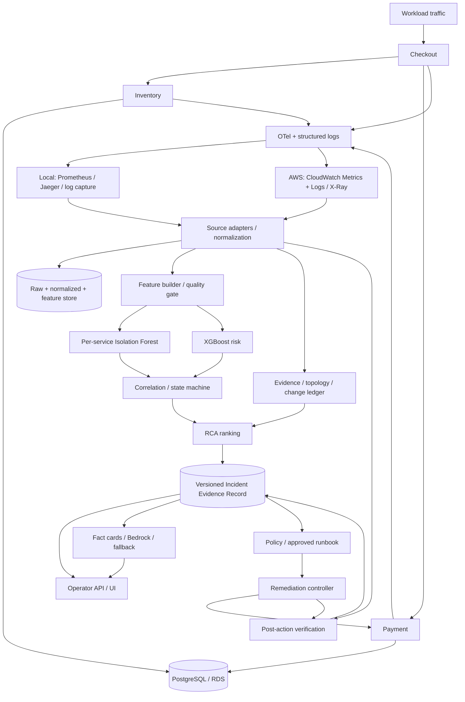

# SentinelOps — Đặc tả kỹ thuật triển khai MVP

| Thuộc tính | Giá trị |
| --- | --- |
| Phiên bản | 1.1 — Accepted architecture, provisional numerical targets |
| Ngày | 2026-10-25; đối chiếu implementation 2026-10-30 |
| Baseline | Kiến trúc gốc `main@20edcae`, PRODUCT_SPEC v1.1; trạng thái implementation đối chiếu `07c57c7`, ADR-001…013 |
| Phạm vi | Single environment/cluster, ba business services, một database dependency, một automatic rollback runbook |
| Trạng thái | Kiến trúc được chấp nhận qua ADR-006…009 ngày 2026-10-26; trạng thái implementation theo báo cáo thực thi; thresholds/targets mới vẫn provisional |

## 1. Quyền ưu tiên và quy ước

PRODUCT_SPEC v1.1 và ADR Accepted xác định ý nghĩa kiến trúc. JSON Schemas hiện có xác định wire format đang được implementation chấp nhận. Ví dụ trong PRODUCT_SPEC khác JSON Schema phải được giải quyết qua decision log; không tự đổi required fields, enum hoặc `schema_version`.

Tài liệu này dùng **MUST** cho điều kiện bắt buộc, **SHOULD** cho mặc định có thể đổi khi ghi lý do, **PROPOSED** cho thiết kế/giá trị mới chưa được chốt. Mọi số hiệu năng hoặc chất lượng bên dưới là target đề xuất, không phải kết quả đo hoặc tiêu chí chính thức AI4Life.

Các giới hạn, gate và mục cần quyết định được quản lý tại [CONSTRAINTS_AND_GATES.md](CONSTRAINTS_AND_GATES.md). Thứ tự implementation nằm trong [DELIVERY_PLAN.md](DELIVERY_PLAN.md).

## 2. Yêu cầu chức năng và phạm vi

| ID | Yêu cầu | Output quan sát được | Phase |
| --- | --- | --- | --- |
| FR-01 | Thu metrics/logs/traces thật và lưu provenance | Raw capture và source refs | P4/P10 |
| FR-02 | Chuẩn hóa và tạo features không dùng tương lai | TelemetryPoint, FeatureWindow, quality metadata | P4 |
| FR-03 | Tạo experiment/dataset/splits bất biến | Run/dataset manifests và checksums | P5 |
| FR-04 | Anomaly detection bằng per-service Isolation Forest, có statistical control | DetectionResult và baseline comparison | P6 |
| FR-05 | Degradation scoring bằng XGBoost | DegradationRiskResult và lead-time report | P6 |
| FR-06 | Correlate và quản lý state/persistence | Incident lifecycle events | P7 |
| FR-07 | RCA deterministic, có abstention | Suspect ranking cùng evidence refs | P7 |
| FR-08 | IER authoritative, có revisions và semantic validation | Stored/readable IER và audit | P7 |
| FR-09 | Explanation từ Bedrock, có validation/fallback | GroundedExplanation gắn với IER revision | P8 |
| FR-10 | UI hỗ trợ điều tra và xem action history | Evidence/detail/timeline/explanation views | P8 |
| FR-11 | Chạy approved Payment rollback có verify | RemediationAction, execution/audit records | P9/P10 |
| FR-12 | AWS observability/deployment và offline training tái lập | IaC, CloudWatch/X-Ray refs, SageMaker/S3 artefacts | P10 |
| FR-13 | Replay/evaluation/test matrix độc lập với live cloud | Versioned evaluation report | P4–P11 |
| FR-14 | Quan sát và bảo vệ control plane | Readiness, own telemetry, permissions/cost controls | Xuyên suốt |

v1 không mở rộng sang multi-cloud/multi-cluster, không để LLM điều khiển hạ tầng, không tự sửa dữ liệu commerce/IAM và không tự retrain production. Quyền hạn runbook chỉ bao phủ target đã allow-list.

## 3. Kiến trúc đích



Training là offline: frozen dataset + split → preprocessing/model/calibration → model bundle bất biến → activation registry. Serving chỉ nạp bundle tương thích đã được kích hoạt. SageMaker là môi trường training AWS; online AI Engine có thể nạp artifact từ S3, không bắt buộc mua một hosted model endpoint riêng.

### 3.1 Module và process boundaries — Accepted ADR-006

Giữ các workload services hiện có. Control plane bắt đầu bằng các module trong một Python package để giảm số điểm tích hợp; API và background workers chạy process riêng, dùng cùng domain code. Chỉ tách microservice khi có bằng chứng về quyền, tải hoặc lifecycle khác nhau.

```text
src/sentinelops/
  api/                  request validation, auth, projections
  telemetry/            source adapters, canonical buckets, quality
  features/             registry, shared batch/online transforms
  ml/                   training wrappers, calibration, model registry
  incidents/            correlation, health/lifecycle, evidence, RCA
  explanations/         fact cards, provider, validator, fallback
  remediation/          policy, runbooks, executor, verification
  storage/              database/object store repositories, migrations
  workers/              scheduler, durable task processing, reconciliation
experiments/            scenario configs, manifest schemas, report templates
infra/                  local, Terraform, Kubernetes/Helm
```

Đây là cây đích, không yêu cầu di chuyển toàn bộ source hiện tại trước khi thêm tính năng. Feature/domain logic MUST dùng chung giữa API, worker và replay, tránh ba implementation cho cùng phép tính.

### 3.2 Persistence — Accepted ADR-006

| Dữ liệu | Local | AWS | Quy tắc |
| --- | --- | --- | --- |
| Time series debug | Prometheus TSDB | CloudWatch Metrics | Không coi Collector exporter là database |
| Logs/traces | Captured JSON logs, Jaeger | CloudWatch Logs, X-Ray | Archive refs/snippets cần cho report trước khi retention hết |
| Raw/normalized/features/model bundles | Filesystem object-store adapter | S3 | Versioned prefixes + SHA-256; không overwrite dataset/model ID |
| IER revisions, tasks, actions, audit | PostgreSQL control database/schema | RDS PostgreSQL control database/schema | Tách credentials và quyền khỏi commerce |

Có thể dùng chung database instance trong sandbox để tiết kiệm; commerce role không được đọc/ghi control tables và controller không được sửa commerce data. Boundary storage theo ADR-006 đã được chấp nhận. Local PostgreSQL control store đã có immutable revisions, CAS, audit/outbox và health/incident checkpoints; AWS RDS/S3 deployment vẫn có gate riêng. Placeholder DynamoDB trong `.env.example` không thay quyết định này. Thay storage backend phải review transaction/CAS/outbox semantics và có migration/ADR tương ứng.

## 4. Contract strategy

### 4.1 Các wire contracts đang có

| Contract | Required fields/ý nghĩa đáng chú ý | Producer đích |
| --- | --- | --- |
| TelemetryPoint | `schema_version="1.0"`, `timestamp`, `service`, `p95_latency_ms`, `error_rate` | Normalizer |
| FeatureWindow | `schema_version="1.0"`, `service`, `window_start`, `window_end`, numeric-or-null `features` | Feature builder |
| DetectionResult | `service`, `observed_at`, score 0…1, flag, `model_name="isolation-forest"`, version | IF wrapper |
| DegradationRiskResult | Risk 0…1, `state=normal/watch/degrading`, `model_name="xgboost"` | XGBoost wrapper |
| IncidentEvidenceRecord | `state=degrading/incident/recovering/recovered/escalated`, signals, ranking, evidence | Incident/RCA module |
| GroundedExplanation | Incident ID, summary, claims với non-empty evidence refs | Explanation module |
| RemediationAction | Runbook/target/type, dry-run/approval/blast-radius/status | Controller |

Schemas có `additionalProperties:false`. Không thêm trực tiếp `run_id`, `timeline`, `validation`, `model_provider`, `lifecycle` hoặc fields mới vào các payload đó. Một wrapper mới không được làm thay đổi response shape của endpoint cũ âm thầm.

### 4.2 Hợp đồng bổ sung: trạng thái implementation và phần còn thiếu

Bảng dưới đây phân biệt schema đã tồn tại với các hợp đồng còn thiếu; nguồn wire format hiện hành là file schema được liên kết, không phải danh sách field thiết kế ban đầu. Schema, producer và quality gate là ba phạm vi khác nhau: schema hợp lệ không chứng minh G2/G3 hoặc production readiness.

| Hợp đồng | Fields/ý nghĩa chính hiện có | Trạng thái và nguồn kiểm chứng |
| --- | --- | --- |
| ObservationEnvelope | Envelope/record ID, environment/source/service, payload, bucket/available/ingested clocks, measurements/quality/provenance | [Schema](../contracts/observation-envelope.schema.json), [telemetry path](STEP4_TELEMETRY.md) đã triển khai |
| InfrastructureObservation | Component/environment, observed/available clocks, metrics, source ref và measurement scope | [Schema](../contracts/infrastructure-observation.schema.json) đã có; PostgreSQL/RDS observation tách khỏi HTTP RED theo ADR-007 |
| FeatureEnvelope | Payload, feature-set/source identity, window/as-of, quality/provenance | [Schema](../contracts/feature-envelope.schema.json), batch/online transform dùng chung trong telemetry path |
| ExperimentRunManifest | Run/session/scenario/split, truth/phase intervals, source commit/images/clocks và raw refs | [Schema](../contracts/experiment-run.schema.json), local experiment runner đã có; truth nằm ngoài predictor/diagnostic inputs |
| DatasetManifest | Source/feature/SLO/label versions, run refs, counts/exclusions và training readiness/blockers | [Schema](../contracts/dataset-manifest.schema.json) và builder đã có; approved-source G2 vẫn BLOCKED |
| ModelManifest / release ledger | Artifact/calibration checksums, ordered features, provenance, runtime versions/config/seed/thresholds; approval/route refs tách riêng | [Bundle/registry software](MODEL_PIPELINE.md): `sentinelops-model/v1` và `validated-model-release/v1` kiểm bằng code; chưa có JSON Schema riêng, chưa có approved model/G3 acceptance |
| IncidentEnvelope | Exact IER payload, revision/recorded clock, context/actor/reason/timeline | [Schema](../contracts/incident-envelope.schema.json), [persistent API](STEP7_INCIDENT_API.md) và [continuous consumer](STEP8_INCIDENT_WORKER.md) đã có; không tự cấp action/explanation permissions |
| ChangeEvent | Target, before/after version/config, observed clock, deployment ref | Chưa có wire contract/ledger deployment tổng quát; bounded operational change evidence không thay thế hợp đồng đích này |
| ActionExecution/AuditEvent | Runbook/target, actor/policy decision, idempotency/attempt/result/verify/audit | Chưa có execution/audit contract và controller; schema RemediationAction hiện có không chứng minh action đã được thực thi |

[Feature-envelope sample](../samples/feature-envelope.sample.json) và [observation-envelope sample](../samples/observation-envelope.sample.json) được validator kiểm tra. Runtime/schema/package checks và các báo cáo source/runtime được ghi riêng trong [PROJECT_STATUS.md](PROJECT_STATUS.md). Không gọi các contract đã có là chưa triển khai, cũng không biến model fixture hoặc schema request thành bằng chứng approved model, action execution hay quality acceptance.

Model wrapper chỉ nhận numeric vector theo registry. `environment`, IDs, timestamps, source strings, run/scenario IDs và quality reasons không được tự biến thành model feature. Training label loader là thành phần duy nhất được đọc fault truth store.

### 4.3 Semantic validation

Ngoài JSON Schema, MUST kiểm tra:

- `window_start < window_end`; timestamps timezone-aware UTC; units và service/component IDs thuộc registry.
- Feature keys/order và supported null policy khớp model manifest; cấm NaN/Infinity.
- Evidence IDs unique trong một IER; mọi ranking/explanation ref tồn tại trong revision tương ứng.
- Ranking deterministic, score giảm dần, ties theo service ID; mỗi suspect có ít nhất một evidence có liên quan.
- Revision tăng đơn điệu, transition hợp lệ và optimistic concurrency không bị vượt qua.
- Action target/runbook/approval đến từ server policy; client payload không tự cấp quyền.

## 5. Telemetry semantics và thời gian

### 5.1 Source profiles và metric catalog

| Signal | Semantics/đơn vị | Local source | AWS source đích |
| --- | --- | --- | --- |
| Request count/rate | Business-route requests; count / giây | Histogram/counter deltas trong Prometheus | CloudWatch RED metrics, đối chiếu structured logs |
| p95 latency | Server request duration, milliseconds, một service/bucket | Merge histogram buckets rồi tính quantile | Canonical log rollup theo service/bucket, publish custom CloudWatch metric |
| Error rate | HTTP status ≥500 / tổng business requests, 0…1 | Counter/histogram status dimensions | CloudWatch + log rollup consistency check |
| Timeout count | Explicit timeout events, count/bucket | Counter mới hoặc `downstream_timeout` logs | Explicit counter/log event; không suy ra mọi 5xx là timeout |
| Log errors | Một bộ event/template đã version, count/bucket | Structured log capture | CloudWatch Logs |
| CPU/memory | Utilization theo giới hạn đã định, 0…100 | Container/node metrics khi được bổ sung | Container/service metrics; có denominator rõ |
| DB connections | Số connections / usable connection capacity ×100 | PostgreSQL measurement | RDS/CloudWatch metric + capacity config version |
| Trace edges | SERVER→CLIENT→SERVER và DB dependency spans | Jaeger | X-Ray |
| Change events | Actual deployment/config changes | Deployment ledger/Kubernetes events | Deployment pipeline/events |

Chỉ ba business services cần TelemetryPoint/IF model trong baseline. `rds` là infrastructure RCA candidate nhận InfrastructureObservation thật. Không tạo latency/error giả cho RDS để thỏa schema hoặc dùng demo RDS scores làm inference evidence.

Metric labels MUST có cardinality thấp: service, method, route template, status; không chứa request/correlation/trace/user IDs. Health/readiness/internal fault requests không nằm trong business SLO/model aggregations.

### 5.2 Công thức và quy tắc aggregation

Với một bucket có N requests và E responses ≥500:

```text
request_rate = N / bucket_duration_seconds
error_rate = E / N, chỉ xác định khi N > 0
p95_latency_ms = percentile của duration distribution trong bucket
```

Counter được xử lý reset theo từng time series trước aggregation. Với classic histograms, cộng bucket deltas/rates theo service và `le` trước `histogram_quantile(0.95, ...)`; không lấy trung bình p95 của các pods để gọi đó là service p95. Phần trăm lỗi dùng tổng lỗi/tổng requests, không average tỷ lệ của pods. [Prometheus histograms](https://prometheus.io/docs/practices/histograms/)

Metric exporter có thể thêm suffix/unit; source adapter dùng catalog đã discovery/validate ở startup, không đoán tên bằng substring và âm thầm nhận nhầm series.

### 5.3 AWS p95 path — PROPOSED

Mặc định đề xuất: worker rollup đọc request-completed JSON logs từ CloudWatch Logs theo service/event-time, deduplicate và tính duration distribution cho bucket 60 giây; publish một canonical p95 metric/bucket và lưu evidence refs. Dedup bằng stable source event ID hoặc application request-instance ID được bổ sung ở P4, không dùng correlation ID hoặc nội dung log giống nhau để gộp các requests thật khác nhau. Đối chiếu request counts với RED metrics độc lập; thiếu log hoặc lệch counts vượt tolerance làm bucket không eligible.

Thiết kế này phải được spike/đo latency/cost ở P10. Không giả định CloudWatch có thể tính percentile từ OTel histogram đã xuất thành arbitrary statistic sets; AWS có điều kiện riêng về dữ liệu percentile. Nếu chọn export raw Values/Counts thay log rollup, phải version source profile và chứng minh parity trước activation. [CloudWatch percentile restrictions](https://docs.aws.amazon.com/AmazonCloudWatch/latest/APIReference/API_GetMetricStatistics.html)

P95 từ local histogram và AWS log distribution có sai số khác nhau. Source profile và bucket definitions được giữ trong manifest; model AWS cần calibration/training phù hợp, không tự coi hai nguồn hoàn toàn tương đương.

### 5.4 Event time, watermark và missingness — PROPOSED defaults

| Tham số | Mặc định | Ghi chú |
| --- | --- | --- |
| Timezone | UTC trong mọi record | UI có thể render theo timezone người xem |
| Bucket | 60 giây | `[start,end)`, UTC-aligned |
| Prometheus scrape | 5 giây ở source profile hiện hành | Điều chỉnh từ 15s sau live coverage failure; không phải feature step |
| Feature window/step | 300 giây / 60 giây | Chỉ dùng completed buckets trong `[t-300s,t)` |
| Allowed lateness | Local 30 giây; AWS đề xuất 120 giây | Chốt từ source-lag measurement và version theo profile |
| Minimum feature coverage | 4/5 buckets | Các feature required vẫn phải available theo registry |
| Minimum traffic | 30 requests/bucket để dùng p95/SLO | Target thử nghiệm; được tune trước freeze, không dùng cho claim production |
| Maximum current observation age | 180 giây | Chặn auto-action nếu nguồn hiện tại cũ hơn giới hạn; kiểm tra availability ở AWS |

`observed_at` là thời gian sự kiện/bucket, `available_at` là lúc source có thể cung cấp, `ingested_at` là lúc processor nhận. Inference không được chạy trước feature thực sự available. Finalized bucket không bị sửa âm thầm; late corrections tạo revision riêng cho audit, không backdate alert.

N=0 làm error rate/p95 không xác định. Không phát TelemetryPoint giả hợp lệ với `0/0→0`; phát quality/no-traffic observation riêng và giữ dấu gap. Missing telemetry, warmup hoặc insufficient traffic đưa operational health vào `UNKNOWN` metadata; không coi là healthy/recovered.

Replay có hai chế độ được ghi nhãn: event-time analytical replay và arrival-aware serving replay. Chỉ arrival-aware replay được dùng để ước lượng lead time/MTTD như online; không cho replay thấy dữ liệu đến muộn sớm hơn thực tế.

## 6. Feature specification

Feature registry được version và định nghĩa: tên, đơn vị, transform, lookback, required/optional, missing policy và model family dùng field đó.

| Feature | Công thức trong 5 phút | Availability |
| --- | --- | --- |
| `request_rate_mean_5m` | Tổng count / tổng covered seconds | Required khi source có counts |
| `p95_latency_ms_mean_5m` | Mean của per-bucket p95 hợp lệ | Required; đây là mean của p95 buckets, không gọi là p95 toàn window |
| `p95_latency_ms_slope_5m` | OLS slope theo bucket end time, ms/phút | Required khi ≥4 valid buckets |
| `error_rate_mean_5m` | Tổng lỗi / tổng requests trong covered buckets | Required |
| `error_rate_slope_5m` | OLS slope per-bucket ratio/phút | Required khi ≥4 valid buckets |
| `timeout_count_sum_5m` | Tổng explicit timeout counts | Optional tới khi instrument đủ |
| `log_error_count_sum_5m` | Tổng event/template errors đã version | Optional tới khi capture đủ |
| `cpu_pct_mean_5m`, `memory_pct_mean_5m` | Mean utilization có source/denominator rõ | Optional; không mock |

Tên feature ở sample hiện có như `timeout_count_mean_5m` vẫn hợp wire schema nhưng không tự đồng nghĩa feature set mới. Model manifest khóa exact keys. Feature-set version thay đổi khi đổi unit, aggregation, requiredness, null handling hoặc source semantics.

Không forward-fill latency/error qua outage. Optional null được xử lý bằng preprocessing fit trên training và missing indicators đã đăng ký. Required signal thiếu hoặc vượt quality threshold thì abstain. RDS metrics dùng cho infrastructure evidence/RCA; việc thêm DB features vào business models cần định nghĩa join event-time và version feature set.

Độ dốc tính theo thời gian thực của bucket, không theo row index sau khi mất samples. Không dùng centered rolling window, backward fill từ tương lai, full-dataset scaling hoặc post-incident outcome trong vector serving.

## 7. Experiment và dataset design

Sources are frozen by [ADR-011](adr/ADR-011-frozen-gamma-rcaeval-contract.md) and the machine-validated [training-data contract](../configs/training_data_contract.json): GAMMA v1 training, RCAEval RCA validation/heldout evaluation, at most two public sources, no row concatenation. [ADR-010](adr/ADR-010-public-training-data-and-transfer.md) still governs provenance/transfer; [the execution plan](PUBLIC_DATA_PLAN.md) replaces its initial RCAEval/SMD choice. Local inventories describe live integration/transfer acceptance. Public sources retain their feature/label identities and must not be silently coerced into `http-red-5m/v1`. Source selection does not establish precursor labels or live model readiness.

The [GAMMA client-capture capability audit](GAMMA_CLIENT_CAPABILITY.md) verifies exactly 48 original small files from four already quarantined groups, with byte-pinned group/split context before raw or network access. [Actual execution](reports/2026-10-30-gamma-client-capability.md) accounts for all 24 pairs: aggregate request/histogram quantities and unsigned integer streams do not establish per-bucket SLO clocks/status/denominators or healthy/precursor labels. No case/split promotion or implicit RED mapping is allowed; G2/G3 remain blocked.

RCAEval [frozen conservative partitions](RCAEVAL_PARTITIONS.md) now group overlapping/nearby captures across systems and native fault-family repetitions before role assignment; previously inspected group closure remains development. [The measured metadata-only audit](reports/2026-10-28-rcaeval-partitions.md) covers all 735 cases, preserves label-clock quarantine and modality gaps, and keeps acquisition/cache access to final holdout sealed. Its small OB-only evaluation subset and unknown session independence do not establish localization quality or full G4. Diagnostic input must exclude all evaluator case/fault/root/schedule metadata.

The [native development adapter/evaluator](RCAEVAL_NATIVE.md), governed by [ADR-013](adr/ADR-013-native-rcaeval-evaluation.md), now executes only the original three admitted cases. The source-native result is separate from local SLO/correlation/IER contracts: exact event clocks and native entities, no aliases or receipt reconstruction, and no label-selected windows. The [trusted source-inventory correction](reports/2026-10-30-rcaeval-source-admission.md) additionally rejects self-declared replacement bytes or incomplete modality inventories before cache reads. Fixed generic exception markers and recorded-span-duration fractions use an isolated method allowlist with the unchanged RCA policy; model/onset/deployment components remain unavailable. [Measured execution](reports/2026-10-29-rcaeval-native-development.md) evaluates all three cases and abstains on all three; its 0.40 support ceiling cannot meet 0.75 coverage. This does not accept full G4, public-to-live transfer, independent trials or model/action activation.

### 7.1 Scenario catalog

| ID | Scenario | Root ground truth | Serving evidence được phép | Expectation |
| --- | --- | --- | --- | --- |
| S0 | Healthy với load ổn định/thay đổi và benign spike | None | Telemetry bình thường | Không tạo incident; negative control |
| S1 | Payment latency/error đột ngột | Payment | HTTP/DB spans, log errors, RED | Detection/cascade; không hứa dự báo trước |
| S2 | Bad Payment image deployment | Payment/bad deployment | Actual change event + telemetry + trace/log | Golden path RCA → approved image rollback |
| S3 | Payment latency tăng dần | Payment | Online measurements/trends | Risk trước independently measured SLO breach |
| S4 | DB connection/query pressure thật | RDS/database | DB utilization + query spans + downstream timeline | RDS được xếp hạng dựa trên bằng chứng thật; default escalate |
| S5 | Hai fault độc lập có evidence phân biệt | Hai targets | Separate deployment/trace evidence | Không gộp chỉ vì cùng thời gian/cùng Checkout |

S5 dùng thêm direct service traffic nếu Inventory failure chặn Checkout trước khi Payment được gọi. Nếu signals không đủ phân biệt, engine phải ghi uncertainty và abstain auto-action; dataset phải có cả trường hợp phân biệt được để test correlation đúng.

Fault injection API dùng cho S1/S3 local không được coi là deploy event. Scenario ID, target truth, fault mode và intensity schedule không được truyền vào RCA như bằng chứng vận hành. Change events thật từ deployment pipeline được phép vì production cũng quan sát được.

### 7.2 Run protocol và inventory đề xuất

Mỗi run ghi seed, traffic profile, service/image/config versions, source profile, phase boundaries, root truth, SLO config và artifact refs. Healthy baseline phải đủ dài trước fault để xây full windows. Capture tiếp sau recovery đủ verification window.

Pilot trước G2: ít nhất 3 independent healthy runs/profile và 3 fault runs/key scenario, dùng để kiểm tra pipeline/calibration feasibility. Pilot chưa tự đủ để PASS G2. Development dataset phải có ít nhất 300 healthy train và 100 healthy calibration windows/service, đồng thời có gradual labels ở cả train/validation; mở rộng capture nếu pilot thiếu các điều kiện này.

Release dataset mục tiêu ban đầu:

- Healthy: ít nhất 12 runs × 60 phút, dự kiến 7 train / 2 validation / 3 test; nhiều load profiles. Sau warmup, kiểm tra thực tế có ≥300 healthy train và ≥100 healthy calibration windows/service.
- S1–S4: mục tiêu 15 runs/scenario, dự kiến 7 train / 3 validation / 5 test, nhiều seeds/intensities. Chỉ các gradual runs hợp label protocol dùng để fit degradation model.
- S5: ít nhất 5 heldout multi-fault runs; thêm development runs riêng để thiết kế correlation mà không xem test outcomes.
- Có ít nhất một heldout intensity hoặc traffic profile phù hợp supported operating envelope; giữ actual counts theo split trong report.

Đây là collection budget đề xuất, không phải bảo đảm cỡ mẫu thống kê. Nếu CI/uncertainty quá rộng thì tăng số run; hàng nghìn windows chồng lấn không thay thế independent runs.

### 7.3 Split và label rules

Split theo toàn bộ run và thời gian; các services trong cùng experiment run thuộc cùng split. Nếu một continuous capture bị cắt thành nhiều runs, giữ toàn session trong cùng split hoặc purge ít nhất lookback + label horizon quanh boundary. Mọi preprocessing/feature selection/model fit chỉ dùng train; calibration/threshold dùng validation; final test khóa tới P11.

Isolation Forest fit healthy training windows. Calibration reference dùng healthy validation slice đã định, không dùng heldout test.

XGBoost baseline là binary precursor-state classification cho gradual runs: y=0 ở healthy/benign-load phases, y=1 ở degrading phase trước SLO breach theo label protocol. Incident/post-recovery samples không được dùng để làm đẹp precursor score; báo riêng nếu đánh giá. `slo_breach_at` và phase labels chỉ nằm trong training/evaluation store.

First risk alert trước breach là lead time quan sát được, không phải lời hứa failure sau X phút. Run không breach được ghi censored/no-breach; không tự gán một future breach. Label protocol phải được freeze trước model comparison.

## 8. Models, calibration và inference

### 8.1 Statistical control

Rolling median/MAD trên healthy training/reference data là control/fallback nghiên cứu theo ADR-002. Chọn threshold/persistence bằng cùng validation và false-alert budget với IF. Baseline output dùng schema/report riêng; không gắn `model_name="isolation-forest"` cho kết quả statistical rule.

### 8.2 Isolation Forest

Mỗi business service có model riêng, seed/config/version đã lưu. Không reuse score trực tiếp mà không kiểm tra chiều: scikit-learn `score_samples` càng thấp càng bất thường. Đề xuất `z=-score_samples(x)`, sau đó chuyển sang percentile bằng healthy calibration ECDF bất biến để score 0…1 tăng theo bất thường. Lưu ECDF/reference hash cùng bundle. [IsolationForest score semantics](https://scikit-learn.org/stable/modules/generated/sklearn.ensemble.IsolationForest.html)

`is_anomalous` là score vượt per-service threshold; persistence/state được xử lý ngoài model. Score percentile không phải calibrated failure probability. Hysteresis và threshold values là config, không hard-code trong schema.

### 8.3 XGBoost

Một baseline classifier dùng chung ba services trên standardized feature registry, với service-specific health normalization fit từ healthy train nếu cần; giữ service name ở routing/metadata, không tự one-hot run/scenario IDs. Có thể chuyển sang per-service models khi dữ liệu hỗ trợ và review cấu hình/evaluation.

Output `risk_score` 0…1 được gọi là risk score. Các state `normal/watch/degrading` được map theo thresholds đã freeze. Chỉ gọi probability khi reliability/calibration metrics được đo trên independent validation. Không diễn giải score thành thời gian tới lỗi. Model family giữ theo ADR-002; objective/hyperparameters được ghi trong bundle.

### 8.4 Model bundle và activation

Bundle MUST chứa model, preprocessing, ordered feature list, feature/source versions, label/calibration version, thresholds, library/runtime versions, seed, training config, dataset/split hashes và evaluation summary. Binary chỉ nạp từ trusted artifact store với checksum; không load serialized object từ API upload tùy ý.

Activation là thao tác có audit và expected-current version; kiểm tra bundle compatibility + smoke inference trước atomic swap. Worker đang xử lý một window pin một model version cho toàn request. Giữ last-known-good bundle để rollback; không tự train/activate khi serving.

Không có model phù hợp → `503 model_unavailable`. Sai feature set → `422 incompatible_feature_set`. Rủi ro không available có thể để `degradation_risk=null` trong IER signal, kèm quality/status trong envelope; không đặt thành 0. Statistical control không âm thầm thay IF trong frozen DetectionResult.

## 9. SLO, health và lifecycle

### 9.1 Objective incident condition — PROPOSED

SLO thử nghiệm trên business routes: bucket 60 giây có ít nhất 30 requests; breach nếu p95 >750 ms hoặc error rate >5%, trong hai eligible buckets liên tiếp. Các giá trị này phải được chốt/tune từ healthy runs trước dataset/model freeze. Không dùng threshold đã chọn sau khi xem final test.

Anomaly/risk có persistence mà chưa breach có thể chuyển DEGRADING. SLO breach được ghi độc lập; không dùng IF output làm ground truth để đánh giá chính IF. Operational incident có thể mở từ sustained model signal hoặc objective SLO breach; envelope phải lưu `trigger_source` và first-emitted time của từng nguồn. SLO-only fallback được ghi rõ là rule-triggered, không tính thành detector/model success. Evaluator báo IF-only, risk-only và combined operational results riêng để tránh dùng chính SLO rule làm cả ground truth lẫn bằng chứng model tốt.

### 9.2 Health state

```text
HEALTHY -> DEGRADING -> INCIDENT -> RECOVERING -> HEALTHY
DEGRADING -> HEALTHY
RECOVERING -> INCIDENT nếu verify fail
```

`UNKNOWN` là availability/quality condition ở envelope, không thêm vào frozen IER enum. Nó chặn kết luận recovered và auto-remediation nhưng giữ incident trước đó để điều tra.

Persistence đếm bucket/window IDs mới; duplicate replay không cộng lần thứ hai. Dùng hysteresis để thoát trạng thái; không đóng incident chỉ từ một clean sample. Default entry là hai consecutive eligible observations, exit/verification dùng ba buckets theo policy; thresholds cụ thể được version.

Implementation checkpoint: [objective SLO health producer](STEP7_SLO_HEALTH.md) and [real captured-source replay](reports/2026-10-26-slo-health-replay.md) implement this rule-source prerequisite with explicit UNKNOWN, policy/source identity and immutable decisions. This is separate from model outputs and independent unsampled-log evaluation labels. [Computed analytical IER writing](STEP7_RCA.md) now has a protected local producer; [continuous local SLO checkpoints](STEP7_HEALTH_WORKER.md) now have [actual crash/outage/replay evidence](reports/2026-10-28-continuous-health-worker.md) and [operational metrics/restart guards](reports/2026-10-28-health-worker-metrics.md). The [continuous incident consumer](STEP8_INCIDENT_WORKER.md) now implements downstream local correlation/RCA/IER publication with [measured S1/S5 development evidence](reports/2026-10-29-continuous-incident-local.md); the incident consumer additionally has [measured private operational metrics](reports/2026-10-30-incident-worker-metrics.md). Other module metrics, full quality gates and action verification remain open. Replay decision clocks are not historical emissions.

### 9.3 Incident lifecycle và projection

```text
OPEN -> RCA_READY -> [EXPLAINED] -> MITIGATION_PLANNED
MITIGATION_PLANNED -> MITIGATING -> VERIFYING
VERIFYING -> RECOVERED -> CLOSED
VERIFYING -> ROLLED_BACK -> ESCALATED
VERIFYING -> ESCALATED
OPEN/RCA_READY -> ESCALATED khi không có action an toàn
OPEN/RCA_READY/EXPLAINED -> VERIFYING khi phục hồi tự nhiên, không có action
```

Explanation là nhánh optional, không chặn policy/verification. Internal lifecycle lưu ngoài payload IER với immutable event history.

| Internal stage | Projection vào `IER.state` |
| --- | --- |
| OPEN/RCA_READY/EXPLAINED/MITIGATION_PLANNED | `degrading` hoặc `incident` theo objective health context |
| MITIGATING/VERIFYING | `recovering` |
| RECOVERED/CLOSED sau verify pass | `recovered` |
| ROLLED_BACK/ESCALATED hoặc CLOSED không phục hồi | `escalated` |

Native restart/natural recovery có thể làm health tốt lại; record phải ghi recovery source. Nhánh natural recovery đi thẳng tới VERIFYING với `recovery_source=natural`, vẫn phải đạt đủ telemetry/traffic verification trước RECOVERED; không tạo MITIGATING/action giả để đi qua state machine. Không gắn là SentinelOps action success nếu không có action execution. Recurrence sau CLOSED tạo incident mới có relation tới incident trước; recurrence khi VERIFYING quay về INCIDENT/escalation theo runbook, không bỏ qua cooldown để tự lặp action.

## 10. Correlation và RCA

### 10.1 Correlation — PROPOSED

Candidate window ban đầu 120 giây theo event time. Điều kiện ghép cần evidence về dependency path, liên kết trace, hoặc shared dependency/change context; gần thời gian chỉ là điều kiện hỗ trợ. Shared downstream symptom không đủ để đồng nhất hai root candidates.

Topology snapshot có version/hash, edge direction rõ: Checkout depends on Payment/Inventory; cả hai depend on RDS. Trace observed edges bổ sung/sanity-check topology. Không suy ra assured causality từ một edge.

Deduplicate theo signal/window/model identity. Correlation output giữ grouping reasons và alternative grouping/uncertainty. Tạo new incident khi không đủ căn cứ ghép; update active incident bằng expected revision.

Implementation checkpoint: [conservative SLO episode correlation](STEP7_CORRELATION.md), [actual S0/S3 replay](reports/2026-10-27-slo-correlation.md) and [two S5 development profiles](reports/2026-10-28-s5-development.md) provide typed bounded grouping with explicit ambiguous shared consumers, source scopes and native direct-request support. Correlation output is analytical grouping; [the downstream RCA producer](STEP7_RCA.md) separately scores source support and persists computed local IERs, including multi-group retry/restart acceptance. Final multi-fault holdout and model-signal integration remain pending; the [continuous local consumer](STEP8_INCIDENT_WORKER.md) now has separately measured native S1/S5 lifecycle evidence.

### 10.2 RCA scoring — PROPOSED initial configuration

```text
score(candidate) =
    0.25 * anomaly_strength
  + 0.20 * temporal_precedence
  + 0.25 * dependency_trace_relevance
  + 0.15 * log_support
  + 0.15 * recent_change_support
```

Mỗi component được định nghĩa vào [0,1], lưu value, method/config version và evidence refs trong RCA detail envelope. Anomaly strength của RDS phải đến từ infra rule/reference được ghi nhãn rõ, không giả IF result. Missing support không được đổi thành bằng chứng phủ định hoặc tự redistribute weights để làm score cao; giữ missing coverage riêng.

Temporal precedence dùng observed times và clock/source uncertainty; chênh nhỏ hơn uncertainty không được khẳng định "xảy ra trước". Dependency relevance ưu tiên component upstream có affected descendants và failure-path evidence. Recent change chỉ dùng deployment/config event thật đã quan sát, không dùng fault manifest.

Các weights là điểm khởi đầu để ablation/development replay, không phải học thuyết causality hoặc kết quả đã tối ưu. Báo top-1/top-3/MRR trên heldout incidents và so với anomaly-only, topology/time-only ablations.

Default action eligibility đề xuất cần top score ≥0.75, margin với candidate thứ hai ≥0.15, evidence coverage đạt policy và phù hợp runbook. Thấp hơn hoặc mâu thuẫn → `uncertain`/reason trong envelope và escalation. Score threshold không tự là quyền thực thi.

Implementation checkpoint: [versioned RCA policy/results and local producer](STEP7_RCA.md) retain the initial weights, explicit missing coverage and abstention. [Actual S3 replay](reports/2026-10-28-rca-replay.md) supplies bounded trace/log/connection support but abstains; no model or causal-performance acceptance is inferred. Computed IERs use a new immutable actual replay-emission intent, separate from the historical onset/analytical cutoff, with stable retry identities and OPEN/RCA_READY/ESCALATED revisions. Availability stays UNKNOWN and actions stay disabled. Continuous workers, ablations, independent-root/public evaluation and production activation keep their separate gates.

### 10.3 Evidence model

Mỗi fact có ID stable trong revision, type, service/component, observed time, source ref, query/range hoặc immutable snapshot ref. Dữ liệu gốc phải truy được trong retention/evidence bundle. Hash/chỉ source ref không thay thế một fact có nội dung kiểm tra được.

IER authoritative chứa kết quả được tính/validate. Generated explanation lưu riêng và tham chiếu đúng incident/revision; không ghi ngược text LLM vào evidence, score hay ranking.

## 11. Incident persistence và API

### 11.1 Local tables đã có và logical tables còn dự kiến

Nguồn DDL local hiện hành là [schema v1](../infra/control/002-incident-store.sql), [health ledger v2](../infra/control/003-health-worker.sql) và [incident journal v3](../infra/control/004-incident-consumer.sql). Các bảng đã có dưới đây không phải kế hoạch chưa triển khai; acceptance runtime và migration vẫn được ghi riêng theo commit.

| Table / store | Keys/constraints | Trạng thái / purpose |
| --- | --- | --- |
| `incidents` | Incident ID PK, current revision FK, lifecycle/clocks | Đã có: current pointer/list index với CAS |
| `incident_versions` | `(incident_id,revision)` PK; idempotency key unique | Đã có: immutable payload/context/actor/reason và database receipt clock |
| `incident_events`, `outbox` | Event ID PK/FK, incident/revision unique, lease/attempt state | Đã có: audit và transactional downstream publication |
| `health_streams`, `health_batches`, `health_signals` | Source-bound stream; unique stream/bucket/service và signal IDs | Đã có: atomic accepted three-service health ledger/checkpoint |
| `incident_consumers`, `incident_consumer_steps`, `incident_consumer_checkpoints` | Unique consumer per stream, ordered bucket/state refs và CAS pointer | Đã có: durable consumer progress |
| `incident_jobs`, `incident_job_evidence`, `incident_episode_recoveries` | Unique group/job/incident, frozen evidence and recovery refs | Đã có: source-derived groups, one accepted evidence capture và natural recovery |
| `incident_commands`, `incident_command_receipts` | Unique command/ref and job/expected revision; matching receipt | Đã có: stable retry/idempotency qua IER publication |
| `explanations` | Incident/revision/provider/prompt identity | Chưa có bảng/provider pipeline; target validated projection/fallback |
| `actions`, `action_events` | Action ID/idempotency, target/runbook và ordered audit | Chưa có bảng/controller/execution verification |
| Generic `tasks_outbox` | Task/dedup key, status/lease/attempt | Chưa có generic scheduler contract; local incident outbox/commands ở trên có scope riêng |
| Database `model_activations` | Environment/service/current bundle + revision | Chưa có bảng; local [model registry](MODEL_PIPELINE.md) đã dùng checksum-pinned artifact release ledger, zero approved models |
| `change_events` | Event ID, target, immutable version refs | Chưa có bảng deployment/change ledger tổng quát |

The [continuous local health producer](STEP7_HEALTH_WORKER.md) now uses additive schema-v2 health_streams/health_batches/health_signals tables for atomic three-service bucket decisions and a source-bound checkpoint. Its append-only health ledger is a prerequisite for downstream consumers; it does not enqueue or implement continuous RCA/IER itself.

The separately implemented [continuous incident consumer](STEP8_INCIDENT_WORKER.md), under [ADR-012](adr/ADR-012-continuous-incident-consumer.md), adds schema-v3 consumer identity/steps/checkpoint, frozen group jobs, episode recoveries, evidence and publication command/receipt tables. Its lock and every mutation in one iteration use a dedicated nonpooled writer connection, with separate source reads and no transaction across Docker/HTTP. Current UNKNOWN availability prevents natural closure even when older recovery decisions exist. IER `detected_at` is the immutable actual local intent clock; original source onset/evaluation clocks remain explicit facts. [Native S1 and both S5 development cases](reports/2026-10-29-continuous-incident-local.md) verify seven naturally closed IERs, explicit shared-consumer ambiguity, process/lock recovery, protected HTTP history and transported raw/journal reconstruction. Every published revision still requires its own successful CI/artifact inspection. Additive schema, software tests or these development captures do not accept full G4, heldout accuracy or model/action activation.

Update current pointer, append version/event và enqueue downstream tasks trong cùng transaction. Dùng compare-and-set revision; crash/retry không tạo hai current versions. Large raw evidence nằm trong object store; DB giữ refs/checksums.

### 11.2 API hiện hành và interfaces còn dự kiến

[Local API runbook](STEP7_INCIDENT_API.md), [OpenAPI implementation](../src/sentinelops/api.py) và schema supplement xác định interface đang chạy. Local token scopes không phải production IdP/authorization acceptance.

| Endpoint | Contract/hành vi | Trạng thái |
| --- | --- | --- |
| `GET /health` | Process liveness, độc lập Bedrock | Đã có |
| `GET /ready`, `GET /ready/incidents` | Model/control-store readiness tách riêng | Đã có; inference readiness mặc định unavailable khi không có approved model |
| `POST /v1/detect`, `POST /v1/risk` | Frozen FeatureWindow và DetectionResult/DegradationRiskResult; compatible pinned model | Guard/compatibility/software đã có; zero approved source models, mặc định 503 |
| `POST /v1/incidents` | Authenticated validated IER import, idempotency/expected revision, exact IER response và revision headers | Đã persist vào control DB; không tự cấp model/action truth |
| `POST /v1/incidents/{id}/revisions` | Protected bounded supplemental write/lifecycle context | Đã có với semantic/CAS/idempotency checks |
| `GET /v1/incidents` | State/service filters, bounded stable cursor, limit 1…100 | Đã có; time-range filter còn thuộc target, chưa có query parameter |
| `GET /v1/incidents/{id}` | Current hoặc revision-specific exact IER, ETag/revision headers | Đã có |
| `GET /v1/incidents/{id}/context` | IncidentEnvelope với bounded/paginated timeline | Đã có; wire fields theo schema, không tự thêm action/explanation fields |
| `POST /v1/incidents/demo` | Explicit demo-only provenance | Đã có; disabled mặc định, không là model/production evidence |
| `GET /v1/incidents/{id}/explanation` | GroundedExplanation/provider validation/fallback metadata | Chưa triển khai |
| `POST /v1/internal/windows` | Authenticated envelope ingress/job ID | Chưa triển khai; continuous workers hiện đọc verified local source ledger trực tiếp |
| `POST /v1/incidents/{id}/actions`, `GET /v1/actions/{id}` | Server policy/runbook target/approval/dry-run/blast radius và execution detail | Chưa triển khai |

New interfaces MUST có OpenAPI/JSON Schema và producer/consumer fixtures trước integration. Không publish wrapper-shaped response dưới contract cũ. Demo endpoint chỉ bật trong demo profile và payload/record phải có provenance demo bên ngoài frozen IER.

Status policy: 422 invalid schema/semantics/features; 404 missing resource; 409 conflicting revision/idempotency payload; 401/403 unauthorized; 503 unavailable required dependency/model. Error object có code, message, request ID; không lộ DSN, stack trace hoặc secret. Side-effect endpoint cần idempotency key và expected incident revision.

Foundation `POST /v1/incidents` ban đầu echo. [Migration persistence hiện tại](STEP7_INCIDENT_API.md) giữ nguyên IER body, yêu cầu bearer identity, `If-Match`/idempotency, trả revision qua headers và cung cấp context/list contracts riêng. Import được ghi là manual assertion, không tự thành model/RCA/recovery evidence; các action/recovery writers chưa tích hợp bị chặn. Không dùng endpoint write này làm public arbitrary evidence upload trong AWS; chỉ trusted producers/authorized operators. Local static-token adapter chưa thay thế production identity adapter.

## 12. Grounded explanation

Input là fact cards từ một IER revision đã validate, chỉ gồm metrics/facts/timestamps/ranking và evidence IDs cần thiết. Không gửi raw request body, credentials, ground truth hoặc nguyên khối log chưa lọc.

Provider trả schema GroundedExplanation. Validator MUST kiểm tra shape, refs tồn tại, incident/revision khớp và metric/time/entity tokens không bị đổi. Claims dùng facts/relations được phép; causal assertion chỉ được diễn đạt như suspected nếu RCA đã cung cấp. Không có tools/AWS/Kubernetes credentials trong runtime của model.

Text entailment không thể được bảo đảm chỉ bằng kiểm tra refs. V1 ưu tiên bounded fact-card rendering: text claims cuối cùng được render từ validated fact/template selections; free-text summary bị ràng buộc vào facts và bị loại nếu chứa dữ kiện không xác minh được. Evaluation có adversarial paraphrase/unsupported-causality cases, không báo "zero hallucination" trên mọi input.

Timeout đề xuất 10 giây, tối đa một provider retry nếu không vi phạm latency/quota budget, circuit breaker khi provider fail. Invalid refs/output/timeout → deterministic summary từ cùng facts; lưu fallback reason, prompt/provider/model versions và source IER revision ngoài payload. Không đánh dấu stale explanation là current sau IER update.

## 13. Controlled remediation

### 13.1 Golden runbook: `payment-rollback-known-good/v1`

**Trigger:** Payment là root suspect phù hợp S2, actual deployment change gần sự cố, telemetry còn mới, đủ confidence/margin và operator policy đã cho phép runbook.

**Target:** Một Deployment Payment trong allow-listed workload namespace, với target identity xác minh từ cluster/namespace/resource UID và active image digest.

**Action:** Set image về digest trong known-good deployment ledger đã xác nhận trước sự cố. Không nhận image/tag tùy ý từ LLM/client. Giữ replica count; không sửa database, IAM, node hoặc Deployment khác.

**Prechecks bắt buộc**

1. Global/per-runbook enable; environment có action allow-list; incident revision và evidence freshness khớp.
2. Không có active action cùng target; idempotency/cooldown pass; giới hạn một target Deployment/attempt.
3. Current image khớp change được chẩn đoán; known-good digest tồn tại, khác current và được phép.
4. Kubernetes API dry-run và RBAC check pass; replica/rollout strategy thỏa blast-radius policy.
5. Capture pre-action metrics/config; audit durable trước execute; traffic đủ cho verify.

Trong runbook này, `max_pods` giới hạn số existing pod instances được phép thay thế, không phải số API calls. Policy kiểm tra desired replicas không vượt bound và đặt giới hạn concurrent surge riêng; ghi lại old/new pod UIDs để audit. Golden path dùng static replica count, không có HPA đồng thời thay Payment replicas. `max_replicas_delta=0`; patch phải có resource-version/UID precondition để phát hiện thay đổi ngoài controller. Nếu replicas/rollout strategy vượt policy thì block/escalate.

### 13.2 Execution, crash safety và verify

Durable action claim + per-target lock, unique idempotency key và attempt budget được persist trước patch. Kubernetes side effect và DB transaction không atomic; sau crash phải reconcile desired/observed digest và rollout generation trước khi quyết định retry. Không tuyên bố exactly-once delivery.

Patch trả thành công → `verifying`, chưa phải `recovered`. Verify yêu cầu Deployment ready đúng image và ba completed post-action buckets liên tiếp có đủ traffic, latency/error dưới SLO recovery thresholds. Chỉ dùng samples thuộc sau action-effective time; dữ liệu trước action không được tính vào verify.

Verification timeout đề xuất 10 phút, cooldown 10 phút, một automatic attempt/incident/target. Thiếu telemetry hoặc không đủ traffic làm verification inconclusive; hết timeout phải escalate. Timeout/cloud lag được tính trong report.

Nếu runbook rollback không phục hồi, giữ known-good state và escalate; không tự redeploy known-bad image để reverse action. `rolled_back` trong RemediationAction chỉ dùng khi một compensating runbook được phê duyệt thật sự đã chạy, không dùng như từ đồng nghĩa "image patch thành công".

Kill switch chặn mọi dispatch mới và được recheck ngay trước side effect. In-flight mutation đã gửi không thể giả định hủy được; reconcile, verify hoặc escalate và audit trạng thái đó.

### 13.3 Safety test matrix

Phải chứng minh: disabled action; wrong namespace/resource UID; stale/missing refs; low confidence; absent known-good; excessive replicas/blast radius; dry-run denial; duplicate/concurrent requests; DB audit failure; worker crash trước/sau patch; Kubernetes timeout; verification success/failure/missing telemetry. Mỗi test nêu expected blocked/escalated/recovered outcome và side effects thực tế.

## 14. Security, deployment và vận hành

| Boundary | Thiết kế đích |
| --- | --- |
| Workload | Namespace/role riêng; production/AWS không public internal fault controls |
| Collector | Chỉ nhận OTLP từ workloads trong mạng cho phép; không public exporter/health/admin |
| Control API/UI | MVP dùng private ingress/port-forward; nếu có public ALB thì auth OIDC và chặn bypass |
| AI/Data worker | Read telemetry, read approved model, write feature/incident data; không được mutate Kubernetes |
| Explanation | Bedrock invocation được giới hạn model/region; không có quyền remediation |
| Controller | Chỉ đọc evidence/policy và patch approved Deployment; không cluster-admin/IAM write/commerce write |
| Experiment runner | Quyền fault/load sandbox riêng; tách khỏi controller và serving truth access |
| Secrets | Secret manager/Kubernetes secret mechanism phù hợp; không commit static AWS keys hoặc dùng credentials dev trên AWS |

Single AWS region/cluster; IaC mô tả network/EKS/RDS/S3/roles, workload manifests pin images bằng digest. Hạn chế public endpoints, kiểm soát egress cần thiết, retention và teardown. Region/model/quota/budget được xác nhận trước apply; không coi đây là authorization tạo tài nguyên từ tài liệu.

Mỗi module emit own metrics: ingestion lag, valid/quarantined records, eligible windows, inference latency/errors, incident count/dedup, evidence validation, explanation fallback, action outcome và worker queue age. Không dùng incident ID/trace ID làm metric labels; giữ trong logs/traces.

Implementation checkpoint: health-worker và [incident-worker operational metrics](reports/2026-10-30-incident-worker-metrics.md) đã có actual local OTLP/Collector/Prometheus observations, bounded labels và restart/source guards. Incident counters được đối chiếu theo process logs và durable journal, không dùng global IER totals. Các module khác và Grafana dashboard chưa được acceptance; đây không phải full NFR-10.

Retries có bound/exponential backoff/jitter, checkpoint và dedup keys; poison records vào quarantine với reason. Bedrock hỏng không chặn detection/RCA. Control DB hỏng chặn action nếu không persist audit/lock được. Artifact/schema/model mismatch là lỗi startup/readiness, không fallback thành score healthy.

Local retention đề xuất 7 ngày cho Prometheus; captures đã freeze được archive riêng. AWS log/trace/S3 retention và chi phí phải chốt ở G0/G7. Report trỏ tới evidence snapshot còn truy cập được; link X-Ray đã hết hạn không đủ cho audit release.

## 15. Evaluation và bàn giao kỹ thuật

Evaluator đọc immutable run truth riêng và serving outputs đã timestamp, không truyền truth vào pipeline. So sánh baseline/model ở cùng supported traffic, SLO, persistence và false-alert budget. Bootstrap/grouping theo independent run, báo sample counts và confidence intervals; không tính thousands of overlapping windows như independent incidents.

Evaluation gồm detector event precision/recall/F1, false incidents/service-hour, MTTD, degradation PR-AUC/lead time, RCA top-k/MRR/abstention và closed-loop recovery/unsafe actions. Target và công thức tại [CONSTRAINTS_AND_GATES.md](CONSTRAINTS_AND_GATES.md).

Mỗi release bundle có: commit/image digests; dataset/split/model/config hashes; environment/source/library versions; full run IDs và command logs; output IER/actions; metric denominators/uncertainty; evidence snapshots; observed failures/limitations. Live, arrival-aware replay và analytical replay được báo riêng.

## 16. Nguồn kỹ thuật dùng để đối chiếu

Các nguồn này hỗ trợ semantics công nghệ, không đặt ra target hoặc rules của cuộc thi.

| Chủ đề | Nguồn chính thức |
| --- | --- |
| OTel context propagation | [OpenTelemetry Python propagation](https://opentelemetry.io/docs/languages/python/propagation/) |
| Histogram aggregation | [Prometheus histograms and summaries](https://prometheus.io/docs/practices/histograms/) |
| CloudWatch percentile constraints | [CloudWatch GetMetricStatistics](https://docs.aws.amazon.com/AmazonCloudWatch/latest/APIReference/API_GetMetricStatistics.html) |
| Isolation Forest score direction | [scikit-learn IsolationForest](https://scikit-learn.org/stable/modules/generated/sklearn.ensemble.IsolationForest.html) |
| AWS observability integration | [ADOT and X-Ray](https://docs.aws.amazon.com/xray/latest/devguide/xray-services-adot.html) |
| Kubernetes Deployment semantics | [Kubernetes Deployments](https://kubernetes.io/docs/concepts/workloads/controllers/deployment/) |
| Training artifact lifecycle | [SageMaker ModelArtifacts](https://docs.aws.amazon.com/sagemaker/latest/APIReference/API_ModelArtifacts.html) |

Ngày đối chiếu của bộ tài liệu: 2026-10-25. Khi implementation bắt đầu, pin phiên bản thực tế; không tự nâng dependency đã pin chỉ vì tài liệu online có version mới.
