# AWS demo — truy cập và toàn bộ luồng

Chốt ngày **18/11/2026**, region **ap-southeast-1**. Tài liệu được đối chiếu offline từ repo và artifacts đã lưu; không phải kết quả kiểm tra cloud mới. Lệnh trong tài liệu dành cho operator chạy khi thực hiện demo; việc viết tài liệu không thực thi các lệnh đó.

## 1. Trạng thái và quy tắc hiện hành

| Thành phần | Trạng thái dùng cho buổi demo |
| --- | --- |
| EKS | `sentinelops-dev`, Kubernetes **1.34**, context **sentinelops-demo**; 2 node `m7i-flex.large` trong private subnet |
| Namespace runtime | **sentinelops-b-actions** |
| Đã triển khai | `checkout-service`, `payment-service`, `inventory-service` (Service port **8000**); `postgres`, `otel-collector`, `prometheus` (**9090**), `jaeger` (**16686**), `sentinelops-traffic`, `sentinelops-health-worker`, `sentinelops-incident-worker` |
| RDS control | `sentinelops-control-dev`, PostgreSQL **16.15**, private, single-AZ `db.t4g.micro`; DB `sentinelops_control`, port **5432**, TLS verify-full |
| Chưa triển khai | **remediation-controller**; không suy trạng thái live từ việc renderer có manifest |
| Grafana | **Không có trên EKS**; chỉ có cấu hình trong docker-compose local, không có URL Grafana AWS |
| API/UI, Cognito | Không có API/UI always-on; **không Cognito**, theo quyết định owner `f7244d2`. UI trial G6 chỉ là phương án demo theo phiên, cần pod/port/token được xác nhận riêng |
| Truy cập | Mọi cổng ứng dụng qua `kubectl port-forward` về **localhost**. EKS API có endpoint public chỉ mở cho IP operator; private endpoint cũng bật |
| Telemetry demo | Collector → Prometheus/Jaeger nội bộ; không tuyên bố đã có parity CloudWatch/X-Ray. CloudWatch dashboard còn lỗi apply trong báo cáo |
| Model / rollback | Có code và tooling; nạp model, known-good, action runtime và controller là các điều kiện phải kiểm trước demo trọn vòng. Chưa có bằng chứng trọn vòng EKS trong nguồn này |

**Quy tắc hiện tại:** chỉ **LOW + score ≥ 0.80 + margin ≥ 0.15 + runbook executable**, không abstain/UNKNOWN/kill switch, mới có decision **oncall** và tạo **proposal**. On-call chạy `scripts/approve_runbook.py` để duyệt từng proposal; sau đó controller mới được xét rollback qua mọi guard. **Không tự chạy rollback khi đạt điểm.** Tất cả trường hợp còn lại chuyển **engineer**. Catalog chỉ được siết ngưỡng qua `auto_min_score/auto_min_margin`; tên khóa cũ không cấp quyền tự chạy.

Thứ tự xử lý mâu thuẫn nguồn: yêu cầu/trạng thái owner hiện tại và [AUTO_RUNBOOK_INTERFACE](../design/AUTO_RUNBOOK_INTERFACE.md) + code hiện hành → trạng thái triển khai trong [báo cáo 18/11](AWS_DEPLOY_REPORT_2026-11-18.md) → [kế hoạch demo](AWS_DEMO_PLAN.md) và [guide](../guide/README.md) cũ. Câu “tự chạy, không cần duyệt”, band 0.50 cho on-call, severity cũ “Checkout bị ảnh hưởng là high”, API/Grafana đích trong tài liệu cũ không áp dụng ở đây.

## 2. Bảng truy cập

### 2.1. AWS Console

Đăng nhập bằng AWS identity/profile operator đã được owner cấp quyền; repo không cấp username/password Console. Các URL dưới đây không nhúng tài khoản, endpoint thật hay principal ARN. Billing/Budgets là dịch vụ toàn cục dù URL giữ tham số region.

| Dịch vụ | URL Console | Tìm / kiểm tra |
| --- | --- | --- |
| EKS | https://ap-southeast-1.console.aws.amazon.com/eks/home?region=ap-southeast-1#/clusters/sentinelops-dev | Cluster, node, access entries, endpoint access |
| RDS | https://ap-southeast-1.console.aws.amazon.com/rds/home?region=ap-southeast-1#databases: | `sentinelops-control-dev`, private endpoint, engine, master secret reference |
| ECR | https://ap-southeast-1.console.aws.amazon.com/ecr/repositories?region=ap-southeast-1 | Private repos `sentinelops/application`, `sentinelops/control-plane`; regression dùng repo application |
| S3 | https://ap-southeast-1.console.aws.amazon.com/s3/buckets?region=ap-southeast-1 | Bucket từ output `artifact_bucket`; models và backup `terraform-state/` |
| Secrets Manager | https://ap-southeast-1.console.aws.amazon.com/secretsmanager/listsecrets?region=ap-southeast-1 | `sentinelops/dev/control-runtime`; RDS master secret lấy tên/ref từ Terraform |
| Budgets | https://ap-southeast-1.console.aws.amazon.com/billing/home?region=ap-southeast-1#/budgets | Budget toàn tài khoản **$80**, cảnh báo 25/50/80% và forecast 100%; budget lọc tag IaC không bao phủ đủ EC2 |
| CloudWatch | https://ap-southeast-1.console.aws.amazon.com/cloudwatch/home?region=ap-southeast-1 | Log groups từ `log_group_names`; dashboard output không chứng minh dashboard apply thành công |
| VPC | https://ap-southeast-1.console.aws.amazon.com/vpcconsole/home?region=ap-southeast-1 | Private/public subnets, NAT, S3 Gateway Endpoint, SG |
| KMS | https://ap-southeast-1.console.aws.amazon.com/kms/home?region=ap-southeast-1#/kms/keys | Key mã hóa RDS/S3/logs; phải giữ nếu còn giữ dữ liệu mã hóa |

### 2.2. Context và port-forward

Các block shell dùng **Bash/WSL**, chạy từ root repo. Mỗi port-forward ở một terminal riêng, giữ tiến trình sống. Không mở ra mọi interface; `localhost` là loopback. Sau khi pod rollout, port-forward có thể cần khởi động lại.

```bash
export AWS_REGION=ap-southeast-1 AWS_PAGER=''
CONTEXT=sentinelops-demo
NS=sentinelops-b-actions
# Chỉ cần khi chưa có context; lệnh này gọi AWS khi operator thực thi.
aws eks update-kubeconfig --region "$AWS_REGION" --name sentinelops-dev --alias "$CONTEXT"
kubectl --context "$CONTEXT" -n "$NS" get deployments,pods,services
```

Mọi lệnh sau dùng context tường minh, không phụ thuộc current-context.

| Đích | Lệnh | URL localhost / xác thực |
| --- | --- | --- |
| Prometheus | `kubectl --context sentinelops-demo -n sentinelops-b-actions port-forward --address localhost svc/prometheus 9090:9090` | http://localhost:9090 ; `/graph`, `/targets`, `/-/ready`; không login ứng dụng trong manifest |
| Jaeger | `kubectl --context sentinelops-demo -n sentinelops-b-actions port-forward --address localhost svc/jaeger 16686:16686` | http://localhost:16686 ; search traces; không login ứng dụng trong manifest |
| Checkout | `kubectl --context sentinelops-demo -n sentinelops-b-actions port-forward --address localhost svc/checkout-service 8001:8000` | http://localhost:8001/docs ; http://localhost:8001/health ; http://localhost:8001/ready |
| Payment | `kubectl --context sentinelops-demo -n sentinelops-b-actions port-forward --address localhost svc/payment-service 8002:8000` | http://localhost:8002/docs ; http://localhost:8002/health ; http://localhost:8002/ready ; http://localhost:8002/internal/faults |
| Inventory | `kubectl --context sentinelops-demo -n sentinelops-b-actions port-forward --address localhost svc/inventory-service 8003:8000` | http://localhost:8003/docs ; http://localhost:8003/health ; http://localhost:8003/ready ; http://localhost:8003/internal/faults |
| OTel health / metrics (tùy chọn) | `kubectl --context sentinelops-demo -n sentinelops-b-actions port-forward --address localhost svc/otel-collector 13133:13133 8889:8889` | http://localhost:13133/ ; http://localhost:8889/metrics |
| Commerce PostgreSQL (tùy chọn) | `kubectl --context sentinelops-demo -n sentinelops-b-actions port-forward --address localhost svc/postgres 15432:5432` | PostgreSQL host `localhost`, port `15432`, DB `sentinelops`, user `sentinel`; password từ `commerce-credentials` |
| RDS control | Không có Service RDS trong testbed để port-forward trực tiếp | Private endpoint; thao tác qua Job/pod trong VPC, CA `control-rds-ca`, giữ hostname/TLS verify-full. Không thay DNS RDS bằng localhost trong DSN |
| UI trial (chỉ nếu đã có phiên) | `kubectl --context sentinelops-demo -n sentinelops-b-actions port-forward --address localhost pod/REPLACE_TRIAL_POD 18000:REPLACE_TRIAL_PORT` | http://localhost:18000/ui/ ; pod/port lấy từ phiên thật; token operator giữ trong pod. Không có pod hay URL always-on đã xác nhận |

`/internal/faults`: **GET** đọc trạng thái, **POST** đổi fault trên Payment/Inventory khi hai cờ dev cho phép (manifest đã bật). **Checkout không khai báo route này**, GET/POST trả 404; không demo fault Checkout qua URL đó. `/health` chỉ chứng minh process sống; `/ready` kiểm DB/downstream; hai endpoint không thay business traffic. Service HTTP hiện không yêu cầu login riêng; quyền đến cổng được giới hạn bằng Kubernetes access và port-forward.

Luồng truy cập:

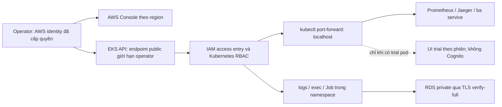

### 2.3. Log và trạng thái worker

```bash
kubectl --context sentinelops-demo -n sentinelops-b-actions logs -f deployment/sentinelops-health-worker -c health-worker --since=10m
kubectl --context sentinelops-demo -n sentinelops-b-actions logs -f deployment/sentinelops-incident-worker -c incident-worker --since=10m
kubectl --context sentinelops-demo -n sentinelops-b-actions logs -f deployment/sentinelops-traffic --since=10m
kubectl --context sentinelops-demo -n sentinelops-b-actions logs deployment/payment-service -c payment --since=10m
# Chỉ sau khi controller được triển khai:
kubectl --context sentinelops-demo -n sentinelops-b-actions logs -f deployment/remediation-controller --since=10m
```

Tìm `READY`, health `COMMITTED`, stream/consumer đúng epoch; incident revisions `OPEN`, `RCA_READY`, `ESCALATED`; với controller tìm `runbook_proposal`, `runbook_approval_escalated`, `action_state_observed`. Container crash: lấy pod cụ thể rồi `logs POD -c CONTAINER --previous`. Không dump env/Secret/DSN vào log. Artifact refs và DB ledger phải đối chiếu cùng stream, target UID và revision; dòng READY không chứng minh model inference hay rollback thành công.

### 2.4. Tài khoản DB và truy xuất bí mật

Không lưu password/token/DSN có credential trong cả hai tài liệu. Kubernetes Secret base64 không phải mã hóa. [CONTROL_RUNBOOK](../../scripts/aws_demo/CONTROL_RUNBOOK.md) yêu cầu không in bí mật ra terminal/file/log; các lệnh dưới chuyển qua stdin cho consumer bảo mật do operator cấu hình. `SECRET_CONSUMER` là executable nhận stdin của password manager/công cụ kết nối được operator chọn, **không phải script có sẵn trong repo**; không đặt thành `cat`, `tee` hay logger.

| Nguồn / tên | Identity / key | Phạm vi |
| --- | --- | --- |
| K8s `commerce-credentials` | user `sentinel`, keys `password`, `database-url` | Commerce DB `sentinelops`; DSN có credential |
| K8s `control-runtime` | user `control_writer`, keys `username`, `password`, `database-url`, `api-database-url` | Worker dùng `database-url` **không credential** + password file; `api-database-url` có credential chỉ dành consumer phù hợp |
| Secrets Manager `sentinelops/dev/control-runtime` | JSON `username`, `password`, `database-url`, `worker-database-url`, `expires-at` | Bản nguồn runtime; không tự sync K8s vì không có External Secrets/CSI |
| K8s `remediation-runtime` | user `control_action_writer`, key `action-database-url` | Identity riêng ghi remediation; là dependency của controller, phải kiểm/provision trước dùng; **không có Secrets Manager action riêng** |
| RDS managed master secret | user `control_bootstrap`, JSON `username`, `password`; ref từ `control_database_secret_arn` | Bootstrap/disable Job, không cấp master cho worker |
| K8s `incident-observer-credentials` | Observer token/CA cấp theo SA/RBAC | Không phải password đăng nhập UI; không sao chép token vào tài liệu |

```bash
set +x
# Đặt SECRET_CONSUMER tới executable nhận bí mật qua stdin trong phiên operator.
: "${SECRET_CONSUMER:?Cau hinh consumer stdin an toan truoc khi truy xuat}"
kubectl --context sentinelops-demo -n sentinelops-b-actions get secret commerce-credentials -o jsonpath='{.data.password}' | base64 --decode | "$SECRET_CONSUMER"
kubectl --context sentinelops-demo -n sentinelops-b-actions get secret control-runtime -o jsonpath='{.data.password}' | base64 --decode | "$SECRET_CONSUMER"
# Đây là toàn DSN có password, không in/ghi ra file:
kubectl --context sentinelops-demo -n sentinelops-b-actions get secret remediation-runtime -o jsonpath='{.data.action-database-url}' | base64 --decode | "$SECRET_CONSUMER"
aws --region ap-southeast-1 secretsmanager get-secret-value --secret-id sentinelops/dev/control-runtime --query SecretString --output text | jq -er '.password' | "$SECRET_CONSUMER"
# Terraform chỉ xuất ref; không ghi literal ARN vào tài liệu:
aws --region ap-southeast-1 secretsmanager get-secret-value --secret-id "$(terraform -chdir=infra/aws output -raw control_database_secret_arn)" --query SecretString --output text | jq -er '.password' | "$SECRET_CONSUMER"
```

Chỉ xem metadata/key lengths bằng `kubectl ... describe secret NAME`. Login `control_writer` và `control_action_writer` là ngoại lệ demo, hết hạn **25/11/2026 00:00 UTC = 07:00 Asia/Bangkok**; vẫn phải `disable` để NOLOGIN/PASSWORD NULL và ngắt session. Đọc [CONTROL_RUNBOOK §4–7](../../scripts/aws_demo/CONTROL_RUNBOOK.md) trước sync/rotate/disable.

## 3. Kiến trúc AWS và luồng nghiệp vụ

Nét liền mô tả liên kết hạ tầng/runtime; nét đứt ghi rõ nhánh tùy chọn/chưa deploy. S3 có thật nhưng artifact runtime trong manifest hiện mount PVC, **không tự đồng bộ toàn bộ artifacts lên S3**. Hai NAT phục vụ egress theo AZ; RDS vẫn single-AZ dù subnet group trải private subnets.

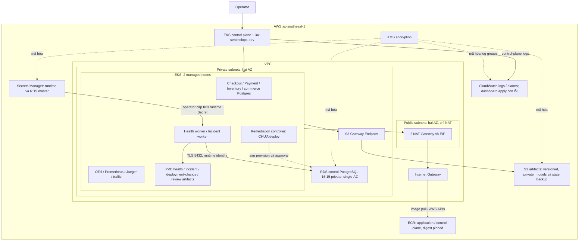

Luồng request thực tế: traffic gọi từng service; Checkout gọi Inventory rồi Payment, truyền correlation/trace headers. Payment ghi `payments`, Inventory đọc `inventory`; không có transaction phân tán hay trừ kho/hoàn tiền đầy đủ.

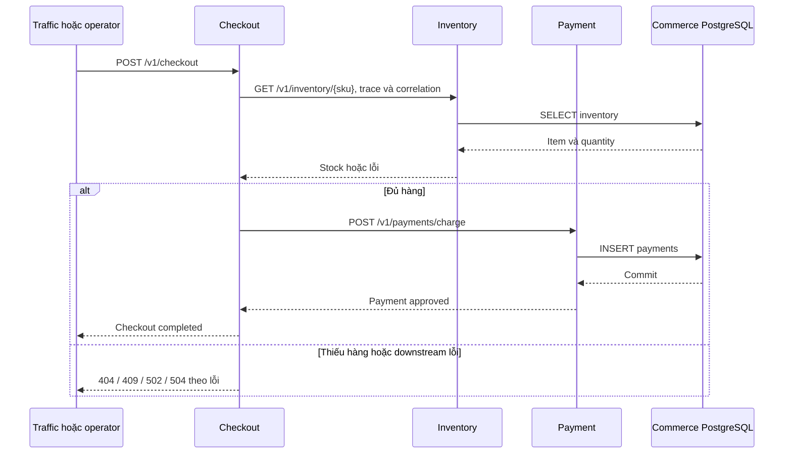

## 4. Telemetry → health → ledger

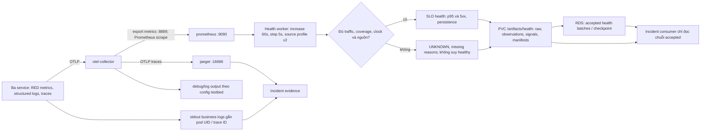

Profile `prometheus-increase-60s-5s/v2`; SLO p95 > **750 ms** hoặc error rate > **5%**, tối thiểu **30 business requests/bucket**, coverage **0.80**, entry **2 bucket**, recovery **3 bucket**. Bucket là 60 giây UTC đã đóng; watermark/readiness/freshness vẫn phải đạt. Log/trace query phải dùng đúng bounded window và physical source binding. CloudWatch/X-Ray exporter trong `20-collector.yaml` là pipeline riêng ở namespace khác, không phải đường số liệu nội bộ này.

## 5. Health signal → incident → RCA

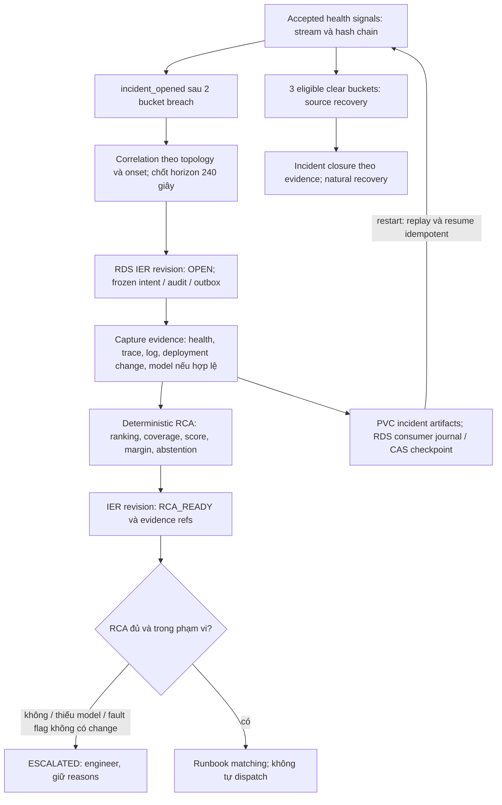

RCA dùng weights anomaly **0.25**, temporal **0.20**, dependency trace **0.25**, log **0.15**, recent change **0.15**; kết luận cần score ≥ **0.75**, coverage ≥ **0.75**, margin ≥ **0.15**, không ambiguous. Đây là **điểm RCA**, khác điểm matching **0.80**. Model IF/XGBoost bổ sung anomaly/risk, không thay SLO mở incident. Fault flag RAM không tạo deployment-change evidence.

Severity `severity/v2`: critical khi Checkout 5xx ≥20% hai bucket; high khi Checkout 5xx ≥5% hoặc p95 >1500 ms hai bucket, hoặc ≥2 structural root; low khi các non-Checkout bị ảnh hưởng có max p95 trong (750,1250] ms, error ≤5%, Checkout dưới ngưỡng high; còn lại medium. Không dùng severity cũ trong guide.

## 6. Triệu chứng → catalog → on-call / engineer

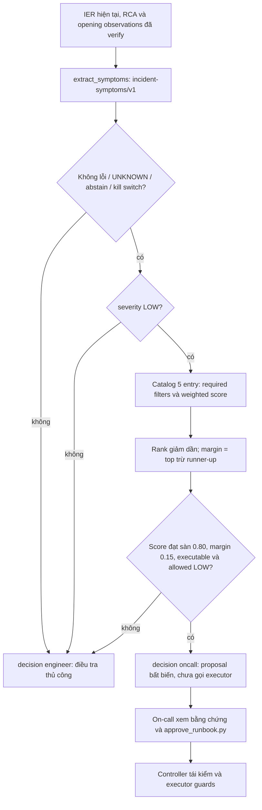

Chỉ `payment-bad-deploy-rollback` executable, executor `payment-rollback-known-good/v1`. Bốn entry manual: `inventory-bad-deploy`, `payment-errors-no-change`, `db-lock-contention`, `checkout-latency-downstream`. Score deterministic không phải xác suất; không có decision `auto`, không có nhánh 0.50–0.80 chờ on-call.

## 7. Proposal → duyệt on-call → rollback → verify

**Luồng code sau đây chưa được xác nhận triển khai trên EKS.** Cần controller image chứa code approval hiện tại; không coi digest cũ trong artifacts là đã bao gồm thay đổi worktree.

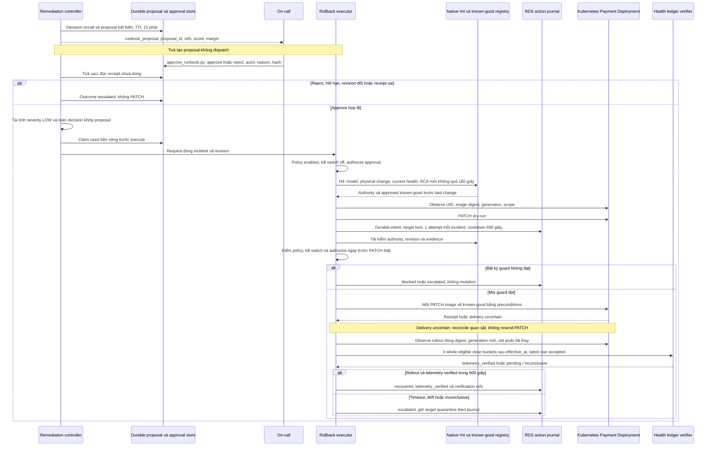

Lệnh duyệt **sau khi controller đã deploy**, thay placeholder bằng proposal thật và danh tính on-call, không dùng email:

```bash
kubectl --context sentinelops-demo -n sentinelops-b-actions exec deployment/remediation-controller -- \
  python scripts/approve_runbook.py --store /artifacts/remediation \
  --proposal-id REPLACE_PROPOSAL_ID --approved-by REPLACE_ONCALL_NAME \
  --decision approve --reason 'Đã kiểm tra incident revision, evidence và runbook' \
  --confirm-oncall-approval
```

Đổi `approve` thành `reject` để từ chối. Receipt create-only gắn ID/hash toàn proposal, chỉ dùng một lần; không sửa reject thành approve. TTL proposal **15 phút không gia hạn RCA 180 giây**: duyệt muộn vẫn bị chặn (`approval-after-evidence-freshness`). Restart không tái sử dụng claim approval; có thể mất lượt chạy nếu crash giữa claim và execute, cần engineer. Bật kill switch sau PATCH không đảo mutation đã gửi; verifier tiếp tục reconcile bằng policy gốc.

## 8. Known-good: review Job → evidence → approve Job → ledger

Known-good approval và on-call proposal approval là **hai quyết định riêng**. Known-good phải có trước bad deployment, ràng buộc đúng Payment target/UID, environment và health stream.

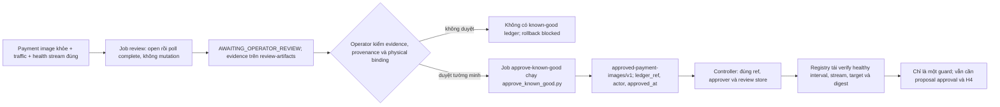

`artifacts/aws-demo/review.yaml` là manifest đã lưu, không chứng minh Job hoàn tất. Review Job mount health PVC read-only, review PVC writable và node affinity theo health worker vì RWO. Nếu worker chuyển node/stream/UID phải render lại; không áp manifest cũ mù quáng. `backoffLimit: 0`, evidence review expires sau 10 phút; Job Complete chỉ nghĩa evidence sẵn sàng, không phê duyệt image. `artifacts/aws-demo/approve-known-good.yaml` cũng chỉ là artifact đầu vào, cần đối chiếu evidence/actor/stream thật trước apply.

```bash
# Sau khi review manifest đúng target/node và được phép thực hiện:
kubectl --context sentinelops-demo -n sentinelops-b-actions logs -f job/review -c review
kubectl --context sentinelops-demo -n sentinelops-b-actions logs job/approve-known-good -c approve
# Entrypoint dùng trong approve Job, sau khi người vận hành đã xem evidence:
python scripts/approve_known_good.py --review-store /artifacts/review \
  --evidence-ref artifact://manifests/REPLACE_EVIDENCE_HASH.json \
  --approved-by REPLACE_OPERATOR_NAME --environment dev --confirm-operator-approval
```

Lệnh Python chạy trong Job/pod có mount đúng store, không phải root filesystem máy operator. Ref ledger cần truy cập được ở `--known-good-store`; renderer hiện mount `review-artifacts` read-only tại `/artifacts/review`, tách khỏi decision store `/artifacts/remediation`. Kiểm desired manifest và topology volume thật trước deploy. Ngoài `action-database-url` do `action-runtime` tạo, renderer controller còn yêu cầu hai key **`known-good-ledger-ref`** và **`approved-by`** trong `remediation-runtime`; operator cấp từ ledger vừa duyệt, không tự đặt ref giả. `action-runtime` một mình chưa cấp đủ các key cho controller. Kill switch trong renderer là **`/artifacts/remediation/KILL_SWITCH`**; file tồn tại sẽ chặn dispatch mới.

## 9. Luồng triển khai và cấp runtime secret

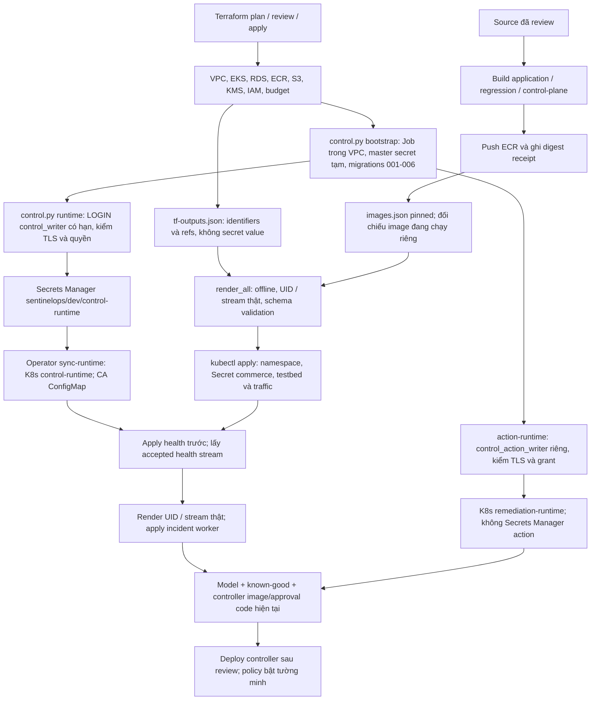

Bootstrap dùng `control_bootstrap`, không dùng local roles SQL; runtime không dùng master. Master Secret/SQL ConfigMap tạm được cleanup; runtime password sinh trong RAM và truyền stdin. Worker `database-url` không credential; API/trial key `api-database-url` có credential. Không có sync tự động từ Secrets Manager sang K8s.

Renderer `render_all.sh` tạo cả `30-api.yaml`, `20-collector.yaml` namespace AWS riêng và `40-workers.yaml` có controller; **không `kubectl apply -f` cả thư mục** để suy rằng mọi thành phần đã triển khai. Đường hiện tại dùng `41-health-only.yaml`, sau đó `42-workers-no-controller.yaml`, testbed và traffic ở `k8s-pass2`. `30-api.yaml`/OIDC input không phải bằng chứng Cognito hay API live. Kubeconform 1.34 chỉ kiểm schema; không kiểm IAM/TLS/PVC/UID/acceptance.

Ví dụ render offline từ receipts thật vào thư mục mới (yêu cầu môi trường Python 3.11 + dependencies/kubeconform theo README):

```bash
bash scripts/aws_demo/render_all.sh artifacts/aws-demo/images.json \
  artifacts/aws-demo/tf-outputs.json artifacts/aws-demo/runtime-pass2.json \
  --output artifacts/aws-demo/k8s-next-reviewed
```

## 10. Nạp model — MODELWIRE

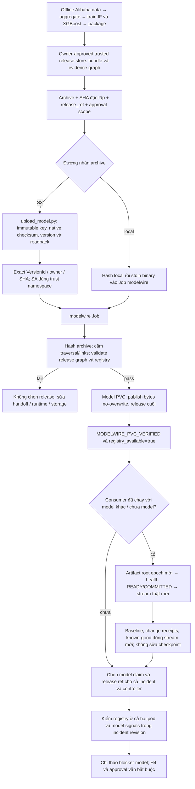

Nguồn thao tác chính xác: [MODELWIRE](../../scripts/aws_demo/MODELWIRE.md). `de38fc6b` là short model identity, không phải archive checksum/release ref. Model version, manifest hash, archive SHA, `artifact://manifests/...` release ledger và S3 VersionId khác nhau. Bốn file raw chưa đủ; trusted release store thường có 10 file gồm bundle và release/approval/evaluation graph. Không tạo PASS flags hoặc tự coi local parity là parity EKS.

Phải rebuild image nếu thiếu frozen config packaging; dùng cùng control-plane digest đã review cho Job và consumers. Worker/controller mount `/models` read-only, health không cần model. Terraform chưa provision EFS/RWX; EBS RWO cần topology cùng node, readOnly không biến thành RWX. Role `data-worker` IaC trust namespace `sentinelops`, không tự dùng ở `sentinelops-b-actions`; nếu chưa có SA đúng trust thì tải exact version bằng operator và dùng đường local. Không cấp AWS credentials dài hạn cho workers. Khi đổi model trên consumer đang chạy, dùng epoch artifact root mới theo MODELWIRE, không sửa identity/checkpoint DB để ép qua gate. Nạp bundle không train, không duyệt release, không bật remediation.

## 11. Đọc incident, giải thích, resume và quarantine

API/UI dưới đây là **khả năng code / trial theo phiên**, không phải endpoint always-on trên EKS. Không dùng API `/v1/detect` legacy để chứng minh Alibaba inference.

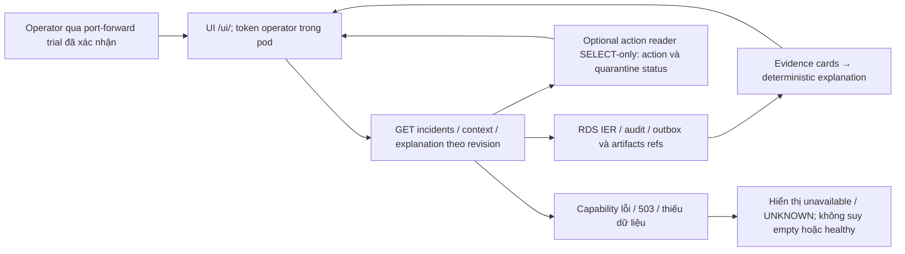

Bedrock tắt trong demo; explanation không đổi RCA, severity hay quyền action. UI read-only không duyệt proposal thay CLI. Trial receipts `q09_eligible: false` không thay nghiệm thu Q-09/G6. Chưa có manifest pod UI trial đã xác nhận trong nguồn triển khai; không dùng `run_g6_trial.py --kind` như một lệnh EKS đã được hỗ trợ sẵn.

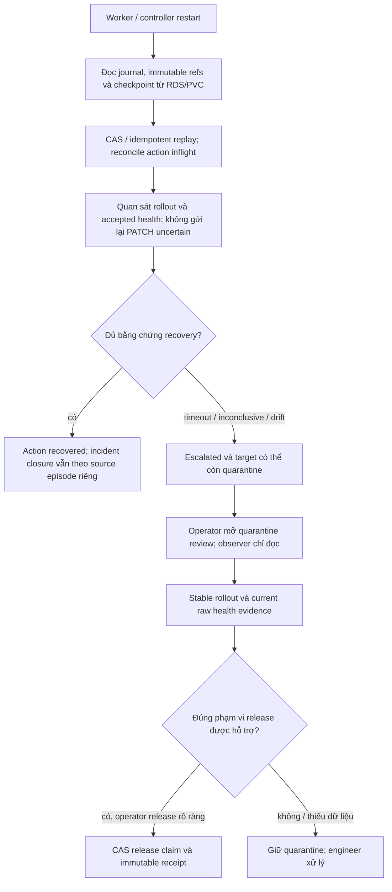

## 12. Kịch bản demo từng bước

### 12.1. Demo phần đang triển khai: phát hiện và chuyển engineer

1. Mở Console EKS/RDS/ECR và hai port-forward Prometheus/Jaeger; mở port-forward ba service. Kiểm `/health`, `/ready`, Prometheus targets và log health/incident worker. Không hiển thị secrets hoặc bảng định danh local trên màn hình công khai.
2. Giữ `sentinelops-traffic` chạy; kiểm business request count/coverage, accepted health stream và healthy baseline. Health/readiness requests không thay business traffic.
3. Đọc Payment fault state rồi tiêm +950 ms bằng POST dưới đây. Đây là **fault flag**, không phải bad image deployment; chỉ demo detection/RCA/escalation, không kỳ vọng rollback.

   ```bash
   curl --fail-with-body http://localhost:8002/internal/faults
   curl --fail-with-body -X POST http://localhost:8002/internal/faults -H 'Content-Type: application/json' --data '{"mode":"latency","delay_ms":950}'
   ```

4. Trên Prometheus xem p95 Payment/Checkout tăng; trên Jaeger tìm trace Checkout → Inventory → Payment. Hai eligible breach buckets mới xác nhận source episode; correlation cần horizon của nó, không hứa incident xuất hiện tức thì.
5. Đọc logs/evidence: `OPEN → RCA_READY → ESCALATED`, nói rõ reasons khi RCA thiếu model/deployment change. Đây là kết quả đã ghi trong báo cáo; giá trị p95/lần chạy mới phải đo lại. Không trình bày `actions_allowed=false` như đã rollback.
6. Gỡ fault trong mọi trường hợp, kiểm GET state và đủ clear buckets:

   ```bash
   curl --fail-with-body -X POST http://localhost:8002/internal/faults -H 'Content-Type: application/json' --data '{"mode":"healthy","delay_ms":0}'
   ```

### 12.2. Demo trọn vòng có on-call duyệt: chỉ sau khi đủ dependency

1. Chốt image chứa severity/matching/controller/**approval code hiện tại**; đối chiếu digest đang chạy, không suy từ `images.json`. Có model trusted store thực, Job MODELWIRE verify và release chọn ở cả incident/controller. Nếu đổi model/stream, tạo epoch và baseline/receipts mới.
2. Kiểm runtime action `remediation-runtime`, TLS, target UID/binding, PVC topology và review store mount. Review healthy Payment, operator duyệt known-good qua approve Job, kiểm ledger resolve đúng image/stream và approval có trước bad change.
3. Deploy controller sau review, policy bật tường minh `--policy-enabled`, kill switch off, nhưng **vẫn phải chờ on-call approval từng proposal**. Chưa hoàn tất các bước này thì dừng ở demo 12.1 hoặc luồng local đã xác nhận.
4. Deploy **payment-regression digest đã review**, ghi physical deployment change/evidence đúng stream; không dùng fault flag thay bad image. Theo `scripts/run_runbook_demo.py`, runner đòi source/review/controller/change stores, target, TLS/token files, health stream, known-good ledger/actor và regression digest thật; không tự điền placeholder thành quyền chạy.
5. Đợi incident LOW, score ≥0.80, margin ≥0.15 và log `runbook_proposal`. Cho thấy trước duyệt chưa có PATCH; on-call kiểm incident revision/evidence rồi chạy lệnh §7 ngay khi evidence còn mới.
6. Theo action journal: guards → dry-run → một PATCH Payment → rollout → 3 whole eligible post-action buckets → `recovered` **và** `telemetry_verified`. Nếu approval hết hạn/RCA stale/guard fail thì trình bày escalation đúng lý do, không bỏ guard để ép demo thành công.
7. Chạy **3 lượt liên tiếp**, Payment bắt đầu mỗi lượt trên known-good, cách nhau ít nhất cooldown **600 giây**. Receipt runner ở `artifacts/aws-demo/runs/<n>.json`; không truyền `--approve-as` trong demo on-call thủ công. Cờ đó chỉ dành tập dượt có identity tường minh, không phải mặc định tự duyệt.
8. Lượt kill switch qua `--kill-switch-run`: bật đúng file switch mà controller theo dõi, chứng minh **0 mutation** qua dispatch/action journal và workload observations. Không chỉ dựa số pod. Ca failed-verify riêng cần phạm vi fault đã review, phải escalated/quarantine; không nhận recovery nếu nguồn bị UNKNOWN.
9. UI trial chỉ mở nếu phiên pod/port/token thật đã được bàn giao; dùng read-only xem cùng revision và action receipt. Nếu chưa có, trình bày Prometheus/Jaeger, logs và evidence/ledger thay vì bịa URL incident UI.

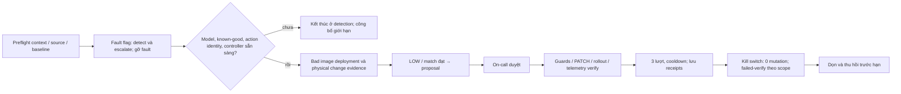

## 13. Teardown và hạn 24–25/11

Đây là thứ tự operator thực hiện theo [AWS_DEMO_PLAN §8](AWS_DEMO_PLAN.md#8-checklist-dọn-dẹp-sau-demo) và [CONTROL_RUNBOOK §7](../../scripts/aws_demo/CONTROL_RUNBOOK.md). Không có lệnh teardown nào được chạy để viết tài liệu này. KMS dùng chung với dữ liệu/state; phải quyết định giữ/hủy dữ liệu trước destroy.

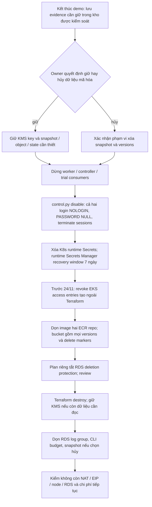

| Hạn / hạng mục | Việc phải xác nhận |
| --- | --- |
| **24/11/2026** | Thu hồi EKS access entries ngoài Terraform. Tag `Expires` không tự revoke; cần kiểm lại danh sách bằng identity operator |
| **25/11/2026 00:00 UTC / 07:00 Bangkok** | Cả `control_writer` và `control_action_writer` hết hạn; vẫn chạy `disable`, kiểm không còn session và xóa runtime Secrets, không chờ expiry thay thu hồi |
| KMS / state / snapshot | Key scheduled deletion làm dữ liệu không đọc được ngay; lịch xóa 30 ngày không phải thời gian tiếp tục đọc. Giữ dữ liệu thì phải giữ key |
| ECR / S3 | Không force delete/destroy mặc định; repo còn image hoặc bucket còn versions có thể chặn destroy |
| Ngoài Terraform | EKS access entries, log group `/aws/rds/instance/sentinelops-control-dev/postgresql`, budget toàn tài khoản tạo bằng CLI và snapshot cuối phải kiểm riêng |

## 14. Chỉ mục nguồn để tái kiểm

| Nội dung | Nguồn |
| --- | --- |
| Trạng thái triển khai, blockers, deadline | [AWS_DEPLOY_REPORT_2026-11-18](AWS_DEPLOY_REPORT_2026-11-18.md), [AWS_DEMO_PLAN](AWS_DEMO_PLAN.md) |
| Policy mới, proposal/approval, threshold | [AUTO_RUNBOOK_INTERFACE](../design/AUTO_RUNBOOK_INTERFACE.md), `src/sentinelops/remediation/{matching,controller,approvals}.py`, `scripts/approve_runbook.py`, `configs/runbook_catalog.json` |
| Hạ tầng / outputs | `infra/aws/*.tf`, nhất là `network.tf`, `eks.tf`, `storage.tf`, `iam.tf`, `cloudwatch_kms.tf`, `outputs.tf` |
| Runtime snapshot local | `artifacts/aws-demo/{tf-outputs,images,runtime-pass2}.json`, `k8s-pass2/*.yaml`, `review.yaml`, `approve-known-good.yaml`; các file này không đưa vào Git |
| Truy cập / bootstrap / render / review / model | [CONTROL_RUNBOOK](../../scripts/aws_demo/CONTROL_RUNBOOK.md), [README.render](../../scripts/aws_demo/README.render.md), [README.review](../../scripts/aws_demo/README.review.md), [MODELWIRE](../../scripts/aws_demo/MODELWIRE.md) và Python scripts cùng thư mục |
| Nghiệp vụ / endpoint / fault | `services/{checkout,payment,inventory}/app.py`, `services/common/{faults,runtime,observability}.py`, `scripts/aws_demo/traffic_loop.py` |
| Telemetry / incident / ML | `src/sentinelops/{telemetry,incidents,workers,ml}/`, `configs/{slo_health_policy,severity_policy,rca_policy}.json` |
| Guards / verification / quarantine | `src/sentinelops/remediation/{authority,executor,registry,domain,verification,quarantine}.py`; `scripts/{review_payment_image,approve_known_good,run_remediation_controller,run_runbook_demo}.py` |
| API / UI / explanation / giới hạn local | `src/sentinelops/api.py`, `src/sentinelops/{ui,explanations}/`, `scripts/run_g6_trial.py`; [guide overview](../guide/01_OVERVIEW.md), [AI training](../guide/02_AI_TRAINING_DATA.md), [incident flow](../guide/03_INCIDENT_FLOW.md), [local status](../guide/04_LOCAL_BUILD_STATUS.md), [guide README](../guide/README.md) |

Bản điền endpoint/bucket/repo/digest từ JSON nằm ở **`artifacts/aws-demo/ACCESS.local.md`**, đã nằm dưới rule ignore `artifacts/`. Không stage/commit bản local hoặc copy identifiers của nó vào tài liệu này. Các giá trị JSON/manifest là snapshot offline, không thay kiểm tra live trước buổi demo.
