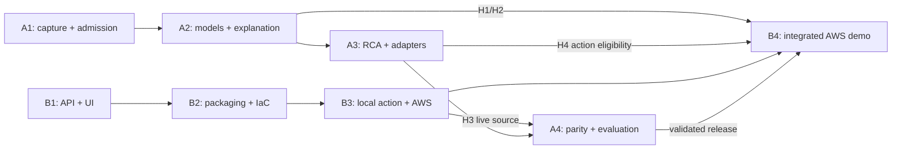

# SentinelOps — kế hoạch giao hàng cho hai người

Ngày chốt cách làm: **2026-10-31**, theo yêu cầu owner. Baseline: `main`
`f4891cf`, sau merge PR #24. Kế hoạch này thay thứ tự triển khai của bản 1.1;
không thay product scope, ADR Accepted, nguồn dữ liệu hoặc ngưỡng nghiệm thu.

**Ưu tiên: hoàn thành đường chạy của sản phẩm, rồi sửa lỗi có tác động thực tế.**
Không làm lại nền tảng đã có, mở thêm kiến trúc hoặc tối ưu vài millisecond khi
chưa có model được chấp nhận, UI dùng được và môi trường triển khai.

Đọc cùng [handoff cho người mới](../TEAM_HANDOFF.md) và
[hợp đồng giữa hai luồng](WORKSTREAM_CONTRACT.md). Trạng thái đo của sản phẩm ở
[PROJECT_STATUS.md](../PROJECT_STATUS.md); tiêu chí G0–G8 vẫn ở
[CONSTRAINTS_AND_GATES.md](../architecture/CONSTRAINTS_AND_GATES.md).

## 1. Phân công và kết quả cuối của từng người

Tên A/B là vai trò để owner gán người, không suy ra danh tính từ Git author.
Mặc định người đang theo dữ liệu nhận A, người mới nhận B; đổi người không đổi
phạm vi sở hữu. Không bắt người kia review từng commit hoặc xong cả lane trước.

| Luồng | Chủ sở hữu | Kết quả phải giao |
| --- | --- | --- |
| **A — Data / AI / RCA** | Corpus, features, training/evaluation, model registry, workers/RCA, backend explanation | Data được admission; MAD/IF/XGBoost so sánh đúng split; bundle/model card và hướng dẫn activation; RCA giữ uncertainty; explanation có fallback/evidence refs |
| **B — Application / Platform** | API integration/auth, operator UI, packaging, CI/dashboard, Kubernetes/remediation, AWS | UI/API đọc incident thật; local start/stop; rollback Payment có guard/audit; IaC/deployment với quyền, cost/teardown và demo guide |

Mỗi người tự triển khai, self-review và kiểm tra phần mình. Chỉ yêu cầu người kia
review khi sửa interface chung, chạm dữ liệu lane kia hoặc chuẩn bị activation/
side effect chung. Không giả định một người thứ ba làm integration hoặc QA.

## 2. Điểm xuất phát: dùng lại phần đã có

- Ba service Checkout/Payment/Inventory, PostgreSQL commerce/control, OTel,
  Collector/Prometheus/Jaeger, telemetry/features và experiment runner đã có.
- Health/incident workers, IER persistence/read API, correlation và RCA có đường
  chạy local/CI. Dùng lại; không viết lại incident subsystem.
- Kiểm tra code/runtime của phần bị tác động bằng runbook và CI đúng SHA;
  không cần giữ một report lịch sử để xác nhận service hoạt động.
- Corpus prospective HTTP v2 và guarded model software đã có, **chưa có model
  được chấp nhận**. Report gần nhất chưa đạt G2/G3; inventory đang chạy phải kiểm
  tra trên máy capture, không suy từ Git.
- UI, explanation/provider, action execution và AWS chưa hoàn thành. Đây là đầu
  ra cần làm tiếp, không phải lý do chạy lại toàn bộ phase cũ.

## 3. Hai hàng công việc chạy đồng thời

Mốc là đầu ra sử dụng được, không phải lịch cố định hay một PR cho mỗi dòng.
Effort chỉ cập nhật khi người nhận đã kiểm tra môi trường; không tính chờ data/CI
thành coding và không hứa deadline khi chưa biết capacity, cloud access và data.

| Mốc | A làm đến khi hoàn tất đầu ra | B làm độc lập cùng thời điểm |
| --- | --- | --- |
| **1** | **A1 — Corpus:** kiểm inventory/controller hiện có; giữ checkout capture bất biến; resume đúng tiến trình/epoch được phép. Audit từng group, giữ train → calibration → development. Giao inventory, thiếu hụt chính xác và cách tiếp tục. | **B1 — App local:** đóng gói API/workers/testbed/control DB trên môi trường riêng; UI list/detail/timeline/evidence đọc API hiện có. Hiển thị UNKNOWN/503/abstention đúng. Giao cách mở UI và xem incident qua DB thật, không chờ model. |
| **2** | **A2 — Models + explanation:** trong lúc capture tự chạy, hoàn thiện evaluation/report và explanation từ IER với deterministic fallback. Sau admission/freeze hợp lệ, fit MAD/IF/XGBoost, đánh giá development, giao H1 bundle/model card và H2 backend explanation. | **B2 — Product + packaging:** UI health/model-unavailable/history/action status; nối H2 khi có. Làm auth adapter, pin images/config, readiness tách dependency, dashboard demo và CI theo tác động. Viết IaC AWS/local Kubernetes ngay. |
| **3** | **A3 — RCA + adapters:** kiểm RCA trên development được phép; sửa evidence/adapter ảnh hưởng supported scenarios; báo coverage/missed/abstained. Làm adapter/source-parity AWS theo H3. Không tune holdout hoặc mở rộng GAMMA. | **B3 — Closed loop + cloud foundation:** triển khai `payment-rollback-known-good/v1` trên Kubernetes local: digest tốt/xấu thật, policy/dry-run/idempotency/lock/audit/verify/escalate. Chuẩn bị AWS plan, region/quota/budget/quyền; chưa apply ngoài phạm vi được cấp. |
| **4** | **A4 — Validation:** nhận H3 live AWS capture của B, xác minh source/feature parity và model compatibility; giao release evidence cho operator. Final evaluation chỉ sau protocol/freeze và quyền mở holdout. | **B4 — AWS + release:** sau cloud authorization, triển khai baseline EKS/control PostgreSQL/S3/observability; nối model release đã được chấp nhận, explanation và action. Giao truy cập, phiên bản, logs, rollback, chi phí/teardown và demo guide. |

A2 thiếu data thì A tiếp tục explanation/evaluation/adapters. AWS thiếu budget thì
B hoàn thiện UI/local closed loop/IaC plan. Chỉ đầu ra phụ thuộc bị chặn, cả hai
không ngồi chờ hoặc sửa chung một module.

Corpus nonfinal có **30 slot, budget workload 19,5 giờ**, chưa kể overhead/run hỏng.
Không rút ngắn window hoặc đổi nhãn để tiết kiệm giờ. Chạy controller có handle/
checkpoint, kiểm process trước resume; không cần ngồi theo dõi capture thủ công.

A sở hữu final protocol/collector/evaluator ở A4 sau khi owner cấp quyền và
freeze release. CLI capture hiện tại chủ động từ chối sealed-final; không bỏ
guard để chạy final bằng lệnh nonfinal hoặc gọi tập đã xem là untouched holdout.

## 4. Chỉ chờ nhau ở boundary thật

| Dependency | Chỉ chặn | Trong lúc chờ vẫn làm |
| --- | --- | --- |
| H1: chưa có accepted model | B chưa bật inference thật; G3 chưa pass | API/UI xử lý 503, incident/SLO pipeline, packaging/deployment |
| H2: backend explanation chưa xong | Wiring route explanation cuối | UI đọc IER/evidence/timeline, không cần Bedrock |
| H3: chưa có source AWS thật | A chưa chứng minh AWS parity, B chưa activate model AWS | A làm adapter/tests; B triển khai app/cloud và unavailable state |
| H4: chưa có RCA/evidence đủ điều kiện action | Auto action thực sự phải giữ blocked | B hoàn thiện executor/local guard tests; A làm evidence/coverage trên development |
| Budget/quota/region hoặc quyền holdout chưa cấp | Cloud apply/final evaluation tương ứng | Local, code, IaC validation và development report |
| Interface cần breaking change | Consumer chịu tác động chờ version/migration cụ thể | Item không dùng interface đó |

Không đặt điều kiện “A xong toàn bộ thì B bắt đầu”. Software G4/G5/G6 có thể làm
trước model; khi **nghiệm thu toàn hệ thống** vẫn giữ gate hiện có.

## 5. Kiểm tra đủ để giao hàng, có điểm dừng

- Mục tiêu effort: khoảng **70% triển khai/tích hợp, 20% kiểm tra/review, 10% bàn
  giao**. Đây là hướng phân bổ, không buộc dừng xử lý mất dữ liệu/sai nhãn/action nguy hiểm.
- Mỗi lát cắt: happy path dùng được, lỗi quan trọng của dependency bị tác động và
  regression bắt lỗi đã sửa. Pass thì giao; không tăng test count bằng ma trận vô hạn.
- Feedback thông thường nhắm **5–15 phút**; điều tra quá **30 phút** thì ghi câu
  hỏi/impact và chọn phép kiểm tiếp theo. Đây là điểm đánh giá lại, không phải
  timeout để hạ test. Không lặp phép thử không tạo thông tin mới.
- Docs: links/diff/consistency. Logic: focused tests. API/storage: contract + một
  integration liên quan. Dataset: lineage/split/leakage. Action: guard bắt buộc +
  thực thi/verify. Không chạy whole Docker cho mỗi sửa UI/text.
- Full regression ở ranh giới integration/release hoặc khi sửa core dùng chung;
  không sau từng file. Dùng CI đúng SHA, tránh chạy lại native suite dài cả local
  lẫn remote nếu không có rủi ro mới cần đo.
- **B2 sở hữu tách CI theo tác động:** docs/UI check nhẹ; native suites cho worker/
  source/DB/observability và release. Giữ check kết luận luôn có kết quả; tránh
  required check Pending khi path-filter bỏ workflow
  ([GitHub workflow syntax](https://docs.github.com/en/actions/reference/workflows-and-actions/workflow-syntax)).
  Implementation hiện có ở `scripts/ci_impact.py`: workflow luôn chạy, foundation
  và `ci-summary` luôn cho kết luận; UI/assets chạy browser/JS checks, code/config/
  DB/worker hoặc path chưa biết chạy đủ native/public suites. `workflow_dispatch`
  buộc full validation cho release. Không dùng workflow-level path filter khiến
  required check treo Pending; chỉ skip job ngoài scope và summary kiểm mọi job
  được yêu cầu. Job bị skip không được mô tả là một native measurement đã pass.
- Chỉ tối ưu khi số đo vượt yêu cầu, ảnh hưởng sử dụng hoặc chi phí đáng kể.
  Không dành nhiều giờ làm nhanh thêm chút ít khi đường demo còn thiếu.

Không bỏ secret/auth, provenance/split/holdout, no-model/UNKNOWN, persistence khi
sửa storage và action safety. Không dùng skip-CI, bỏ assertion hay đổi threshold/
dataset để làm release xanh.

## 6. Giao hàng và kết thúc

Hai clone/tài nguyên riêng theo [hợp đồng](WORKSTREAM_CONTRACT.md). Mỗi người đưa
lát cắt hoàn chỉnh vào `main` bằng commit nhỏ `feat:`, `fix:`, `docs:`; PR chỉ khi
owner yêu cầu. Refresh remote trước push, chỉ fast-forward, không force-push.
Không khóa lane kia trong suốt CI của phần độc lập. Nếu remote tiến, chỉ tích hợp
lại commit chưa publish của mình; không viết lại lịch sử đã gửi. Chỉ chạy lại
kiểm tra bị tác động bởi phần vừa tích hợp.

Checkpoint/handoff dùng commit/CI, URI/hash/version và dependency thật của
H1/H2/H3/H4. Cập nhật status/runbook hiện có khi capability đổi. Chỉ giữ report
riêng cho data/model/evaluation cần so sánh hoặc tái hiện; không bắt mỗi lane
tạo report và không lưu riêng smoke PASS hay nhật ký từng test.

**Lane done:** đầu ra bàn giao và consumer dùng được; blocker còn lại ghi riêng,
không đổi BLOCKED thành DONE. **MVP chạy được:** telemetry thật → incident/IER →
UI, model đã được chấp nhận và môi trường AWS được phép. **Toàn dự án done:** thêm
explanation/fallback, action+verify local/AWS, source parity, final evaluation/
release và G0–G8 liên quan được chứng minh. Demo có giới hạn có thể giao sớm,
không thay nghiệm thu phần còn thiếu.

## 7. Checklist thực thi B — Application/Platform và UI

Owner đã nhận **lane B và UI** ngày 2026-10-31. Baseline đối chiếu code:
`39b8694` sau PR #24 và lần tổ chức lại docs. Đây là kế hoạch triển khai, không
phải xác nhận UI, override, auth production hoặc cloud đã có. Giữ ownership của
A trong contract; không tiếp tục sửa corpus/model/worker để làm UI.

### B1 — Lát cắt đầu tiên: incident thật lên UI local

B1 đã có implementation và đường chạy local nguồn thật; cách mở UI/kiểm tra ở
[API/UI runbook](../runbooks/INCIDENT_API.md) và
[runtime B](../runbooks/LOCAL_TESTBED.md#lane-b-isolated-application-runtime).
Handoff capability hiện tại ở [PROJECT_STATUS](../PROJECT_STATUS.md). Các mục
B2–B4 bên dưới vẫn cần hoàn tất theo dependency/gate riêng; B1 không nghiệm thu
model, RCA accuracy, explanation, action hoặc AWS thay cho các gate đó.

| Thứ tự | Việc B triển khai | Điểm kết thúc có thể kiểm tra |
| --- | --- | --- |
| B1.1 — Sandbox riêng | Override Compose cho project `sentinelops-b`, toàn bộ published ports theo contract; commerce/control volumes riêng. API trên 18000, control DB 15433. Kiểm rendered config và port ownership trước `up`; không down/prune tài nguyên A | Config không còn published port của A; start/stop chỉ tác động project B. Readiness DB và model tách riêng |
| B1.2 — UI shell + kết nối | Assets trong **mới** `src/sentinelops/ui/`, route same-origin `/ui` từ FastAPI. Bản đầu dùng HTML/CSS và JavaScript modules, không thêm frontend service/build framework. Token nhập vào memory của tab, không nhúng bundle, URL hay localStorage; logout xóa dữ liệu/token | Mở UI qua API 18000; có loading, chưa đăng nhập, sai token, mất mạng và DB unavailable; không lộ token trong log/DOM nội dung lỗi |
| B1.3 — List và detail | List incident, filter state/service, phân trang bằng opaque cursor. Detail đọc exact IER và context, evidence có thể tra theo ID, source refs hiển thị/copy an toàn; giữ thứ tự ranking backend | Thao tác trên API thật, không hardcode incident/score. Empty list khác lỗi 503; số đếm của một trang không được gọi tổng incident |
| B1.4 — Timeline/history + uncertainty | Pin incident revision khi tải detail/context/history; theo `next_after_revision`, không trộn revision. Tách trạng thái store/model và thời điểm cập nhật; UNKNOWN không hiển thị healthy | Chuyển revision đúng nội dung; response cũ không ghi đè selection mới. Model 503 vẫn xem được incident/evidence/history |
| B1.5 — Đóng đường chạy thật | Dùng CLI worker hiện có trên host B với endpoint/DSN/root riêng; thu workload của B khi không gây nhiễu phép đo A. Gây một lỗi Payment có kiểm soát trong sandbox B, đọc IER worker tạo từ control DB qua UI | Một incident có source lineage thật đi qua worker → PostgreSQL → HTTP → UI. Khởi động lại API vẫn đọc cùng revision; fixture chỉ chứng minh phần mềm UI, không thay nghiệm thu này |

**Mapping UI chỉ dùng wire fields đã có:**

| Màn hình/trạng thái | Nguồn | Ràng buộc |
| --- | --- | --- |
| Readiness | `/health`, `/ready` và protected `/ready/incidents` | `/health` chỉ liveness; `/ready` có thể 503 vì model dù store dùng được. Render `dependencies` riêng |
| List | `GET /v1/incidents`: `items`, `next_cursor` | Chỉ `state`, `service`, `limit`, `cursor`; chưa có time-range/search/global aggregate API. Đổi filter phải reset cursor |
| Detail | `GET /v1/incidents/{id}?revision=N` | IER giữ strict v1, revision/ETag ở headers; không thêm field để tiện UI |
| History và availability | `GET /v1/incidents/{id}/context?revision=N&after_revision=…` | Pin revision; dùng `context.availability`, `lifecycle_stage`, `recovery_source` và `timeline`; không suy recovered từ thiếu dữ liệu |
| Model signals | `service_signals` của IER và readiness | Mảng rỗng/risk null là không có signal tương ứng, không phải score 0. Không gọi `/detect` với feature do UI bịa |
| RCA/evidence | `root_cause_ranking`, `evidence[]`, `evidence_refs` | Đây là suspect/support, không phải xác suất đúng hay quyền remediation. Hiển thị facts/reasons nguyên nghĩa, không tự xếp hạng lại |

IER/context hiện chưa có typed fields cho đầy đủ RCA coverage/margin/abstention
và model-version provenance. B1 không parse prose để dựng trạng thái “RCA đã xác
nhận”, cũng không biến `escalated` thành một lý do abstention cụ thể. Khi thiếu
structured qualification, hiển thị chưa có kết luận RCA được xác nhận từ API,
vẫn cho xem ranking/facts. Nếu cần field mới, chốt supplemental contract/version
và producer với A; không mở rộng strict IER hoặc đọc trực tiếp corpus/artifact
riêng của A từ browser. `artifact://` là reference, không mặc định là URL tải được.

B1 là UI **chỉ đọc**. Explanation hiện unavailable cho đến H2 thật; không thêm
provider giả. Action không có nút execute khi policy/executor chưa triển khai;
không coi lifecycle ghi trong DB là bằng chứng action đã chạy.

**Packaging và isolation:** bổ sung assets vào wheel/image rồi kiểm installed
package, không để UI chỉ chạy được từ checkout. Worker CLI đang xác minh loopback
source/control DB; bản local đầu giữ worker là host processes có lifecycle riêng,
không nhét vào container rồi đổi hostname/bỏ guard để chạy. Các flags hiện có
`--prometheus`, `--jaeger`, `--project`, `--metrics-otlp-endpoint` và DSN môi trường
được wiring theo port B. Artifact roots B không dùng chung checkpoint của A.
Không bật load/stress cùng host trong lúc A đang đo nếu capacity chưa tách được;
coding/UI và API/DB checks độc lập vẫn tiếp tục.

**Kiểm tra đủ cho B1:** focused API/schema regressions; browser flow login → list
→ filter/pagination → detail → pinned history; lỗi 401/404/503, network/retry và
response đến sai thứ tự; render log/fact không thực thi HTML/script. Kiểm keyboard,
focus, tương phản và layout hẹp ở các màn chính. Dùng một integration real DB/API
và một incident nguồn thật để nghiệm thu lát cắt; không chạy lại cả native suite
cho từng sửa CSS. Dùng CI đúng SHA ở mốc integration.

### B2 → B4 — Việc tiếp sau và dependency thật

- **B2:** package/start-stop/readiness và config/image pin; health/model-unavailable
  UI; nối H2 qua wrapper versioned khi backend A tồn tại; auth adapter và session
  phù hợp môi trường; dashboard vận hành và CI theo tác động. Các phần action chưa
  có phải hiển thị unavailable, không thành công giả.
- **B3:** executor `payment-rollback-known-good/v1` trong Kubernetes local riêng;
  immutable known-good digest, policy/dry-run/approval, idempotency/lock/audit,
  telemetry verify và escalation. Viết/validate IaC plan song song; giữ auto action
  blocked khi H4 thiếu qualification. Không dùng explanation làm authorization.
- **B4:** chỉ deploy/activate khi có quyền cloud/budget/region và H1/H3 đủ gate.
  Lệnh apply AWS, mở final holdout và activation model không được cấp quyền chỉ
  bởi checklist này. Phạm vi hiện tại vẫn local; không provision AWS.

### Thứ tự commit dự kiến

1. `feat(platform): isolate lane B local runtime` — override, config và lifecycle
   riêng; chưa tuyên bố có incident E2E.
2. `feat(ui): add authenticated incident list and detail` — shell/asset packaging,
   API client, read-only list/detail và unavailable states.
3. `feat(ui): show pinned incident history and evidence` — timeline pagination,
   revision consistency, provenance và uncertainty theo fields thực sự có.
4. `test(ui): verify source-backed local incident flow` — hoàn tất đường chạy B1
   trên nguồn/DB thật, sửa lỗi thực tế và cập nhật runbook mở UI.

Không hứa thời gian hoàn thành theo số test hoặc thời gian chờ A/CI. Điểm bắt đầu
tiếp theo là **B1.1**, rồi giao list/detail sử dụng được trước khi mở rộng B2–B4.
