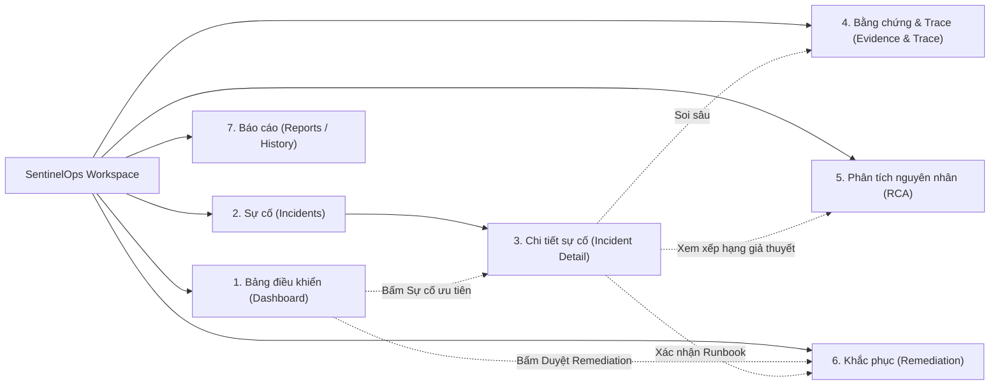

# SentinelOps — Đề xuất Redesign UI/UX & Design System

Tài liệu đặc tả hoàn chỉnh bản thiết kế lại giao diện web cho nền tảng **SentinelOps (AIOps / Incident Intelligence / Evidence-driven Ops)**, tối ưu hóa cho tốc độ đọc nhanh (scanability), chiều sâu kỹ thuật và trải nghiệm demo thuyết phục trước giảng viên / stakeholder.

---

## 1. Mục tiêu & Nguyên tắc UI/UX

1. **Hiểu tình trạng hệ thống trong 3 giây (Demo-first Clarity):** Ngay khi mở màn hình đầu tiên, người xem (kể cả không chuyên sâu SRE) biết ngay hệ thống đang ổn hay đang có sự cố nào, ở service nào, và có hành động nào cần phê duyệt hay không.
2. **Evidence-driven Storytelling:** Kết nối mạch lạc thành 1 câu chuyện liền mạch từ **Triệu chứng (Dashboard / Metrics)** → **Đường đi lỗi (Service Map & Trace Waterfall)** → **Vì sao xảy ra (Root Cause Analysis + Confidence/Coverage)** → **Xử lý & Kiểm chứng (Remediation + SLO Verify)**.
3. **Thẩm mỹ Modern SaaS Trắng – Cam:** Nền trắng / off-white sạch sẽ, khoảng trắng thoáng, phân cấp chữ rõ ràng; màu **Cam (`#EA580C` / `#F97316`)** giữ vai trò điểm nhấn thương hiệu, CTA chính và highlight khu vực trọng yếu; màu **Đỏ (`#DC2626`)** chỉ dành cho `Critical` / lỗi / hành động rủi ro; màu **Xanh lá (`#059669`)** cho `Healthy` / `Verified`.
4. **Giảm nhiễu thị giác:** Hạn chế tối đa icon trang trí dư thừa; ưu tiên summary block tiếng Việt dễ hiểu, callout box có viền nhấn, bảng dữ liệu rộng rãi và biểu đồ trực quan.

---

## 2. Information Architecture (Kiến trúc thông tin)



| Menu / Tab | Keyword kỹ thuật | Mục tiêu sử dụng |
| --- | --- | --- |
| **Bảng điều khiển** | `Dashboard` | Toàn cảnh hệ thống, khối "Cần chú ý ngay", KPI chính, sức khỏe 3 service, xu hướng 24h |
| **Sự cố** | `Incidents` | Hàng đợi sự cố sạch sẽ + 6 bộ lọc độc lập + tìm kiếm tức thì |
| **Chi tiết sự cố** | `Incident Detail` | Hồ sơ sự cố chia lớp rõ ràng: Header → RCA + Impact → Evidence → Trace → Remediation → Lịch sử |
| **Bằng chứng & Trace** | `Evidence & Trace` | Service Dependency Map (React Flow), Trace Waterfall + đối chiếu baseline, 5 sub-tab Evidence |
| **Phân tích nguyên nhân** | `Root Cause Analysis` | Root cause chính, thanh Confidence & Coverage, bảng xếp hạng giả thuyết, Timeline suy luận |
| **Khắc phục** | `Remediation` | Đề xuất chờ duyệt, Runbook từng bước, modal xác nhận, mô phỏng rollout & kết quả Verify SLO |
| **Báo cáo** | `Reports / History` | Lịch sử vận hành, xu hướng theo ngày/tuần, Top Services, MTTD / MTTI / MTTR, Remediation Success |

---

## 3. Wireframe & Bố cục chi tiết từng màn hình

### 3.1. Bảng điều khiển (`Dashboard`)
```text
+---------------------------------------------------------------------------------+
| [CẦN CHÚ Ý NGAY] Hệ thống hiện có 2 sự cố mức cao ở Payment & Inventory         |
|  Tóm tắt tiếng Việt dễ hiểu + [Duyệt Remediation (1)]  [Xem sự cố ưu tiên]      |
+---------------------------------------------------------------------------------+
| [Incident mở] | [Alerts/Inc 24h] | [Latency p95] | [Error/SLO] | [Rem. Success] |
+--------------------------------------+------------------------------------------+
| Xu hướng Incident & Latency (24h)    | Tình trạng 3 Service chính               |
| (Recharts Composed Bar + Line)       | - Payment (Critical · 1.240 ms · 18,4%)  |
|                                      | - Inventory (Warning · 890 ms · 0,8%)    |
|                                      | - Checkout (Warning · 1.290 ms · 14,2%)  |
+--------------------------------------+------------------------------------------+
| Bảng tóm tắt Incident gần nhất (Highlight dòng Critical đang mở, click mở ngay) |
+---------------------------------------------------------------------------------+
```

### 3.2. Sự cố (`Incidents`)
```text
+---------------------------------------------------------------------------------+
| Bộ lọc: [Tìm kiếm...] [Severity] [Status] [Service] [Thời gian] [Environment]   |
| Remediation pill: (Tất cả) (Có Remediation) (Không có Remediation)  [Xóa lọc]   |
+---------------------------------------------------------------------------------+
| Incident ID & Tóm tắt | Service | Severity/Status | Root Cause nghi ngờ | Mở -> |
| [RED ROW] INC-1048... | Payment | Critical / Mở   | Deploy v2.8.4 (94%) | [Mở]  |
|           INC-1047... | Invent. | High / Suy giảm | DB Lock (86%)       | [Mở]  |
+---------------------------------------------------------------------------------+
```

### 3.3. Chi tiết sự cố (`Incident Detail`)
- **Layer 1 — Header:** Incident ID + Revision, Severity badge, Status badge, Environment, danh sách Service bị ảnh hưởng (đánh dấu dịch vụ trọng tâm), thời điểm phát hiện.
- **Layer 2 — 2 cột (7:5):** Khối **Root Cause Analysis** nổi bật (viền & nền cam nhạt, Confidence bar) + Khối **Ảnh hưởng (Impact)** với 4 ô số liệu (`Latency p95`, `Error Rate`, `SLO Health`, `% Request bị ảnh hưởng`).
- **Layer 3 — Evidence:** Grid các card bằng chứng trọng yếu kèm chú thích tiếng Việt dễ hiểu.
- **Layer 4 — Trace Timeline:** Waterfall view trực tiếp của request lỗi + nút so sánh với Trace mức nền trước triển khai.
- **Layer 5 — 2 cột (7:5):** Khối **Remediation** (runbook hiện tại + CTA tới khu vực duyệt) + **Lịch sử cập nhật** theo từng revision.

### 3.4. Bằng chứng & Trace (`Evidence & Trace`)
- **Thanh chọn Incident:** Cho phép chuyển nhanh giữa kịch bản Payment 503 (B7/KB2), Inventory DB Lock, KB1 Latency 950ms và KB3 Abstain.
- **3 Callout Bằng chứng nổi bật:** Giải thích ngắn gọn bằng tiếng Việt (ví dụ *"Latency tăng đột biến tại Payment"*, *"Error Rate của Checkout vượt ngưỡng"*, *"Trace cho thấy bottleneck nằm ở Payment → Payment DB"*).
- **Service Map & Dependency Graph (React Flow):** Đồ họa trực quan luồng `Checkout → Payment → Payment DB` và `Checkout → Inventory → Inventory DB` với cạnh hoạt ảnh đỏ/cam trên nhánh lỗi.
- **5 Sub-tabs chuyên biệt:** `Traces` (Waterfall + Span Inspector) · `Metrics` (Biểu đồ p95 vs Baseline + ngưỡng SLO 750ms) · `Logs` · `Deployments / Changes` · `Related Signals` (ML Isolation Forest & XGBoost).

### 3.5. Phân tích nguyên nhân (`RCA`)
- **Hero RCA Card:** Nêu rõ nguyên nhân chính #1, thanh **Confidence Score** (ngưỡng ≥ 75%) và **Evidence Coverage** (ngưỡng ≥ 75%), kèm trạng thái an toàn **Abstain** khi thiếu bằng chứng (như KB3).
- **Cột trái — Xếp hạng giả thuyết:** Thanh điểm trực quan cho từng ứng viên (#1, #2, #3), bấm chọn giả thuyết để lọc bằng chứng hỗ trợ tương ứng.
- **Cột phải — Bằng chứng hỗ trợ + Timeline suy luận:** Chuỗi bước từ Detection → Capture → Coverage Gate → Scoring → Proposal.

### 3.6. Khắc phục (`Remediation`)
- **KPI Strip:** Số đề xuất Pending / Đã Verify thành công / Thất bại.
- **2 cột (5:7):** Danh sách đề xuất & lịch sử (lọc theo trạng thái) + Không gian thao tác chi tiết:
  - Diff Image Digest (Image gây lỗi vs Known-Good)
  - Danh sách các bước Runbook + lệnh tương ứng
  - **Khu vực Phê duyệt nổi bật:** Ô ghi lý do audit + nút **Cam** (`Phê duyệt & Thực thi`), nút **Đỏ** (`Từ chối & Chuyển kỹ sư`), nút **Xám** (`Kiểm tra lại Incident`) kèm hộp thoại xác nhận `<dialog>`.
  - **Bảng kết quả Verify hậu khắc phục:** So sánh chỉ số Trước vs Sau vs Mục tiêu SLO.

### 3.7. Báo cáo (`Reports / History`)
- **Filter:** Chu kỳ (`7 ngày` / `4 tuần`), `Service`, `Environment`.
- **4 KPI vận hành:** `MTTD`, `MTTI`, `MTTR`, `Remediation Success Rate`.
- **2 biểu đồ Recharts:** Xu hướng Incident & MTTR theo ngày/tuần + Biểu đồ ngang Top Services dễ gặp sự cố.
- **Bảng lịch sử Incident** đầy đủ.

---

## 4. Design System cơ bản

### 4.1. Bảng màu (Color Tokens)
| Nhóm | Token / Hex | Vai trò sử dụng |
| --- | --- | --- |
| **Page Canvas** | `#FAFAFB` | Nền tổng thể tạo cảm giác thoáng, hiện đại |
| **Card Surface** | `#FFFFFF` | Nền card, bảng, panel với viền `#E6E8EE` |
| **Primary Orange** | `#EA580C` (hover `#C2410C`) | Nút CTA chính, active tab underline, brand mark |
| **Highlight Orange** | `#F97316` / tint `#FFF7ED` | Biểu đồ cột chính, thanh score, khu vực RCA/Warning |
| **Critical Red** | `#DC2626` / tint `#FEF2F2` | Badge `Critical`, dòng sự cố nguy cấp, nút rủi ro/từ chối |
| **Healthy Emerald** | `#059669` / tint `#ECFDF5` | Badge `Đã xử lý` / `Success`, nhánh service ổn định |
| **Ink Hierarchy** | `#0F172A` / `#475569` / `#64748B` | Chữ tiêu đề chính / nội dung / thông tin phụ |

### 4.2. Typography
- **Primary Sans:** `Be Vietnam Pro` (hỗ trợ dấu tiếng Việt sắc nét, hiện đại) + system-ui fallback.
- **Monospace:** `JetBrains Mono` cho Incident ID, Trace ID, lệnh Runbook, image digest và timestamp.
- **Tabular Numbers (`tabular-nums`):** Bắt buộc áp dụng cho toàn bộ KPI, độ trễ (ms), phần trăm (%), và bảng dữ liệu để số thẳng cột khi quét mắt.

### 4.3. Core Primitives
- **Buttons:** `primary` (Cam nổi bật), `danger` (Đỏ cảnh báo), `secondary` (Trắng viền xám), `subtle` (Cam nhạt viền cam), `ghost` (Xám nhẹ). Bo góc `8px` (`rounded-lg`), chiều cao `36px–40px`.
- **Badges:** Bo tròn pill (`rounded-full`), nền nhạt + viền mảnh + chấm màu (`dot`), phân tách rõ `Critical` / `High` / `Medium` / `Low` và `Pending` / `Running` / `Success` / `Failed`.
- **Cards:** Bo góc `12px` (`rounded-xl`), hỗ trợ accent `orange` / `red` / `emerald` cho các khối cần tập trung ánh nhìn.
- **Tables:** Semantic `<table>` với sticky `<thead>`, container query `@container (width < 640px)` tự chuyển sang dạng thẻ xếp chồng trên màn hình nhỏ.
- **Filters:** Grid đồng đều chiều cao `36px`, có bộ đếm kết quả realtime và nút `Xóa bộ lọc` tức thì.

---

## 5. Component Structure (`web/src/`)

```text
web/src/
├── App.tsx                                    # App Shell, Sidebar, Topbar, Demo State & Remediation Simulator
├── index.css                                  # Tailwind v4 tokens, responsive table, native dialog, tabs, motion
├── types/sentinelops.ts                       # TypeScript domain models (Incident, Evidence, Trace, RCA, Remediation)
├── data/mockData.ts                           # Bộ Mock Data bám sát kịch bản KB1, KB2, KB3, B7, Inventory DB Lock
├── lib/utils.ts                               # cn(), định dạng số/thời gian chuẩn vi-VN
├── components/
│   ├── ui/
│   │   ├── button.tsx                         # Button variants (Orange / Red / Gray / Subtle)
│   │   ├── badge.tsx                          # SeverityBadge, StatusBadge, RemediationBadge, Keyword highlight
│   │   ├── card.tsx                           # Card + accent styles (none / orange / red / emerald)
│   │   ├── dialog.tsx                         # Native <dialog> modal với showModal() và scroll containment
│   │   └── tabs.tsx                           # Accessible single-row tablist với keyboard arrows & orange underline
│   └── visualizations/
│       ├── ServiceDependencyMap.tsx           # Interactive React Flow Service Map & Dependency Graph
│       └── TraceWaterfall.tsx                 # Trace Waterfall + Baseline comparison + Expandable span inspector
└── views/
    ├── DashboardView.tsx                      # (1) Bảng điều khiển tổng quan
    ├── IncidentsView.tsx                      # (2) Danh sách Incident + 6 bộ lọc & tìm kiếm
    ├── IncidentDetailView.tsx                 # (3) Chi tiết sự cố chia lớp rõ ràng
    ├── EvidenceTraceView.tsx                  # (4) Evidence & Trace chuyên sâu (5 sub-tabs + Service Map)
    ├── RcaView.tsx                            # (5) Phân tích nguyên nhân + Confidence/Coverage + Timeline suy luận
    ├── RemediationView.tsx                    # (6) Phê duyệt Runbook, thực thi live & Verify SLO
    └── ReportsView.tsx                        # (7) Báo cáo, MTTD/MTTI/MTTR, Top Services & lịch sử
```
