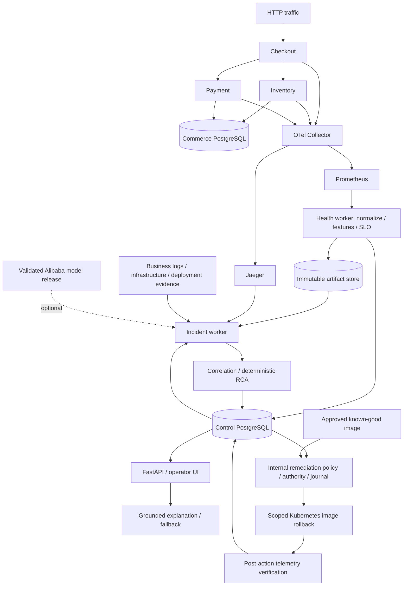

# SentinelOps — Tổng quan repository, kiến trúc và vận hành

> Bản khảo sát ngày 18/11/2026, dựa trên source tại checkout `0884445` và tài liệu trong repository. Các đường dẫn tương đối bên dưới được tính từ file này về thư mục gốc repo. Đây là kết quả đọc code/cấu hình; không phải báo cáo kiểm thử hoặc xác nhận các process, database hay tài nguyên AWS hiện đang hoạt động.

## 1. Repository làm gì?

**SentinelOps là nền tảng AIOps dựa trên bằng chứng cho một hệ thống microservice nhỏ.** Hệ thống được quan sát gồm Checkout, Payment, Inventory và PostgreSQL. SentinelOps thu metrics/logs/traces, kiểm tra chất lượng dữ liệu, đánh giá SLO, bổ sung tín hiệu từ model, gom các biểu hiện thành incident, xếp hạng nguyên nhân nghi vấn và cung cấp giao diện điều tra. Nhánh remediation giới hạn ở rollback Payment về image tốt đã được duyệt, kèm journal, kiểm soát quyền và xác minh hồi phục bằng telemetry.

Repo chứa cả **ứng dụng được giám sát** trong `services/` lẫn **control plane giám sát** trong `src/sentinelops/`. Ba service thương mại là testbed có hoạt động HTTP/SQL thật, nhằm tạo dependency, lỗi lan truyền và dữ liệu có thể đối chiếu. Chúng không phải một hệ thống thương mại điện tử hoàn chỉnh: Checkout kiểm tra tồn kho và gọi charge, nhưng không có đầy đủ transaction phân tán, giữ hàng, trừ kho hay luồng hoàn tiền.

Các chức năng chính:

| Chức năng | Đầu ra/giá trị sử dụng | Nguồn tiêu biểu |
| --- | --- | --- |
| Quan sát hệ thống | RED metrics, structured logs, distributed traces và dữ liệu hạ tầng | [services/common/runtime.py](../../services/common/runtime.py), [observability/otel-collector-config.yaml](../../observability/otel-collector-config.yaml) |
| Chuẩn hóa telemetry | Observation/Feature envelopes có quality, clock, provenance và checksum | [telemetry/core.py](../../src/sentinelops/telemetry/core.py), [telemetry/pipeline.py](../../src/sentinelops/telemetry/pipeline.py) |
| Phát hiện vi phạm SLO | Health signal theo service, episode và recovery có persistence | [incidents/health.py](../../src/sentinelops/incidents/health.py), [slo_health_policy.json](../../configs/slo_health_policy.json) |
| Phân tích bằng ML | Isolation Forest phát hiện bất thường latency; XGBoost dự báo latency vượt ngưỡng | [ml/alibaba_training.py](../../src/sentinelops/ml/alibaba_training.py), [ml/registry.py](../../src/sentinelops/ml/registry.py) |
| Quản lý incident | IER bất biến theo revision, timeline, context, audit và outbox | [incidents/repository.py](../../src/sentinelops/incidents/repository.py) |
| Correlation/RCA | Gom episode theo thời gian/topology; ranking có evidence và lý do abstain | [incidents/correlation.py](../../src/sentinelops/incidents/correlation.py), [incidents/rca.py](../../src/sentinelops/incidents/rca.py) |
| Giải thích | Tóm tắt đúng revision, claim dẫn evidence; deterministic fallback và adapter Bedrock | [explanations/service.py](../../src/sentinelops/explanations/service.py) |
| Điều tra qua API/UI | Danh sách incident, bộ lọc, lịch sử, evidence, explanation, action observations | [api.py](../../src/sentinelops/api.py), [ui/assets/workspace.js](../../src/sentinelops/ui/assets/workspace.js) |
| Remediation có giới hạn | Rollback Payment được kiểm soát, journal bền vững, verify và quarantine | [remediation/executor.py](../../src/sentinelops/remediation/executor.py) |
| Thí nghiệm và đánh giá | Capture/replay, dataset manifests, source parity, detector/RCA evaluation | [experiments/runner.py](../../src/sentinelops/experiments/runner.py), [scripts/](../../scripts/) |

Nguồn định hướng: [README.md](../../README.md), [PRODUCT_SPEC.md](../../docs/architecture/PRODUCT_SPEC.md), [TECHNICAL_SPEC.md](../../docs/architecture/TECHNICAL_SPEC.md). Khi tài liệu thiết kế mô tả cây module đích khác source, nên theo các file thực có ở checkout; ví dụ API hiện nằm trong `api.py`, còn feature builder chủ yếu ở `telemetry/`, không có yêu cầu phải tìm một package `features/` riêng.

## 2. Kiến trúc tổng thể

### 2.1. Hai mặt phẳng và các process



Control plane được tổ chức thành một Python package dùng chung domain code. API, health worker, incident worker và reconciliation worker là các process riêng; không phải cứ bật Uvicorn là các worker tự chạy. Cách này giữ cùng thuật toán cho live, batch và replay, đồng thời tách lifecycle, quyền và retry của từng process. [ADR-006](../../docs/adr/ADR-006-control-plane-and-storage.md) giải thích ranh giới control plane và storage.

Trong local Compose, business services, commerce DB và observability chạy container; control DB được thêm bằng Compose riêng. Launcher Lane B chạy API/health/incident workers trên host, dùng cổng loopback và kiểm tra ownership. Image control plane và renderer Kubernetes phục vụ cách triển khai container hóa khác; không nên trộn giả định mạng của hai cách chạy.

### 2.2. Ba loại persistence

| Loại dữ liệu | Local/implementation | Vai trò và ranh giới |
| --- | --- | --- |
| Commerce data | PostgreSQL: `inventory`, `payments` | Phục vụ truy vấn tồn kho và ghi charge; tách khỏi dữ liệu incident |
| Control data | PostgreSQL schema `sentinel_control`; action schema tùy chọn `sentinel_remediation` | IER revisions, audit/outbox, health batches/checkpoints, consumer journals và action state |
| Raw/artifact/model | `ArtifactStore` trên filesystem, object theo nội dung và SHA-256 | Giữ raw query, normalization, feature, evidence, manifests, model/release references để kiểm tra và replay |
| Dữ liệu quan sát phục vụ tra cứu | Prometheus, Jaeger; cấu hình Grafana | Time series, trace và dashboard; không thay transactional control store |

`ArtifactStore` tạo object không ghi đè và kiểm checksum khi đọc. DB ledger xác định batch nào đã được chấp nhận; file raw tồn tại riêng lẻ chưa chứng minh quyết định đã commit. Hash kiểm tra tính toàn vẹn nội dung, không tự xác thực một người ghi không đáng tin. Xem [telemetry/store.py](../../src/sentinelops/telemetry/store.py), [INCIDENT_STORE.md](../../docs/runbooks/INCIDENT_STORE.md).

Thiết kế AWS dùng S3 cho artifacts và RDS cho control DB. Code local filesystem và IaC S3 không có nghĩa toàn bộ đường S3 serving/storage đã được đo hoặc triển khai đầy đủ.

### 2.3. Những ranh giới cần giữ đúng khi đọc kết quả

- **Source đủ dữ liệu, service khỏe, model sẵn sàng và API còn sống là bốn trạng thái khác nhau.** Một bucket đủ dữ liệu vẫn có thể đang vi phạm SLO.
- **UNKNOWN không phải healthy.** Thiếu traffic, nguồn lỗi, dữ liệu stale/future hoặc coverage thấp không được điền thành số 0 để đóng incident.
- **RCA là giả thuyết có bằng chứng.** Điểm cao/ranking đầu tiên chưa tự chứng minh quan hệ nhân quả hay cấp quyền rollback.
- **Explanation chỉ diễn giải.** Provider không đổi ranking, không tạo evidence và không điều khiển hạ tầng.
- **Train, build bundle, build release và activate là các bước khác nhau.** File model hợp lệ chưa đủ điều kiện serving.
- **Action journal và IER lifecycle là hai hồ sơ riêng.** Action `recovered` hoặc gỡ quarantine không mặc nhiên sửa incident.

Các ranh giới này được thể hiện trong [contracts.py](../../src/sentinelops/contracts.py), [incidents/domain.py](../../src/sentinelops/incidents/domain.py), [remediation/worker.py](../../src/sentinelops/remediation/worker.py) và [CONSTRAINTS_AND_GATES.md](../../docs/architecture/CONSTRAINTS_AND_GATES.md).

## 3. `services/`: hệ thống được giám sát

### 3.1. Checkout

[services/checkout/app.py](../../services/checkout/app.py) cung cấp `POST /v1/checkout`, nhận SKU, số lượng, amount và currency. Luồng xử lý:

1. Tạo `checkout_id`.
2. Gọi `GET /v1/inventory/{sku}` và kiểm lượng tồn đủ.
3. Gọi `POST /v1/payments/charge` với order ID vừa tạo.
4. Trả checkout/payment IDs, trạng thái completed và correlation ID.

Checkout truyền `x-correlation-id` cùng trace headers qua hai lời gọi downstream. Thiếu SKU trả 404, tồn kho không đủ hoặc dependency từ chối request được phản ánh bằng 409; lỗi server downstream thành 502, timeout thành 504. `/ready` gọi readiness của Payment và Inventory; `/health` chỉ báo process sống. Timeout downstream mặc định 4 giây, cấu hình bằng `DOWNSTREAM_TIMEOUT_SECONDS`.

### 3.2. Payment

[services/payment/app.py](../../services/payment/app.py) mở pool `asyncpg` khi startup và cung cấp `POST /v1/payments/charge`. Service áp dụng fault đang chọn, tạo payment ID, ghi vào bảng `payments`, chuẩn hóa currency thành chữ hoa rồi trả trạng thái `approved`. Đây là charge giả lập lưu SQL, không tích hợp cổng thanh toán ngoài. `/ready` kiểm `SELECT 1`; `/health` không truy vấn DB.

`GET/POST /internal/faults` cho phép đọc/đổi fault sandbox. Repo còn có image Payment regression được theo dõi bằng [docker/Dockerfile.payment-regression](../../docker/Dockerfile.payment-regression), [scripts/payment_regression.py](../../scripts/payment_regression.py) và checker riêng; dùng để tạo thay đổi image thực cho kịch bản rollback, khác việc chỉ đổi fault trong bộ nhớ.

### 3.3. Inventory

[services/inventory/app.py](../../services/inventory/app.py) cung cấp `GET /v1/inventory/{sku}`, đọc SKU/name/quantity từ PostgreSQL và trả 404 khi không tồn tại. Service không trừ kho trong luồng checkout hiện tại. Cơ chế pool, DB readiness và fault endpoints tương tự Payment.

[infra/local/init.sql](../../infra/local/init.sql) tạo hai bảng và seed `sku-001`, `sku-002`, `sku-003`; vì vậy có thể dùng `sku-001` cho request thử local.

### 3.4. Thành phần dùng chung

| File | Trách nhiệm |
| --- | --- |
| [common/runtime.py](../../services/common/runtime.py) | Middleware request context; correlation ID, request-instance ID, server span; logs bắt đầu/kết thúc request; counter request/error và histogram duration; trả trace ID qua header |
| [common/observability.py](../../services/common/observability.py) | Cấu hình OTel, exporter, histogram views, trace context, client/DB spans và Kubernetes identity |
| [common/log_export.py](../../services/common/log_export.py) | Export business event logs qua OTLP theo lựa chọn cấu hình, có giới hạn queue/timeout; giữ JSON stdout |
| [common/faults.py](../../services/common/faults.py) | Fault state và guard sandbox; chỉ cho fault injection khi bật cờ và environment thuộc local/test |

Metric aggregation cho SLO/model chỉ chọn business-route catalog trong [telemetry/core.py](../../src/sentinelops/telemetry/core.py); các request `/health`, `/ready`, `/internal/faults` không được đưa vào mẫu số business SLO. Metric labels dùng route template, còn request/correlation/trace IDs phục vụ logs/traces.

## 4. `src/sentinelops/`: các module chính

### 4.1. API, cấu hình, auth và UI

- [main.py](../../src/sentinelops/main.py): ASGI entry point, tạo `app` qua `create_app()`.
- [api.py](../../src/sentinelops/api.py): app factory, dependency wiring, lifespan DB pools, auth, API incident/model/explanation/action observations và readiness.
- [api_settings.py](../../src/sentinelops/api_settings.py): đọc environment, kiểm cấu hình token/OIDC/model; cặp model store/release phải có cùng nhau.
- [api_http.py](../../src/sentinelops/api_http.py): giới hạn body 1 MB, request ID, `Cache-Control: no-store`, chuẩn hóa lỗi và tránh lộ credentials từ dependency exceptions.
- [oidc.py](../../src/sentinelops/oidc.py): adapter kiểm token OIDC/JWKS và scope. Static bearer chỉ dành cho local/test; non-local thiếu identity adapter bị từ chối.
- [ui/routes.py](../../src/sentinelops/ui/routes.py), [ui/assets/index.html](../../src/sentinelops/ui/assets/index.html), [client.js](../../src/sentinelops/ui/assets/client.js), [workspace.js](../../src/sentinelops/ui/assets/workspace.js): UI JavaScript cùng origin `/ui/`, không yêu cầu frontend build server riêng. UI hiển thị list/filter/pagination, detail ghim revision, evidence, timeline, explanation và action observations.

UI giữ token trong bộ nhớ tab, không đưa lên URL hoặc browser storage. Operator token chỉ đọc; producer token có quyền import/revise IER. Token đọc không tạo model/action authority. UI cần giữ rõ lỗi 401/403, provider/network outage, UNKNOWN và model-unavailable, thay vì trình bày chúng như hệ thống khỏe. Xem [INCIDENT_API.md](../../docs/runbooks/INCIDENT_API.md).

Các endpoint quan trọng trong [api.py](../../src/sentinelops/api.py):

| Endpoint | Ý nghĩa |
| --- | --- |
| `GET /health` | Liveness API, không chứng minh DB/model/auth hoạt động |
| `GET /ready` | Readiness tổng hợp incident store, authentication configuration và model; thiếu model có thể trả 503 dù UI vẫn dùng được |
| `GET /ready/incidents` | Protected readiness của incident store |
| `GET /ready/actions` | Protected readiness của action reader, response thể hiện `dispatch_enabled=false` |
| `GET /v1/incidents` | Danh sách có filter và cursor; limit mặc định 50, tối đa 100 |
| `GET /v1/incidents/{id}?revision=N` | Đọc current hoặc revision cụ thể, trả ETag và incident-revision header |
| `GET /v1/incidents/{id}/context` | Context và lịch sử/timeline theo các tham số revision/pagination |
| `POST /v1/incidents` | Trusted producer tạo IER, cần `If-Match` và `Idempotency-Key` |
| `POST /v1/incidents/{id}/revisions` | Trusted producer tạo revision kế tiếp, kiểm concurrency/lifecycle |
| `GET /v1/incidents/{id}/explanation?revision=N` | Explanation chỉ đọc, gắn chính xác revision |
| `GET /v1/incidents/{id}/actions`, `GET /v1/actions/{id}` | Quan sát action journal; không dispatch |
| `GET /v1/actions/{id}/quarantine` | Đọc receipt/trạng thái quarantine riêng của action |
| `POST /v1/detect`, `POST /v1/risk` | Wire endpoints cho feature-window inference; model không có trả 503; release Alibaba cần stream history trả 409 `model_requires_stream_history` |
| `POST /v1/incidents/demo` | Fixture/demo có cờ riêng, mặc định tắt; không phải incident từ nguồn thật |

Đối với model Alibaba hiện hành, đọc kết quả inference trong `service_signals` của IER do incident worker tạo. Một `FeatureWindow` gửi trực tiếp không có baseline/history đủ để tái tạo relative model inputs.

### 4.2. `telemetry/`: adapter, chuẩn hóa và provenance

| Module | Vai trò |
| --- | --- |
| [core.py](../../src/sentinelops/telemetry/core.py) | Business service/route registry, UTC clocks, stable IDs, histogram quantile, normalization và feature transform dùng chung |
| [prometheus.py](../../src/sentinelops/telemetry/prometheus.py) | Query catalog và source profiles; lấy counter/histogram, kiểm scrape/config identity, decode raw capture |
| [scheduling.py](../../src/sentinelops/telemetry/scheduling.py) | Lịch bucket đóng, watermark và chờ thời điểm source đủ dữ liệu |
| [pipeline.py](../../src/sentinelops/telemetry/pipeline.py) | Raw capture → observation → feature; replay và quarantine dữ liệu sai |
| [store.py](../../src/sentinelops/telemetry/store.py) | Content-addressed artifact store và đọc/ghi có integrity checks |
| [infrastructure.py](../../src/sentinelops/telemetry/infrastructure.py) | Đo PostgreSQL connections/capacity theo scope read-only, xuất observation hạ tầng riêng |
| [deployment_changes.py](../../src/sentinelops/telemetry/deployment_changes.py) | Kiểm/diễn giải các observation thay đổi deployment có giới hạn |
| [cloudwatch.py](../../src/sentinelops/telemetry/cloudwatch.py) | Adapter HTTP RED từ log rollup và metric đối chiếu theo catalog/client được cấp rõ ràng |
| [xray.py](../../src/sentinelops/telemetry/xray.py) | Adapter trace X-Ray, hỗ trợ capture/replay theo nguồn đã cấu hình |

Quy tắc thời gian chính: bucket UTC 60 giây, khoảng nửa mở `[start,end)`; cửa sổ feature 300 giây, bước 60 giây. Profile Prometheus hiện dùng scrape 5 giây và watermark 30 giây. Feature/SLO eligibility kiểm traffic tối thiểu 30 requests và coverage tối thiểu 80%; feature HTTP RED cần ít nhất 4/5 bucket hợp lệ. `available_at`, `ingested_at`, decision/inference clocks được giữ riêng để không dùng dữ liệu tương lai.

P95 được suy ra từ distribution đã aggregate đúng, không lấy trung bình p95 của các pod. Error rate là tổng 5xx chia tổng requests. Feature `p95_latency_ms_mean_5m` là trung bình các p95 theo phút, không phải p95 toàn cửa sổ. Counts từ Prometheus `increase` có thể là số ước lượng phân số. RDS là candidate hạ tầng, không được tạo HTTP latency hoặc IF score giả để ép qua contract. Xem [TELEMETRY.md](../../docs/runbooks/TELEMETRY.md).

Hai feature set cần phân biệt: HTTP RED `http-red-5m/v1` vẫn phục vụ pipeline/các envelopes; model Alibaba dùng projection `http-relative-5m/v2` từ raw mean latency/count và history của profile nguồn v2.

### 4.3. `incidents/`: health, grouping, RCA, persistence

**SLO health.** [health.py](../../src/sentinelops/incidents/health.py) dùng [slo_health_policy.json](../../configs/slo_health_policy.json): p95 **lớn hơn 750 ms** hoặc tỷ lệ 5xx **lớn hơn 5%**; hai bucket eligible vi phạm liên tiếp để mở episode, ba bucket eligible sạch liên tiếp để xác nhận recovery. Maximum lag là 60 giây. UNKNOWN reset streak thích hợp nhưng không tự xóa incident đã xác nhận. Health signal SLO độc lập với việc có IF/XGBoost hay không.

**Correlation.** [correlation.py](../../src/sentinelops/incidents/correlation.py) dùng topology và onset interval để gom episode bảo thủ. [topology.yaml](../../configs/topology.yaml) định nghĩa Checkout phụ thuộc Payment/Inventory, hai service này phụ thuộc `rds`. Khi hai sibling root độc lập cùng xảy ra, Checkout có thể là shared consumer mơ hồ; không ép mọi biểu hiện vào một root duy nhất.

**RCA.** [rca.py](../../src/sentinelops/incidents/rca.py), [native_rca.py](../../src/sentinelops/incidents/native_rca.py), [rca_source.py](../../src/sentinelops/incidents/rca_source.py) và [rca_producer.py](../../src/sentinelops/incidents/rca_producer.py) thu/kiểm evidence rồi chấm điểm deterministic. Policy hiện hành trong [rca_policy.json](../../configs/rca_policy.json):

| Thành phần | Trọng số |
| --- | ---: |
| `anomaly_strength` | 0,25 |
| `temporal_precedence` | 0,20 |
| `dependency_trace_relevance` | 0,25 |
| `log_support` | 0,15 |
| `recent_change_support` | 0,15 |

Ngưỡng là score 0,75, margin 0,15 và coverage 0,75; onset uncertainty 60 giây, evidence window 300 giây. Thiếu modality được giữ là missing, không phân bổ lại trọng số để làm score cao giả. Score/ranking được sắp deterministic; evidence refs phải tồn tại và đúng candidate/modality. Không đủ score, margin, coverage, nguồn chưa xác minh hoặc grouping mơ hồ dẫn tới abstention. Trace support cần timing/parentage có kiểm tra, qua [trace_query.py](../../src/sentinelops/trace_query.py) và [trace_evidence.py](../../src/sentinelops/trace_evidence.py).

**Incident Evidence Record (IER).** Payload giữ `incident_id`, `detected_at`, state, severity, affected services, service signals, ranking và evidence. [domain.py](../../src/sentinelops/incidents/domain.py) kiểm transition và command; [repository.py](../../src/sentinelops/incidents/repository.py) quản lý revision bất biến, CAS, idempotency, audit và outbox; [validation.py](../../src/sentinelops/incidents/validation.py) kiểm wrapper semantics.

Payload state (`degrading`, `incident`, `recovering`, `recovered`, `escalated`) khác lifecycle stage của workflow (`OPEN`, `RCA_READY`, `EXPLAINED`, `MITIGATION_PLANNED`, `MITIGATING`, `VERIFYING`, `RECOVERED`, `ROLLED_BACK`, `ESCALATED`, `CLOSED`). Code không cho nhảy tùy ý giữa stage, không sửa detection timestamp gốc và không dùng UNKNOWN để project recovered. Đọc explanation không tự chuyển sang EXPLAINED.

Các file `health_replay.py`, `correlation_replay.py`, `rca_replay.py` và `local_evaluation.py` hỗ trợ tái tạo/đánh giá offline. Replay giữ clock/provenance của bản ghi; nó không tạo bằng chứng rằng một alert lịch sử thực sự được phát đúng giờ.

### 4.4. `workers/`: xử lý liên tục và phục hồi

**Health worker** trong [workers/health.py](../../src/sentinelops/workers/health.py) và [health_source.py](../../src/sentinelops/workers/health_source.py) poll nguồn, tạo một quyết định cho cả ba business services trong mỗi bucket. Ba signals, batch và checkpoint commit trong cùng transaction. Advisory lock serialize producer trên một stream; outage được retry, integrity/config/schema/privilege lỗi thì dừng an toàn. Stream identity gắn với source/profile/policy, cấu hình và artifact root.

**Incident worker** trong [workers/incident.py](../../src/sentinelops/workers/incident.py), [incident_state.py](../../src/sentinelops/workers/incident_state.py), [incident_journal.py](../../src/sentinelops/workers/incident_journal.py) đọc các accepted health batches đúng thứ tự, kiểm raw lineage, giữ pending groups, thu evidence và publish IER revisions qua command/receipt journal. Consumer identity gắn với một health stream và cấu hình; đổi model/source/root không phải thao tác restart vô hại.

Membership của temporal cluster chờ accepted input watermark qua `first_onset + 120s + k*60s`, trong đó `k` là entry persistence. Không dùng wall-clock im lặng để chốt nhóm. Dedicated nonpooled connection giữ session lock và mọi mutation trong iteration; source I/O không nằm trong SQL transaction. Crash sau IER commit nhưng trước receipt retry bằng cùng idempotency identity. Xem [ADR-012](../../docs/adr/ADR-012-continuous-incident-consumer.md).

Các module bổ trợ:

| Module | Nội dung |
| --- | --- |
| [incident_evidence.py](../../src/sentinelops/workers/incident_evidence.py), [incident_rca.py](../../src/sentinelops/workers/incident_rca.py) | Bounded operational evidence capture, replay/verify và projection RCA |
| [model_signals.py](../../src/sentinelops/workers/model_signals.py) | Gắn inference vào đúng accepted source window/model release; kiểm inference start/completion và missingness |
| [deployment_evidence.py](../../src/sentinelops/workers/deployment_evidence.py), [kubernetes_evidence.py](../../src/sentinelops/workers/kubernetes_evidence.py) | Evidence deployment/Kubernetes có identity và thời gian |
| [incident_replay.py](../../src/sentinelops/workers/incident_replay.py) | Tái tạo accepted journals và evidence ngoài live process |
| [metrics.py](../../src/sentinelops/workers/metrics.py) | OTel worker telemetry: readiness, heartbeat, backlog, source eligibility, progress, errors và processing duration |
| [source_policy.py](../../src/sentinelops/workers/source_policy.py) | Chọn `local`, `remote`, `in-cluster` rõ ràng; remote yêu cầu endpoint đã pin, TLS/credential files; in-cluster Prometheus giới hạn Service DNS |
| `legacy_incident_projection.py`, `legacy_incident_replay.py` | Giữ khả năng đọc/replay evidence format cũ; không phải nguồn thẩm quyền thay đường native hiện hành |

Health worker không tự tạo IER; incident worker mới làm correlation/evidence/publication. Hai worker mặc định không tự bật remediation. Dashboard worker telemetry cũng không phải dashboard chứng nhận business SLO/model quality.

### 4.5. `ml/` và `public_data/`: model lifecycle

Đường serving hiện hành dùng **một bundle chung cho ba service**, train trên Alibaba production trace `cluster-trace-microservices-v2022`, theo [ADR-016](../../docs/adr/ADR-016-public-production-training-source.md) và [ADR-019](../../docs/adr/ADR-019-breach-relative-retrain.md). Bundle được tài liệu hiện hành chọn là `de38fc6b`; G3 được duyệt có điều kiện cho phạm vi tích hợp, không đồng nghĩa toàn bộ quality gates đã đạt.

[alibaba_relative_features.json](../../configs/alibaba_relative_features.json) đóng băng feature set `http-relative-5m/v2` với cửa sổ 5 phút, bước 60 giây và baseline median 5–60 phút trước cửa sổ. Sáu features gồm latency level/slope/peak, request-rate level/slope tương đối và log ratio baseline-to-breach. IF chỉ dùng latency level/peak; XGBoost dùng ba đầu vào latency tương đối với mức breach, có monotone constraints tăng và horizon 300 giây. Serving breach latency là 750 ms; ngưỡng watch/degrading lấy từ calibration, không mặc định 0,8.

| Module | Trách nhiệm |
| --- | --- |
| [alibaba_training.py](../../src/sentinelops/ml/alibaba_training.py) | Transform tham chiếu/vector hóa, fitting, split/calibration và đánh giá theo config đóng băng |
| [fault_shapes.py](../../src/sentinelops/ml/fault_shapes.py) | Synthetic fault-shape gate trước khi candidate thành bundle |
| [alibaba_bundle.py](../../src/sentinelops/ml/alibaba_bundle.py), [models.py](../../src/sentinelops/ml/models.py) | Đóng gói/nạp estimator, manifest, version và checksum |
| [alibaba_live.py](../../src/sentinelops/ml/alibaba_live.py) | Dựng relative window từ bounded immutable accepted health history của source v2 |
| [registry.py](../../src/sentinelops/ml/registry.py), [alibaba_release.py](../../src/sentinelops/ml/alibaba_release.py), [release.py](../../src/sentinelops/ml/release.py) | Kiểm release ledger, approval/parity refs, compatibility và routing bundle dùng chung |
| [alibaba_local_evaluation.py](../../src/sentinelops/ml/alibaba_local_evaluation.py), [detector_evaluation.py](../../src/sentinelops/ml/detector_evaluation.py), [evaluation.py](../../src/sentinelops/ml/evaluation.py) | Đánh giá local, detector events, risk và controls; tách development khỏi acceptance |
| [readiness.py](../../src/sentinelops/ml/readiness.py), `local_data.py`, `local_evaluation.py` | Hỗ trợ readiness/dataset/evaluation và các đường lịch sử; không tự cho phép fitting local hiện hành |
| [public_data/alibaba.py](../../src/sentinelops/public_data/alibaba.py), [downloads.py](../../src/sentinelops/public_data/downloads.py), [audit.py](../../src/sentinelops/public_data/audit.py) | Đọc/thu/audit public data và provenance |
| [rcaeval_native.py](../../src/sentinelops/public_data/rcaeval_native.py), [rcaeval_evaluation.py](../../src/sentinelops/public_data/rcaeval_evaluation.py), [rcaeval_partitions.py](../../src/sentinelops/public_data/rcaeval_partitions.py) | Native RCAEval decoding, phân partition và đánh giá RCA, giữ holdout |

Split Alibaba theo microservice identity 60/20/20, không chia ngẫu nhiên các window chồng lấn rồi gọi là độc lập. Local HTTP chỉ phục vụ evaluation; RCAEval chỉ phục vụ RCA evaluation. Alibaba thiếu trường 5xx, nên error detection thuộc SLO rule. MAD và slope là controls đánh giá, không chạy thay model trong serving. Bundle feature v1 `badf9da0` không tương thích đường serving hiện hành.

Repo còn giữ `training_data_contract*.json`, `public_data/policy.py` và reports cũ mô tả GAMMA/local fitting. Đây là phần cần đọc cùng lịch sử ADR; không lấy tên hàm/docstring hoặc file cấu hình lịch sử để phủ định quyết định nguồn train mới. [MODEL_PIPELINE.md](../../docs/runbooks/MODEL_PIPELINE.md) và ADR-019 là đường hướng dẫn hiện hành. ADR-019 cũng bỏ yêu cầu bắt buộc dùng SageMaker cho G7; fit có thể chạy trên operator host.

### 4.6. `explanations/`: giải thích có căn cứ

[explanations/service.py](../../src/sentinelops/explanations/service.py) nhận `IncidentEnvelope` đã ghim revision, validate lại, tạo snapshot và trả payload explanation cùng `provider`, `fallback`. Renderer deterministic trích nguyên văn facts bằng evidence IDs; summary thể hiện trạng thái, mức độ, availability và uncertainty.

Provider tùy chọn chỉ được chọn card IDs từ tập metadata bị giới hạn; không được gửi prose tùy ý, đổi số liệu, rerank RCA hoặc sinh action. Output được validate incident ID/revision/prompt/card IDs rồi render tại local. Mặc định deadline 10 giây, concurrency 4, không retry; circuit breaker và fallback xử lý timeout/selection sai/provider outage.

[bedrock.py](../../src/sentinelops/explanations/bedrock.py) là adapter Converse, cần async client do deployment truyền vào, region/model rõ ràng và quyền invoke tương ứng. Factory không tự tạo AWS SDK client hay gọi cloud. Thiếu provider vẫn có explanation thật từ deterministic renderer; không nên ghi nhãn fallback này là LLM. Xem [EXPLANATIONS.md](../../docs/runbooks/EXPLANATIONS.md).

### 4.7. `remediation/`: rollback Payment có kiểm soát

Runbook giới hạn là `payment-rollback-known-good/v1`, theo [ADR-009](../../docs/adr/ADR-009-payment-rollback-runbook.md). API không có public dispatch endpoint. Request nội bộ chỉ chọn incident ID/revision/idempotency key; client không tự chọn target/image/approval/provider. Policy và kill switch mặc định tắt.

| Module | Vai trò |
| --- | --- |
| [domain.py](../../src/sentinelops/remediation/domain.py), [authority.py](../../src/sentinelops/remediation/authority.py) | Target/policy/deployment types, qualification và authority boundary |
| [approval.py](../../src/sentinelops/remediation/approval.py), [registry.py](../../src/sentinelops/remediation/registry.py) | Operator approval và known-good ledger; replay health, kiểm image/target/generation/approval clock |
| [image_review.py](../../src/sentinelops/remediation/image_review.py) | Thu bằng chứng image trước/sau và health cho operator; receipt chưa duyệt không biến thành approval |
| [kubernetes.py](../../src/sentinelops/remediation/kubernetes.py) | TLS transport, read-only observations và image-only JSON Patch với identity/concurrency tests, server dry run |
| [journal.py](../../src/sentinelops/remediation/journal.py) | Durable intent, target claim, event hash chain, CAS, dispatch budget, cooldown/quarantine |
| [executor.py](../../src/sentinelops/remediation/executor.py) | Điều phối preflight, guards, arming, mutate, reconciliation và verification |
| [verification.py](../../src/sentinelops/remediation/verification.py) | Kiểm ba bucket eligible healthy sau thời điểm action thực sự có hiệu lực |
| [worker.py](../../src/sentinelops/remediation/worker.py) | Resume-only reconciliation; prepared intent bị chặn thay vì tự dispatch lại |
| [reader.py](../../src/sentinelops/remediation/reader.py), [quarantine.py](../../src/sentinelops/remediation/quarantine.py) | SELECT-only action observations và operator quarantine review/release |

Các guard quan trọng gồm exact target/cluster/namespace/deployment UIDs, immutable same-repository image digest, known-good duyệt trước incident/change, dữ liệu đủ mới, replica/blast-radius giới hạn, không HPA/paused deployment và kiểm resourceVersion/generation. Sau arming, một crash/lost response được xử lý bảo thủ: observe/reconcile, không tự gửi thêm patch để cố đạt exactly-once HTTP.

Recovery cần deployment/pod/image đúng cùng ba bucket SLO sạch hoàn toàn sau action. Failed/inconclusive verify dẫn tới escalated/quarantine. Operator gỡ target lock bằng receipt riêng không biến action hoặc incident thành recovered, không reset cooldown/budget và không cấp dispatch authority. Native local trials đã được ghi trong reports, nhưng đó là các trial được ủy quyền cụ thể; không phải auto-remediation được bật mặc định. Xem [CONTROLLED_REMEDIATION.md](../../docs/runbooks/CONTROLLED_REMEDIATION.md).

### 4.8. `experiments/`: capture, truth, labels và evaluation

[runner.py](../../src/sentinelops/experiments/runner.py) điều phối traffic/fault/capture có giới hạn; truth, scenario, root-cause labels và intervention schedule được giữ ngoài serving inputs để tránh rò rỉ nhãn. Các scenario chính là S0 healthy, S1 lỗi đột ngột, S3 latency tăng dần, S4 lỗi phụ thuộc PostgreSQL có kiểm soát, S5 nhiều lỗi độc lập. S2 regression deployment dùng adapter riêng, tiêu biểu [scripts/run_s2_h4.py](../../scripts/run_s2_h4.py).

`traffic.py`, `verification.py`, `labels.py`, `datasets.py` xử lý request observations, đối chiếu coverage, SLO/precursor labels và dataset manifests. `local_corpus.py`, `local_campaign.py`, `local_labels.py` quản lý epoch/session local; `client_clock.py`, `clock_recovery.py`, `local_recovery.py`, `owner_exclusion.py` giữ quyết định clock-invalid/interrupted/excluded có provenance. `s4_postgres.py` và `multifault.py` phục vụ evidence S4/S5.

Một số harness yêu cầu clean committed checkout, exclusive output và protocol frozen; điều đó phục vụ tính tái lập, không có nghĩa người đọc overview phải tạo commit. Không chạy capture campaign trên cùng host đang có measurement khác nếu thiếu cô lập tài nguyên. Xem [EXPERIMENTS.md](../../docs/runbooks/EXPERIMENTS.md), [LOCAL_HTTP_CORPUS.md](../../docs/runbooks/LOCAL_HTTP_CORPUS.md).

## 5. `contracts/`: wire truth và các nhóm schema

Checkout này có **34 JSON Schema files** trong [contracts/](../../contracts/). Đây là nguồn authoritative cho wire format. Nhiều payload cốt lõi có shape nghiêm ngặt; metadata mới đi qua envelope/wrapper thay vì tùy tiện thêm field. [contracts.py](../../src/sentinelops/contracts.py) dùng Draft 2020-12 validator và semantic validation; [schema_registry.py](../../src/sentinelops/schema_registry.py) resolve contract refs cục bộ, không fetch schema qua mạng.

| Nhóm | Schema files và ý nghĩa |
| --- | --- |
| Telemetry | [telemetry](../../contracts/telemetry.schema.json): điểm business HTTP; [observation-envelope](../../contracts/observation-envelope.schema.json): clocks/quality/provenance; [infrastructure-observation](../../contracts/infrastructure-observation.schema.json): nguồn hạ tầng riêng |
| Feature/model output | [feature-window](../../contracts/feature-window.schema.json), [feature-envelope](../../contracts/feature-envelope.schema.json), [detection-result](../../contracts/detection-result.schema.json), [degradation-risk](../../contracts/degradation-risk.schema.json) |
| Thí nghiệm/dữ liệu | [experiment-run](../../contracts/experiment-run.schema.json), [dataset-manifest](../../contracts/dataset-manifest.schema.json), [training-data-policy](../../contracts/training-data-policy.schema.json), [training-data-policy-v2](../../contracts/training-data-policy-v2.schema.json); cần đọc policy lịch sử cùng ADR mới |
| Health/correlation/RCA | [health-signal](../../contracts/health-signal.schema.json), [correlation-result](../../contracts/correlation-result.schema.json), [rca-policy](../../contracts/rca-policy.schema.json), [rca-result](../../contracts/rca-result.schema.json) |
| Incident API | [incident-evidence-record](../../contracts/incident-evidence-record.schema.json): payload; [incident-envelope](../../contracts/incident-envelope.schema.json): revision/context/timeline; [incident-write](../../contracts/incident-write.schema.json), [incident-list](../../contracts/incident-list.schema.json), [api-error](../../contracts/api-error.schema.json) |
| Explanation | [explanation](../../contracts/explanation.schema.json): summary/claims/evidence refs; [explanation-response](../../contracts/explanation-response.schema.json): revision/provider/fallback wrapper |
| Action observations | [remediation-action](../../contracts/remediation-action.schema.json), [action-observation](../../contracts/action-observation.schema.json), [action-list](../../contracts/action-list.schema.json); một field `approved` trong payload không tự tạo quyền execution |
| Image/deployment review | [payment-image-review](../../contracts/payment-image-review.schema.json), [payment-image-evidence](../../contracts/payment-image-evidence.schema.json), [payment-known-good](../../contracts/payment-known-good.schema.json), [payment-deployment-baseline](../../contracts/payment-deployment-baseline.schema.json), [payment-deployment-change](../../contracts/payment-deployment-change.schema.json) |
| Quarantine | [quarantine-review](../../contracts/quarantine-review.schema.json), [quarantine-release](../../contracts/quarantine-release.schema.json), [quarantine-status](../../contracts/quarantine-status.schema.json) |
| Deployment lock local | [lane-b-deployment-lock](../../contracts/lane-b-deployment-lock.schema.json): image/config lock, không cấp model activation/remediation approval |

Semantic validation còn kiểm UTC/time ordering, finite values, bucket alignment, evidence IDs/ref integrity, ranking descending/unique, lifecycle/state consistency và wrapper identity. [samples/](../../samples/) chứa ví dụ dùng cho validation, không phải dữ liệu production. [setup.py](../../setup.py) bundle chính các root schemas vào wheel và kèm UI assets, tránh duy trì bản schema sao chép thủ công.

## 6. `infra/`, Docker và observability

### 6.1. SQL/bootstrap và quyền DB

| File/thư mục | Nội dung |
| --- | --- |
| [infra/local/init.sql](../../infra/local/init.sql) | Local commerce tables và seed inventory |
| [infra/commerce/001-deployment.sql](../../infra/commerce/001-deployment.sql) | Bootstrap PostgreSQL 16 DB mới `sentinelops_commerce`, `commerce_owner`/`commerce_runtime` NOLOGIN, quyền runtime SELECT inventory/INSERT payments; không seed catalog hay tạo Secret |
| [infra/control/001-local-roles.sql](../../infra/control/001-local-roles.sql) | Bootstrap local owner/writer cho control DB |
| [infra/control/001-deployment-roles.sql](../../infra/control/001-deployment-roles.sql) | Bootstrap deployment DB mới, NOLOGIN groups, không password; existing DB cần migration được xem xét riêng |
| [infra/control/002-incident-store.sql](../../infra/control/002-incident-store.sql) | Core IER revisions, audit/outbox/idempotency và quyền runtime |
| [infra/control/003-health-worker.sql](../../infra/control/003-health-worker.sql) | Health streams, accepted batches/signals và checkpoint, core schema version 2 |
| [infra/control/004-incident-consumer.sql](../../infra/control/004-incident-consumer.sql) | Consumer steps/jobs/evidence/commands/receipts, core schema version 3 |
| [infra/control/005-remediation.sql](../../infra/control/005-remediation.sql) | Action schema/version và action-writer group riêng, tùy chọn |
| [infra/control/006-quarantine-review.sql](../../infra/control/006-quarantine-review.sql) | Quarantine review/resolution phục vụ operator |

Compose control tự mount local roles và migrations 002–004 cho volume mới; không âm thầm áp dụng 005/006. Core API writer, action writer, action reader, image-review reader và quarantine resolver có quyền khác nhau. Runtime kiểm quyền thực, không chỉ tin tên role hoặc `default_transaction_read_only`. DB có volume sẵn không tự nhận migration mới từ thư mục init; không xóa volume để “nâng cấp”.

### 6.2. Kubernetes

[payment-rollback-rbac.yaml](../../infra/kubernetes/payment-rollback-rbac.yaml) cấp quyền local cho ServiceAccount rollback: get/patch đúng Deployment Payment, đọc ReplicaSet/Pod/HPA và identity namespaces. [payment-quarantine-observer-rbac.yaml](../../infra/kubernetes/payment-quarantine-observer-rbac.yaml) phục vụ observer. Đây là quyền hẹp cho runbook/observer, không phải cluster-admin tổng quát.

Các manifest ứng dụng/control plane được render bằng [render_business_manifests.py](../../scripts/render_business_manifests.py), [render_api_manifests.py](../../scripts/render_api_manifests.py), [render_worker_manifests.py](../../scripts/render_worker_manifests.py), [render_collector_manifests.py](../../scripts/render_collector_manifests.py). [kubernetes_testbed.py](../../scripts/kubernetes_testbed.py) và [KUBERNETES_LOCAL.md](../../docs/runbooks/KUBERNETES_LOCAL.md) quản lý sandbox. Manifest hợp lệ chưa chứng minh pod/network/telemetry trên EKS đã hoạt động.

### 6.3. Terraform AWS

[infra/aws/](../../infra/aws/) mô tả baseline một region, một cluster, với nhiều lớp quyền/cấu hình bảo vệ:

| File | Phạm vi |
| --- | --- |
| [versions.tf](../../infra/aws/versions.tf), [variables.tf](../../infra/aws/variables.tf) | Terraform `~>1.14`, AWS provider `6.72.0`, TLS provider `4.1.0`, account/region và input validation |
| [network.tf](../../infra/aws/network.tf) | VPC, private/public subnets, routing/NAT, S3 endpoint, flow logs và security groups |
| [eks.tf](../../infra/aws/eks.tf) | EKS cluster/node group, OIDC provider, pod identity addon, KMS key/alias |
| [storage.tf](../../infra/aws/storage.tf) | S3 versioning/encryption/public access block/lifecycle, RDS control DB, subnet group và Secrets Manager resource |
| [ecr.tf](../../infra/aws/ecr.tf) | Image repositories và lifecycle policy |
| [iam.tf](../../infra/aws/iam.tf) | Roles riêng cho telemetry reader, data worker, explanation, controller, API, nodes và flow logs |
| [telemetry_exporter.tf](../../infra/aws/telemetry_exporter.tf), [cloudwatch_kms.tf](../../infra/aws/cloudwatch_kms.tf) | Quyền exporter riêng và key-policy binding cho CloudWatch Logs |
| [observability.tf](../../infra/aws/observability.tf), [dashboard.tf](../../infra/aws/dashboard.tf) | Log groups, X-Ray sampling, budget và CloudWatch operations dashboard |
| [operator_identity.tf](../../infra/aws/operator_identity.tf) | Cognito operator identity tùy chọn, mặc định tắt; tài khoản/enrollment/login vẫn cần vận hành riêng |
| [outputs.tf](../../infra/aws/outputs.tf) | Endpoint/bucket/role/collector/identity bindings và các output thể hiện ranh giới activation/approval |

IaC và scripts push/render không tự là quyền apply/publish. [terraform.tfvars.example](../../infra/aws/terraform.tfvars.example) chứa giá trị minh họa, không phải trạng thái deployed; không lấy region/budget/node type trong ví dụ làm cấu hình hiện hành. Bedrock invocation chỉ được cấp khi model IDs được cấu hình. Không có shared backend được tự tạo; việc quản lý state là quyết định triển khai riêng.

### 6.4. Docker/observability local

- [docker-compose.yml](../../docker-compose.yml): tám container gồm ba business services, commerce PostgreSQL, OTel Collector, Prometheus, Jaeger, Grafana.
- [docker-compose.control.yml](../../docker-compose.control.yml): thêm control PostgreSQL, thành chín container khi kết hợp.
- [docker-compose.b.yml](../../docker-compose.b.yml): thay toàn bộ published ports cho Lane B bằng `!override`.
- [docker-compose.s4.yml](../../docker-compose.s4.yml): cấu hình DB/log lock waits cho development S4 trên project riêng.
- [Dockerfile.service](../../docker/Dockerfile.service): image workload; [Dockerfile.control-plane](../../docker/Dockerfile.control-plane): build wheel và ML dependencies, kèm health/incident worker CLI và public configs, chạy non-root, không nhúng credential/model selection.
- [observability/prometheus.yml](../../observability/prometheus.yml), [otel-collector-config.yaml](../../observability/otel-collector-config.yaml): scrape/export pipeline.
- [rules/sentinelops-workers.yml](../../observability/rules/sentinelops-workers.yml) và [Grafana dashboard](../../observability/grafana/dashboards/sentinelops-workers.json): heartbeat/readiness/absence, eligibility, backlog/progress/errors của workers. Thiếu model không tự tạo alert; missing source không điền thành healthy.

Grafana local mở anonymous Viewer trên loopback để demo; đó không phải production authentication. Collector/Prometheus có thể còn giữ gauge sau SIGKILL nên cần heartbeat/freshness/local-decision guards, không chỉ nhìn một giá trị `ready=1`.

## 7. Cách chạy

### 7.1. Điều kiện và môi trường phù hợp

Python hỗ trợ `>=3.11,<3.13`; CI baseline 3.11. Backend dùng FastAPI/Uvicorn/Pydantic, asyncpg, jsonschema, httpx, OTel và JWT/crypto. Extra `ml` thêm NumPy/Pandas/PyArrow/scikit-learn/XGBoost; extra `dev` có pytest; `ui-test` có Playwright. Node >=20 dùng cho JS UI tests. Các version dependency được pin trong [pyproject.toml](../../pyproject.toml).

API tối thiểu có thể khởi chạy bằng Python trên Windows. Với full worker/experiment/host-process stack, nên dùng **Linux hoặc WSL2 cùng Docker**: source có `fcntl`, POSIX permission/UID checks, `loop.add_signal_handler` và launcher user-systemd. Vì vậy không nên coi toàn bộ CLI là đã hỗ trợ PowerShell native chỉ vì repo hiện được mở trên Windows. Docker Compose cần hỗ trợ `!override` nếu dùng Lane B. Xem [HOST_PROCESSES.md](../../docs/runbooks/HOST_PROCESSES.md).

Các lệnh dưới là hướng dẫn tái tạo, không phải những lệnh đã được chạy trong lần viết overview này. Lệnh full-stack/capture có thể tạo artifacts, DB data hoặc tải image; chọn môi trường và tài nguyên riêng trước khi dùng.

### 7.2. API tối thiểu

Từ root repo, trên Linux/WSL:

```bash
python3.11 -m venv .venv
source .venv/bin/activate
python -m pip install -e '.[dev,ml]'
python scripts/validate_contracts.py
python -m uvicorn sentinelops.main:app --app-dir src --host 127.0.0.1 --port 8000
```

PowerShell native cho phần API cơ bản, nếu đã có Python 3.11:

```powershell
py -3.11 -m venv .venv
.\.venv\Scripts\python.exe -m pip install -e '.[dev,ml]'
.\.venv\Scripts\python.exe -m uvicorn sentinelops.main:app --app-dir src --host 127.0.0.1 --port 8000
```

Mở `http://127.0.0.1:8000/health` và `http://127.0.0.1:8000/docs`. Lệnh này chưa dựng DB/worker/model. Incident endpoints cần control DB và identity; thiếu model giữ inference unavailable. Không dùng `/ready` 503 một mình để kết luận API crash.

### 7.3. Full local stack bằng Lane B

Đây là đường local thuận tiện do [scripts/lane_b.py](../../scripts/lane_b.py) quản lý project `sentinelops-b`, artifact root và credentials riêng. Trong Linux/WSL với project đã được cài editable:

```bash
python -m scripts.lane_b config
python -m scripts.lane_b up
python -m scripts.lane_b status
```

Khởi động các host process ở terminal riêng:

```bash
# Terminal 1: API
python -m scripts.lane_b serve

# Terminal 2: health producer
python -m scripts.lane_b health

# Terminal 3: dùng đúng stream_id từ READY của producer
python -m scripts.lane_b incidents --health-stream <stream_id>
```

Không đoán stream ID, không xóa consumer checkpoint để né configuration mismatch. Launcher tạo `artifacts/lane-b/runtime.json`, `operator-token` và `api-token` với quyền riêng trên môi trường POSIX; token không được launcher in ra. UI dùng operator token. Lần khởi chạy mặc định không chọn model. Chín container ready chưa đồng nghĩa đã có traffic hoặc incident.

| Thành phần | Base Compose | Lane B |
| --- | ---: | ---: |
| Control API, chạy riêng | 8000 theo lệnh mẫu | 18000 |
| Checkout / Payment / Inventory | 8001 / 8002 / 8003 | 18001 / 18002 / 18003 |
| Commerce / Control PostgreSQL | 5432 / 5433 | 15432 / 15433 |
| Prometheus | 9090 | 19090 |
| Jaeger UI | 16686 | 26686 |
| Grafana | 3000 | 13000 |
| Collector OTLP gRPC / HTTP | 4317 / 4318 | 14317 / 14318 |
| Collector metrics / health | 8889 / 13133 | 18889 / 23133 |

Các published ports trên đây bind `127.0.0.1`. Mở `http://127.0.0.1:18000/ui/`. Request tạo traffic thử, trong Bash:

```bash
curl -sS http://127.0.0.1:18001/v1/checkout \
  -H 'Content-Type: application/json' \
  -d '{"sku":"sku-001","quantity":1,"amount":25.0,"currency":"USD"}'
```

Kiểm API bằng token đọc mà không in token:

```bash
TOKEN=$(cat artifacts/lane-b/operator-token)
curl -sS http://127.0.0.1:18000/health
curl -sS http://127.0.0.1:18000/ready
curl -sS -H "Authorization: Bearer $TOKEN" http://127.0.0.1:18000/ready/incidents
curl -sS -H "Authorization: Bearer $TOKEN" http://127.0.0.1:18000/v1/incidents
unset TOKEN
```

Baseline không model có thể cho `/health` 200, `/ready` 503 và protected `/ready/incidents` 200. Incident list trống khi chưa có episode là bình thường. Tạo một request đơn lẻ không đủ mức traffic/persistence của SLO. Check live có sẵn `python -m scripts.check_lane_b_live` chạy healthy → Payment latency → recovery và kiểm IER/API; đây là workload kéo dài, chỉ chạy khi stack/consumer và quyền gây lỗi đã phù hợp. Chi tiết ở [LOCAL_TESTBED.md](../../docs/runbooks/LOCAL_TESTBED.md), [DEMO_LOCAL.md](../../docs/runbooks/DEMO_LOCAL.md).

Dừng foreground API/workers bằng Ctrl+C riêng, rồi:

```bash
python -m scripts.lane_b down
```

`down` giữ volumes/history. `resume-control` chỉ hỗ trợ khởi động lại đúng control volume đã đăng ký; không phải công cụ migrate/restore tổng quát. Không dùng `down --volumes` như thủ tục bảo trì.

### 7.4. Chạy trực tiếp và các biến cấu hình

Đường Compose cơ bản: `docker compose up -d --build`; thêm control DB bằng file control. Có thể chạy cả hai file trong cùng project được chọn rõ:

```bash
docker compose -p sentinelops-local -f docker-compose.yml -f docker-compose.control.yml up -d --build
```

Sau đó tự cấu hình API/workers theo đúng cổng/base project. Không dùng đồng thời port mapping này với launcher khác mà không kiểm xung đột. Các worker CLI trực tiếp và các option được hướng dẫn trong [HEALTH_WORKER.md](../../docs/runbooks/HEALTH_WORKER.md), [INCIDENT_WORKER.md](../../docs/runbooks/INCIDENT_WORKER.md).

| Biến/cấu hình | Tác dụng |
| --- | --- |
| `SENTINELOPS_ENV` | Local/test hay môi trường non-local; quyết định guard demo/static auth |
| `CONTROL_DATABASE_URL` | Control DB credential cho API/worker; cấu hình bằng environment/secret, tránh đưa vào argv/log |
| `SENTINELOPS_API_TOKEN` / `SENTINELOPS_OPERATOR_TOKEN` | Producer và read-only operator local, ít nhất 32 ký tự và khác nhau |
| `SENTINELOPS_OIDC_ISSUER`, `_AUDIENCE`, `_JWKS_URL` | Identity adapter non-local; audience claim/scope có option riêng |
| `SENTINELOPS_MODEL_STORE` / `SENTINELOPS_MODEL_RELEASE_REF` | Cặp trusted store + immutable release ref để API nạp model |
| `SENTINELOPS_ACTION_READ_DATABASE_URL` | Action reader SELECT-only riêng, không dùng writer credential thay thế |
| `COMMERCE_EVIDENCE_DATABASE_URL` | Incident evidence đọc commerce infrastructure, không nhầm với control DB |
| `SENTINELOPS_ENABLE_DEMO` | Fixture route, mặc định false, chỉ local/test |
| `DATABASE_URL`, `PAYMENT_URL`, `INVENTORY_URL` | Business-service DB và downstream routing |

[.env.example](../../.env.example) là mẫu cấu hình; không giả định app Python tự nạp toàn bộ file `.env`. `Settings.from_env()` đọc environment của process. Launcher Lane B tự chọn các biến local và cố ý không kế thừa model activation một cách ngầm định.

### 7.5. Train, build release và activate model

Đường lệnh hiện hành, với `<root>` là dữ liệu/model store riêng đã chuẩn bị:

```bash
python -m scripts.aggregate_alibaba --raw <root>/raw --output <root>/minutes
python -m scripts.train_alibaba --minutes <root>/minutes --output <root>/fit
python -m scripts.package_alibaba_bundle --fit <root>/fit --output <root>/bundle
python -m scripts.alibaba_controls --help
python -m scripts.check_alibaba_source_parity --help
python -m scripts.build_alibaba_release --help
```

Raw acquisition phải giữ nguồn/checksum; các lệnh không tự có public dataset/model binaries từ Git. Source parity phải đo trên môi trường đích và bind đúng bundle. Owner quyết định G3; builder kiểm controls/parity/approval rồi tạo release store mới, **không tự activate**. Serving chọn release rõ ràng qua env hoặc paired `--model-store`/`--model-release-ref` flags của launcher.

Alibaba cần health profile `prometheus-increase-60s-5s/v2`. Khi chuyển release cho consumer hiện hữu, theo thủ tục epoch/migration trong runbook: giữ stream/history cũ, chọn epoch/store mới có identity riêng, chờ fresh accepted buckets và dùng cùng release cho API/incident worker. Không sửa ledger/approval flags thủ công để làm registry ready. Xem [MODEL_PIPELINE.md](../../docs/runbooks/MODEL_PIPELINE.md#source-parity-and-serving-release).

## 8. Kiểm thử, scripts và tài liệu hỗ trợ

Những lệnh kiểm cơ bản được repository hướng dẫn:

```bash
python scripts/validate_contracts.py
python -m pytest -q
python scripts/check_installed_package.py
npm run test:ui
```

`pytest` có software tests và các integration tests phụ thuộc môi trường; kết quả fixture không thay thế runtime DB/Docker/Kubernetes. Installed-package checker kiểm wheel ngoài source checkout, bao gồm schema/UI resources. Browser checks cần extra `ui-test` và browser tương ứng. Các lệnh này có thể sinh cache/build/artifacts nên không được chạy chỉ để đọc repo khi phạm vi yêu cầu cấm ghi file khác.

[.github/workflows/ci.yml](../../.github/workflows/ci.yml) có các job foundation, public-data, incident-storage, remediation-integration, host-process-integration, observability, multi-fault-development, health-worker-integration, incident-worker-s5, UI, IaC và summary. `scripts/ci_impact.py` xác định scope; CI historical phải đối chiếu đúng commit SHA, job skips và artifacts.

Các nhóm scripts đáng chú ý:

| Nhóm | Ví dụ |
| --- | --- |
| Khởi chạy/đóng gói | `lane_b.py`, `lane_b_host.py`, `lane_b_release.py`, `host_runtime.py`, `run_health_worker.py`, `run_incident_worker.py`, `run_remediation_worker.py` |
| Capture và replay | `collect_telemetry.py`, `collect_infrastructure.py`, `replay_health_worker.py`, `replay_incident_worker.py`, `replay_rca.py`, `replay_cloudwatch.py`, `replay_xray.py` |
| Dataset/model/evaluation | `aggregate_alibaba.py`, `train_alibaba.py`, `package_alibaba_bundle.py`, `alibaba_controls.py`, `evaluate_alibaba_local.py`, `evaluate_rcaeval_native.py`, `audit_detector_events.py` |
| Guarded remediation | `review_payment_image.py`, `approve_known_good.py`, `review_payment_quarantine.py`, `run_s2_h4.py`, `run_g6_trial.py`, `summarize_g6_trials.py` |
| Deployment/offline validation | `render_*_manifests.py`, `push_images_ecr.py`, `check_aws_iac.py`, `check_collector_config.py`, `check_control_plane_image.py` |
| Live/integrity checks | `check_lane_b_live.py`, `check_native_incident_api.py`, `check_incident_replay_integrity.py`, `check_*_store.py`, `step2_smoke_test.py`, `step3_smoke_test.py`, `step4_smoke_test.py` |

Entry point tài liệu: [docs/README.md](../../docs/README.md). Hướng dẫn gia nhập ở [TEAM_HANDOFF.md](../../docs/TEAM_HANDOFF.md); architecture decisions ở [docs/adr/](../../docs/adr/); báo cáo có scope ở [docs/reports/](../../docs/reports/); trạng thái/gaps ở [PROJECT_STATUS.md](../../docs/PROJECT_STATUS.md) và [LANE_B_CHECKPOINT.md](../../docs/delivery/LANE_B_CHECKPOINT.md).

## 9. Trạng thái, giới hạn và hướng AWS hiện hành

Code đã có local testbed/observability, deterministic telemetry/features, health/incident workers, persistent IER/API, UI chỉ đọc, explanation fallback, Alibaba model lifecycle và guarded rollback/reconciliation. Tài liệu ghi nhận local native trials và source-parity/model integration trong phạm vi cụ thể. **Full G4/G5/G6/G7/G8 và các quality targets còn có mục chưa nghiệm thu**; không lấy một dashboard xanh, CI PASS hay một lần rollback thành công làm kết luận toàn hệ thống đạt production readiness.

Model `de38fc6b` có kết quả development S1/S3 tốt hơn predecessor trong các epoch được báo cáo, nhưng thiếu coverage/MTTD/holdout tương ứng vẫn được giữ là gap. G6 của release mới cần campaign riêng; không chuyển số trial của `badf9da0` sang release mới. Những con số lịch sử được tra trong [PROJECT_STATUS.md](../../docs/PROJECT_STATUS.md) và các report được nó dẫn, không được đo lại trong overview này.

**Cần đọc tài liệu AWS theo ngày.** `PROJECT_STATUS.md` còn ghi nhiều mốc “AWS chưa triển khai/offline only”, nhưng [AWS_DEMO_PLAN.md](../../docs/delivery/AWS_DEMO_PLAN.md) chốt ngày 17/11 và cập nhật 18/11 đã thay phạm vi offline-only bằng kế hoạch demo AWS được owner giao. Vì thế không thể dùng dòng trạng thái cũ để khẳng định mọi hoạt động AWS vẫn bị cấm hoặc chưa từng diễn ra. Ngược lại, kế hoạch được duyệt cũng chưa chứng minh stack demo đã chạy thành công; lần khảo sát này không kiểm AWS API, cluster hay state runtime.

Kiến trúc demo mới được mô tả như sau:

- EKS chạy ba business services, PostgreSQL commerce, Collector, **Prometheus trong cluster**, Jaeger, API và hai worker.
- RDS bên ngoài cluster lưu control data; S3/ECR/KMS/IAM là các thành phần hạ tầng liên quan.
- Dữ liệu demo đi qua Prometheus source profile v2; CloudWatch/X-Ray delivery không nằm trong đường demo đã chọn.
- Model chọn `de38fc6b`; incident được SLO rule mở, IF/XGBoost cho điểm làm evidence bên trong incident.
- Bedrock tắt; explanation dùng backend deterministic dựa trên bằng chứng.
- Rollback cần operator duyệt known-good và phạm vi thao tác cụ thể. Demo trọn vòng không thay nghiệm thu quality gates.

Các lựa chọn account/region/quota/DB login tạm thời, identity UI và teardown là điều kiện riêng trong demo plan, không nên sao chép thành mặc định production. Source hiện có remote/in-cluster policy, worker renderer và transport liên quan; chỉ sự tồn tại của code đó không chứng minh runtime EKS đã được kiểm.

Giới hạn sản phẩm vẫn là một môi trường/cluster, ba business services, dependency DB và một runbook rollback có allow-list. Repo không cung cấp bằng chứng trong lần khảo sát này về HA, chịu host/power loss, RCA causal correctness tổng quát, LLM quality, cloud telemetry parity hay auto-remediation production. Raw data, model binaries, secrets và phần lớn runtime artifacts nằm ngoài Git; clone repository chỉ cung cấp code/cấu hình và bằng chứng được chọn lưu trong docs.

## 10. Lộ trình đọc nhanh theo nhu cầu

| Muốn hiểu/làm việc gì | Nên đọc |
| --- | --- |
| Bức tranh sản phẩm và ranh giới | `README.md` → `docs/architecture/PRODUCT_SPEC.md` → `TECHNICAL_SPEC.md` → ADR mới liên quan |
| Chạy local và mở UI | `docs/runbooks/LOCAL_TESTBED.md` → `DEMO_LOCAL.md` → `scripts/lane_b.py` |
| Theo dõi request thương mại | `services/checkout/app.py` → `services/inventory/app.py`, `services/payment/app.py` → `services/common/runtime.py` |
| Hiểu số liệu/SLO | `telemetry/core.py` → `telemetry/prometheus.py` → `incidents/health.py` → `workers/health.py` |
| Theo một incident tới evidence/revision | `workers/incident.py` → `incident_journal.py` → `incidents/rca.py` → `incidents/repository.py` → `api.py` |
| Hiểu model đang dùng | ADR-016/019 → `configs/alibaba_relative_features.json` → `ml/alibaba_training.py`, `alibaba_live.py`, `registry.py` |
| Tìm ranh giới action | ADR-009 → `remediation/executor.py`, `journal.py`, `verification.py` → `CONTROLLED_REMEDIATION.md` |
| Chuẩn bị AWS | `AWS_DEMO_PLAN.md` hiện hành → `AWS_BASELINE.md` → `infra/aws/` và renderer; đối chiếu plan với trạng thái môi trường thực |

