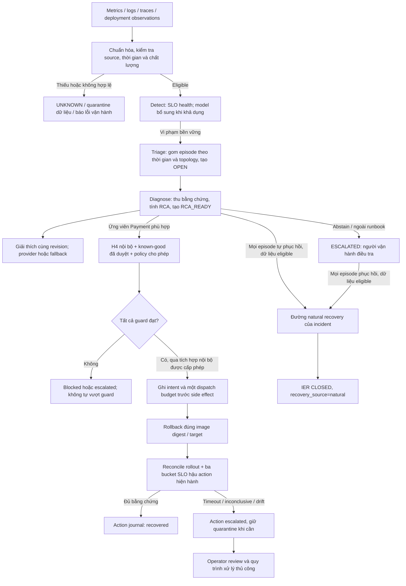

# SentinelOps — quy trình xử lý sự cố từ đầu đến cuối

Ngày đối chiếu: **18/11/2026**. Mã nguồn được đọc tại HEAD `08844452d0b37c603e0c481c9119e16264edba03`. Báo cáo này phân tích repository, không chạy workload, không xác nhận tình trạng runtime hiện tại và không cấp quyền bật remediation.

## 1. Phạm vi và cách hiểu kết quả

SentinelOps là prototype AIOps dựa trên bằng chứng cho **Checkout → Payment/Inventory → PostgreSQL**; PostgreSQL local đóng vai trò database/RDS trong topology. Chuỗi xử lý chính là **thu telemetry → kiểm tra chất lượng → phát hiện vi phạm SLO → gom sự cố → chẩn đoán RCA → giải thích → chọn xử lý → xác minh → đóng hoặc chuyển người vận hành**.

Phải tách ba khả năng:

- **Quan sát/phát hiện:** metrics, logs, traces, SLO health, model signals khi có release tương thích, incident và lịch sử bằng chứng.
- **Hỗ trợ chẩn đoán:** xếp hạng nguyên nhân nghi ngờ bằng thuật toán deterministic, giữ uncertainty và có thể abstain — từ chối kết luận khi bằng chứng chưa đủ.
- **Can thiệp có điều kiện:** executor nội bộ chỉ có runbook `payment-rollback-known-good/v1`, với quyền, image và target được duyệt trước. Không có tác nhân SRE tự do sửa mọi loại lỗi.

**Trạng thái triển khai cần đọc đúng:** có health/incident workers, control DB, API/UI đọc incident, executor/journal và worker tiếp tục xác minh action đã tồn tại. UI không có nút approve/execute; không có public dispatch endpoint; worker remediation được phát hành không tự tạo action mới. `NativeH4Authority` hiện đã có nhánh cấp authority cho bằng chứng Kubernetes/model/change hợp lệ; không nên kết luận từ phần mô tả cũ rằng H4 luôn trả false. Ngược lại, authority nội bộ này cũng không đồng nghĩa auto-remediation production đã được bật.

Runbook cập nhật ghi nhận trial `g6-de38fc6b-02` ngày 16/11/2026 đã rollback thật và đạt action `recovered`; cùng receipt `-01`, release có **1 recovered/2 golden-path attempts, 1 mutation, 0 failed-verify observations**. Q-09 còn thiếu mục tiêu và ca failed-verify; G6 chưa được nghiệm thu. AWS/Bedrock chưa có bằng chứng triển khai production trong tài liệu được đối chiếu. Báo cáo/fixture/CI cũ không chứng minh hệ thống hiện đang chạy tốt.

Nguồn: [README.md](../../README.md); [PRODUCT_SPEC.md](../../docs/architecture/PRODUCT_SPEC.md), §4–5, §8–11; [PROJECT_STATUS.md](../../docs/PROJECT_STATUS.md); [CONTROLLED_REMEDIATION.md](../../docs/runbooks/CONTROLLED_REMEDIATION.md), các mục “Kubernetes incident evidence source”, “Q-09 preparation for the current Alibaba release”; `src/sentinelops/remediation/authority.py:44`; `src/sentinelops/remediation/worker.py:22`.

## 2. Sơ đồ tổng thể

Sơ đồ mô tả các nhánh có trong kiến trúc/mã nguồn. Đường tạo và dispatch action mới **cần tích hợp nội bộ được cấp phép**; chạy resume-only worker hoặc mở UI không tự kích hoạt đường này. `Action recovered` và `IER CLOSED` là hai kết quả lưu ở hai journal khác nhau; executor hiện không tự chuyển lifecycle IER.

Nguồn: `src/sentinelops/workers/incident_journal.py:397`; `src/sentinelops/remediation/executor.py:78`; `src/sentinelops/remediation/executor.py:143`; [ADR-009](../../docs/adr/ADR-009-payment-rollback-runbook.md).

## 3. Các bước xử lý một sự cố

### Bước 0 — Chuẩn bị nguồn, policy và quyền trước sự cố

Operator chọn đúng môi trường, health stream và artifact store gốc; cấu hình topology, health/RCA policy, credential và target. Danh tính consumer gắn với stream, policy, topology, evidence profile và output root; đổi nguồn/model/profile trên consumer hiện hữu cần migration rõ ràng, không được âm thầm tạo lại để nhân đôi episode.

Nếu sử dụng model, phải chọn release đã được duyệt, kiểm tra checksum và source parity trên môi trường đích. Bundle hiện hành trong tài liệu là **`de38fc6b`, ADR-019**, feature `http-relative-5m/v2`, source `prometheus-increase-60s-5s/v2`. Không tái dùng bundle v1 `badf9da0` với code hiện hành. Build release không tự activate model.

Nếu muốn sẵn sàng rollback, phải làm trước sự cố/bad change:

1. Nhận đủ healthy history theo yêu cầu model/source.
2. Thu image evidence bằng `scripts/review_payment_image.py` (`open` rồi `complete`): Deployment/pod/image/UID trước và sau, cùng ba bucket healthy hiện hành từ raw health ledger.
3. **Người vận hành xem physical source binding, provenance image và evidence**, rồi quyết định known-good. Evidence collector không tự duyệt.
4. Ghi ledger bằng `scripts/approve_known_good.py` với quyết định operator rõ ràng. Approval phải có trước toàn bộ khoảng bất định của bad change sẽ dùng cho rollback.
5. Operator cho phép policy rollback trong đúng phạm vi môi trường/target/trial. Ledger image và quyền dispatch là hai điều kiện riêng.

Nguồn: [INCIDENT_WORKER.md](../../docs/runbooks/INCIDENT_WORKER.md), “Identity and source boundary”, “Optional validated model”; [MODEL_PIPELINE.md](../../docs/runbooks/MODEL_PIPELINE.md); [ADR-019](../../docs/adr/ADR-019-breach-relative-retrain.md); `src/sentinelops/remediation/approval.py:16`; `src/sentinelops/remediation/registry.py:47`; [CONTROLLED_REMEDIATION.md](../../docs/runbooks/CONTROLLED_REMEDIATION.md), “Collect image evidence before operator approval”, “Record the operator's known-good approval”.

### Bước 1 — Thu thập và kiểm tra telemetry

Các service xuất RED metrics, structured request-completion logs và distributed traces. Luồng local đọc Prometheus và evidence từ Compose hoặc Kubernetes/Jaeger theo source được chọn. Infrastructure evidence lấy riêng từ PostgreSQL, không giả database thành một HTTP service.

Bucket SLO căn UTC, dài **60 giây**. Profile local dùng scrape **5 giây**, watermark **30 giây**; feature windows có lookback **300 giây**, bước **60 giây**. Trước khi tính health/inference phải kiểm tra:

- service, route, environment, source profile, stream/policy identity;
- bucket đã đóng; dữ liệu thực sự đã available/ingested trước decision cutoff;
- ít nhất **30 requests/bucket**, coverage ít nhất **0,8**; quality eligible;
- số đếm/histogram, giá trị hữu hạn, duplicate/conflict và provenance;
- artifact refs/checksum và chuỗi accepted source không bị thiếu/sửa/đảo thứ tự.

Thiếu dữ liệu, ít traffic, coverage thấp, dữ liệu quá muộn hoặc không eligible sinh `UNKNOWN`, không điền số 0 hay kết luận healthy. Dữ liệu sai có thể bị quarantine ở pipeline; lỗi integrity/configuration có thể dừng worker. Cần phân biệt **quarantine dữ liệu đầu vào** với **target quarantine sau action** ở bước 9.

Các feature HTTP v1 vẫn có contract riêng, nhưng model Alibaba hiện hành dùng accepted stream history để tạo feature tương đối v2. Baseline là median ngoài cửa sổ đang xét, tối thiểu 5 phút và tối đa 60 phút lịch sử theo config; không suy rằng một `FeatureWindow` gửi rời rạc đủ cho inference hiện hành.

Nguồn: [TELEMETRY.md](../../docs/runbooks/TELEMETRY.md); [configs/slo_health_policy.json](../../configs/slo_health_policy.json); [configs/alibaba_relative_features.json](../../configs/alibaba_relative_features.json); `src/sentinelops/telemetry/core.py`; `src/sentinelops/telemetry/pipeline.py`; `src/sentinelops/telemetry/prometheus.py`; `src/sentinelops/ml/alibaba_live.py`.

### Bước 2 — Detect: phát hiện vi phạm thực tế và tín hiệu cảnh báo

**Đường SLO, không phụ thuộc model:** mỗi eligible bucket được xem là vi phạm khi **p95 latency > 750 ms HOẶC error rate 5xx > 0,05**. Hai eligible bucket liên tiếp vi phạm mới phát `incident_opened`; một bucket đầu chỉ đưa health sang `degrading`. Vi phạm có thể là latency ở bucket đầu và error ở bucket sau; code kiểm tra điều kiện OR cho từng bucket, không bắt buộc cùng một loại vi phạm.

So sánh là `>`: đúng 750 ms hoặc đúng 5% chưa vượt giới hạn tương ứng. `UNKNOWN` reset cả breach/clear streak nhưng không tự xóa một incident đã active. Retry đúng cùng bucket không được tính thành bucket thứ hai.

**Đường model bổ sung khi có release hợp lệ:** Isolation Forest đo anomaly latency; XGBoost đo risk latency vượt breach level trong horizon **300 giây**. Threshold lấy từ bundle đã calibration, không hardcode risk 0,8 từ protocol cũ. Risk `watch/degrading` không phải severity incident; risk_score cũng không mặc nhiên là xác suất đã được hiệu chuẩn. Alibaba thiếu trường 5xx nên SLO rule chịu trách nhiệm đường phát hiện lỗi 5xx.

Điểm quan trọng của implementation hiện tại: continuous incident consumer mở incident từ **SLO openings**. Model signals làm evidence/enrichment và IF có thể đóng góp RCA; không được mô tả mọi anomaly/risk là một incident riêng do consumer này tạo. Không có model vẫn tiếp tục SLO processing, với model signal vắng/null và lý do cụ thể. Direct `/v1/detect` và `/v1/risk` bị chặn với release Alibaba cần stream history; đọc `service_signals` trên incident thay vì suy luận endpoint rời rạc là đường serving chính.

Nguồn: `src/sentinelops/incidents/health.py:77`; `src/sentinelops/workers/incident_state.py:21`; `src/sentinelops/workers/model_signals.py`; `src/sentinelops/ml/registry.py`; `src/sentinelops/api.py:95`; [README.md](../../README.md), “Chạy API local”, “Ranh giới sản phẩm”.

### Bước 3 — Triage: gom episode, xác định phạm vi, gán severity, tạo OPEN

Incident consumer đọc **mọi accepted bucket của cả ba service**, kể cả UNKNOWN; kiểm chứng raw lineage trước khi dùng. Episode được gom theo onset và dependency graph:

- cửa sổ cluster tối đa **120 giây tính từ onset đầu**; không nối vô hạn bằng các cặp gần nhau;
- Checkout phụ thuộc Payment/Inventory, cả hai phụ thuộc RDS;
- một signal chỉ nhập vào một dependency candidate khi xác định được đúng một candidate reachable;
- Payment và Inventory cùng lỗi độc lập vẫn có group riêng; Checkout liên quan cả hai giữ group ambiguous cùng các alternative paths;
- không bịa một RDS episode chỉ vì topology có node RDS.

Membership chỉ chốt khi accepted source watermark đạt `first_onset + 120 + entry_buckets × 60` — policy hiện hành là **onset đầu + 240 giây**. Sự im lặng của nguồn hoặc đồng hồ tường chạy qua thời điểm đó không đủ để chốt group. Vì vậy thời điểm SLO xác nhận episode, thời điểm hoàn tất grouping và thời điểm IER `detected_at` là các mốc khác nhau.

Khi group chốt, worker chuẩn bị intent và command `OPEN`: incident ID, detected_at thực tế, affected services, severity, trigger provenance, source/config refs và availability. Ranking ban đầu rỗng. `detected_at` không backdate về onset; incident revision, audit và outbox được ghi transactionally với CAS/idempotency. Import IER qua API chỉ là manual assertion, availability UNKNOWN, không tự trở thành bằng chứng tính toán có authority.

Nguồn: [CORRELATION.md](../../docs/runbooks/CORRELATION.md); `configs/topology.yaml`; `src/sentinelops/workers/incident_state.py:21`; `src/sentinelops/workers/incident_journal.py:136`; `src/sentinelops/workers/incident_journal.py:208`; `src/sentinelops/incidents/repository.py:61`; `src/sentinelops/api.py:363`.

### Bước 4 — Diagnose: thu evidence và xếp hạng nguyên nhân

Worker chọn bounded evidence trong cửa sổ RCA tối đa **300 giây từ first onset**, bị giới hạn thêm bởi cutoff thực tế. Evidence gồm business completion logs, trace của request chậm/5xx, topology, infrastructure và change observations nếu có. Trace phải phù hợp logs/timing; DB lock evidence phải đúng source và chồng lấn database span liên quan. Native spans/logs không được thay bằng fault schedule hay nhãn đáp án của experiment.

RCA deterministic tái tạo kết quả từ capture đã đóng băng. Mọi candidate upstream của affected services vẫn được giữ trong kết quả chi tiết, kể cả candidate chưa quan sát được. Khi có validated model, IF đi vào anomaly component; XGBoost risk được lưu như evidence riêng, không được tự thêm một trọng số RCA mới. Deployment-change support phải là quan sát thực tế, đúng image/generation/UID và pre-incident interval.

Worker tạo revision `RCA_READY`, kèm ranking, component score, coverage, margin và lý do abstention. Nếu abstain thì chuyển `ESCALATED`, giữ evidence cho người vận hành; thứ hạng đầu vẫn chỉ là giả thuyết có điểm cao nhất. RCA result analytical luôn giữ `actions_allowed=false`; authority H4 là hợp đồng bổ sung được kiểm tra riêng.

Nguồn: `src/sentinelops/workers/incident_rca.py`; `src/sentinelops/incidents/rca_replay.py:131`; `src/sentinelops/incidents/rca.py:48`; `src/sentinelops/incidents/rca.py:108`; `src/sentinelops/workers/deployment_evidence.py`; `src/sentinelops/workers/incident_journal.py:397`; [RCA.md](../../docs/runbooks/RCA.md).

### Bước 5 — Explain: giúp operator đọc sự cố, không cấp quyền hành động

Operator có thể mở `/ui/` và đọc incident/revision/evidence/history, rồi yêu cầu explanation cho **đúng revision**. Backend deterministic hoạt động khi không có provider. Provider tùy chọn chỉ được chọn evidence card IDs trong phạm vi cho phép; backend render nội dung cuối từ evidence đã ghi nhận.

Provider không được tự viết lại facts, số liệu, source refs, severity, ranking, approval hay gọi tool thực thi. Timeout, output sai schema, card lạ, revision sai hoặc circuit mở dẫn tới fallback cùng revision. Mặc định deadline 10 giây gồm queueing, concurrency 4, không retry; ba lỗi mở circuit 30 giây. Explanation GET không tự ghi lifecycle `EXPLAINED` và không sửa IER.

Bedrock adapter hiện có trong code nhưng việc bật provider/credential/model access là bước riêng; sự tồn tại adapter không chứng minh đã invoke AWS. Raw fact/log text không được gửi như prompt tự do cho provider selector.

Nguồn: [EXPLANATIONS.md](../../docs/runbooks/EXPLANATIONS.md); `src/sentinelops/explanations/service.py:30`; `src/sentinelops/explanations/service.py:158`; `src/sentinelops/api.py:427`; `src/sentinelops/explanations/bedrock.py`.

### Bước 6 — Decide: chuyển con người hoặc xét runbook rollback

Nếu root không phải Payment, RCA abstain, source UNKNOWN, không có change phù hợp, thiếu known-good hoặc chưa được phép action thì giữ nhánh quan sát/escalation; operator điều tra và áp dụng quy trình ngoài automation khi cần. Severity cao không tự vượt các điều kiện này.

Với ứng viên Payment, `NativeH4Authority.assess` phải tái kiểm chứng accepted job/evidence từ journal. Nhánh có authority đòi hỏi **capture v6, model registry available, observed deployment change, RCA không abstain**, incident revision gắn đúng evidence và current health của affected services đều eligible; không được còn accepted health mới đang chờ consumer. Docker-only capture hoặc một client-uploaded score không đáp ứng H4.

Sau đó `qualify` kiểm tra revision hiện hành, lifecycle `RCA_READY`, availability ELIGIBLE, top RCA là `payment-service`, đúng RCA policy, evidence freshness, current bad image/generation và known-good binding. Request chỉ mang `incident_id`, `incident_revision`, `idempotency_key`; client không chọn image/target/provider hay gửi `approved=true` để lách quyền.

**Điểm human-in-the-loop:** con người duyệt image và cho phép policy/phạm vi action trước; code áp guard cho từng dispatch. Không có cơ chế “LLM đề xuất rồi operator bấm approve trong UI” đã triển khai. Cũng không thấy bắt buộc một lượt click người duyệt mới ngay trước mọi PATCH nếu policy nội bộ đã được cấp phép hợp lệ. Riêng protocol trial hiện tại yêu cầu quyết định known-good và cho phép rollback riêng cho từng trial, không kế thừa từ sandbox đã xóa.

Nguồn: `src/sentinelops/remediation/authority.py:50`; `src/sentinelops/remediation/authority.py:89`; `src/sentinelops/remediation/domain.py:55`; [CONTROLLED_REMEDIATION.md](../../docs/runbooks/CONTROLLED_REMEDIATION.md), các cập nhật H4 và protocol Q-09.

### Bước 7 — Guard/preflight: kiểm tra trước side effect

| Guard bắt buộc | Điều kiện implementation hiện hành |
| --- | --- |
| Enable/kill switch | `Policy.enabled` và callback enable cùng true; mặc định false; kiểm tra lại sát trước transport. |
| Runbook/target | Chỉ `payment-rollback-known-good/v1`; namespace `sentinelops-b-actions`, Deployment `payment-service`, container `payment`, pin cluster/namespace/Deployment UIDs. |
| Freshness | RCA as_of, latest health và Deployment observation trong 180 giây, không ở tương lai. |
| Change | Bad change trước onset không quá 600 giây; current image/generation phải khớp; nếu change có uncertainty interval thì cả interval phải được kiểm tra. |
| Approval | Known-good ledger đúng approver/ref/môi trường/target, tái kiểm chứng raw healthy evidence; approval có trước toàn bộ bad-change interval. |
| Image | Digest bất biến `@sha256:…`, khác current image và cùng image repository; client không cung cấp image tùy ý. |
| Blast radius | Một replica/existing pod, zero surge, RollingUpdate, không HPA và không paused Deployment; không scale target. |
| Drift/concurrency | JSON Patch test UID, resourceVersion, generation, replicas, container name và current image trước khi chỉ replace image. |
| API dry-run | Server-side `dryRun=All` thành công trước khi arm action. |
| Durable budget | Target lock, cooldown 600 giây, một auto-attempt/incident/target; intent/audit/dispatch budget bền vững trước HTTP. |
| Quyền tối thiểu | Credential/RBAC scoped, không ambient kubeconfig; controller không sửa IAM hoặc commerce data. |

Guard fail trước dispatch có thể ghi `blocked` kèm reason. Nếu đã arm rồi điều kiện đổi, executor có nhánh escalated/cancelled-before-send với audit; không thể gộp mọi trường hợp fail thành “chưa có attempt nào”. Sau khi mutation đã gửi, bật kill switch không hủy mutation quá khứ; vẫn phải reconcile và verify.

Nguồn: `src/sentinelops/remediation/domain.py:35`, `:72`, `:123`, `:152`; `src/sentinelops/remediation/authority.py:89`; `src/sentinelops/remediation/executor.py:56`, `:60`, `:78`; `src/sentinelops/remediation/kubernetes.py`; [payment-rollback-rbac.yaml](../../infra/kubernetes/payment-rollback-rbac.yaml).

### Bước 8 — Remediate: rollback một lần, có journal và crash safety

Executor đóng băng bằng chứng preflight, ghi intent và target claim, rồi arm dispatch budget trong DB trước side effect. Chỉ sau bước đó mới PATCH image về approved known-good digest. Audit/event history append-only, hash-linked, projection có CAS; request lặp lại dùng cùng identity không tạo action khác.

Nếu crash sau arm, mất response hoặc không biết PATCH đã tới server chưa, retry **quan sát trạng thái Kubernetes**, không tự gửi PATCH lần hai. Ngay cả crash trước khi packet thực sự được gửi cũng bị coi là ambiguous. Đây là chính sách một attempt có reconcile, không phải bảo đảm exactly-once HTTP.

`scripts/run_remediation_worker.py` chỉ tiếp tục action tồn tại: `dispatching/verifying` được reconcile; `prepared` bị block vì cần explicit revalidation rồi giải phóng claim chưa dùng dispatch; `escalated` không tự gỡ quarantine. Worker không enumerate incident để đề xuất và không gọi execute tạo action mới.

Nguồn: `src/sentinelops/remediation/executor.py:78`; `src/sentinelops/remediation/journal.py`; `src/sentinelops/remediation/worker.py:30`; [infra/control/005-remediation.sql](../../infra/control/005-remediation.sql); [CONTROLLED_REMEDIATION.md](../../docs/runbooks/CONTROLLED_REMEDIATION.md), “Durable action ledger”, “Resume-only worker”.

### Bước 9 — Verify: kiểm chứng rollout và SLO sau action

Không coi PATCH 200, Deployment Ready hoặc một request thành công là phục hồi. Executor cần đồng thời:

1. Target vẫn đúng UID và approved image; generation đúng **bad generation + 1**. External spec/image drift làm escalation, không quy công cho rollback.
2. Rollout có một pod mới, khác old pod UID, ready/available/updated đúng số replica, runtime imageID có digest.
3. `effective_at` được ghi từ quan sát rollout ready; không lấy thời điểm gửi request làm bằng chứng action đã có hiệu lực.
4. Verifier tái đọc raw-verified accepted health ledger gốc, đúng stream/policy/environment. Không nhận streak hoặc cờ success do client cung cấp.
5. Có **ba eligible bucket Payment liên tiếp hoàn toàn nằm sau effective_at**, không tính bucket chồng lấn action hoặc streak healthy trước action. Cùng SLO/traffic/coverage policy ở bước 1–2; UNKNOWN, ít traffic hoặc breach xóa streak riêng của verifier.
6. Executor dùng `post-action-current-slo/v1`: ba bucket phải là clear streak hiện hành, bao gồm latest due accepted bucket theo watermark 30 giây. Một đoạn healthy cũ rồi nguồn dừng hoặc phát UNKNOWN không đủ.
7. Hoàn tất trong budget **600 giây từ dispatch** ở executor; verifier cũng có giới hạn 600 giây tính từ effective_at. DB receipt/cutoff/deadline phải hợp lệ, không được backdate sau khi đọc nguồn chậm.
8. Quan sát Kubernetes lần cuối sau telemetry verification để bảo đảm đúng image/generation/ready và không vừa qua một bucket anchor mới.

Đủ điều kiện thì action journal chuyển `recovered`, giải phóng claim theo journal và giữ cooldown/attempt history. Verifier riêng chỉ trả `telemetry_verified` — các cờ `action_dispatch_authorized`, `deployment_identity_verified`, `recovery_accepted` của verdict vẫn false; executor mới kết hợp rollout và telemetry để ra outcome action.

Không đủ dữ liệu có thể `pending` trong budget; `inconclusive`, timeout hoặc sai identity/generation dẫn đến `escalated`. Các ca không chắc action đã được gửi/thực hiện hoặc verify thất bại giữ target quarantine cho operator, không tự redeploy known-bad image để “bù trừ”.

Nguồn: `src/sentinelops/remediation/executor.py:143`; `src/sentinelops/remediation/verification.py:21`; `src/sentinelops/remediation/verification.py:47`; `src/sentinelops/remediation/domain.py:141`; [ADR-009](../../docs/adr/ADR-009-payment-rollback-runbook.md).

### Bước 10 — Close hoặc escalate, lưu vết và bàn giao

**Đường natural recovery của incident consumer:** mọi episode thành viên phải có `recovery_confirmed` khớp đúng episode, sau ba eligible clear buckets; availability hiện đang consumed của mọi affected service phải ELIGIBLE. Khi đủ điều kiện:

- nhánh RCA không abstain: `OPEN → RCA_READY → VERIFYING → RECOVERED → CLOSED`;
- nhánh abstain: `OPEN → RCA_READY → ESCALATED → CLOSED`, đóng với payload state `recovered` và `recovery_source=natural` khi sau đó có đủ bằng chứng phục hồi.

UNKNOWN hiện hành chặn closure dù đã có recovery event cũ. Việc đóng natural không chứng minh nguyên nhân đã được xác nhận, con người đã làm gì, hay controller đã chạy action. Executor hiện không ghi các transition IER này; action outcome được xem riêng trong Actions tab/API.

**Sau action escalation/quarantine:** operator dùng quy trình hai bước `review_payment_quarantine` (`open` rồi `release`), credential resolver riêng và observer Kubernetes chỉ đọc. Nhánh hỗ trợ yêu cầu original target/source binding, qua drain period 600 giây, known-good rollout đúng next generation, hai quan sát Deployment ổn định bao quanh ba healthy bucket hiện hành và review chưa hết hạn. `PENDING/INCONCLUSIVE/BLOCKED` giữ khóa; trường hợp image/generation/target khác còn cần quy trình operator riêng.

Release chỉ thêm immutable receipt và bỏ active claim bằng transaction/CAS; **không** đổi action `escalated`, IER, dispatch attempt hay cooldown; không cấp dispatch mới và không biến thành recovery accepted. UI chỉ đọc receipt, không có release control.

Artifact, accepted source history, IER revisions, actor/reason, action audit và outbox được giữ để replay/điều tra. Outbox là cơ chế sự kiện bền vững; sự hiện diện của nó không chứng minh đã tích hợp gửi ticket, email hay paging cho on-call.

Nguồn: `src/sentinelops/workers/incident_journal.py:178`, `:397`, `:473`; `src/sentinelops/incidents/domain.py`, `TRANSITIONS`; `src/sentinelops/remediation/quarantine.py:117`, `:175`; [infra/control/006-quarantine-review.sql](../../infra/control/006-quarantine-review.sql); [INCIDENT_API.md](../../docs/runbooks/INCIDENT_API.md).

## 4. Severity, ưu tiên xử lý và các loại điểm

### 4.1 Severity thực sự được code gán

`group_severity` áp dụng precedence **critical → high → medium**. Đây là severity của nhóm sự cố, không phải điểm causal confidence.

| Mức | Điều kiện | Ví dụ diễn giải |
| --- | --- | --- |
| `critical` | Group có opening của Checkout với hai observation hỗ trợ cuối eligible, liên tiếp 60 giây, mỗi observation có error_rate **≥ 20%**. | Checkout trả 25% rồi 22% lỗi 5xx. |
| `high` | Chưa critical, và affected_services chứa Checkout **hoặc** ít nhất hai business services. | Payment latency gây ảnh hưởng thêm Checkout, dù lỗi 5xx thấp. |
| `medium` | Group còn lại, không critical/high. | Một Payment hoặc Inventory incident độc lập, chưa ghi nhận Checkout trong group. |
| `low` | Contract cho phép và tài liệu đề xuất dùng cho watch-level record nếu có policy mở record. **Continuous SLO group producer hiện không sinh mức này.** | Không được tự đổi một risk watch thành incident low đã được triển khai. |

Ngưỡng critical là `>= 0.20`, khác với ngưỡng mở incident SLO `> 0.05`. Severity dựa trên SLO opening/group evidence và được dùng lại khi projection RCA; chưa thấy cơ chế riêng liên tục tính lại severity từ mọi bucket mới như một dịch vụ reprioritization. Tài liệu gọi policy severity là đề xuất/version riêng, nhưng logic hiện thấy nằm trong hàm Python; không có `severity_policy.json` riêng được dùng trong đường này.

**Ưu tiên vận hành:** có thể dùng critical trước high trước medium trước low để người trực phân loại. Tuy nhiên repo hiện chưa triển khai priority queue SEV/P0/P1, phân công owner/on-call, SLA response theo severity hoặc paging workflow. `GET /v1/incidents` lọc state/service, trả severity; query lưu trữ sắp theo **created_at, incident_id**, không tự sort theo severity. Nói “hệ thống ưu tiên xử lý critical trước” như một bảo đảm scheduler là vượt quá implementation.

Nguồn: `src/sentinelops/incidents/rca_replay.py:120`; `src/sentinelops/workers/incident_journal.py:136`, `:397`; [incident-evidence-record.schema.json](../../contracts/incident-evidence-record.schema.json); [CONSTRAINTS_AND_GATES.md](../../docs/architecture/CONSTRAINTS_AND_GATES.md), §4; `src/sentinelops/api.py:399`; `src/sentinelops/incidents/repository.py:133`.

### 4.2 RCA score: mức hỗ trợ giả thuyết, không phải severity

Với candidate `c`, mỗi component có value `[0,1]` hoặc `null` kèm missing_reason. Policy hiện hành:

| Component | Trọng số | Bằng chứng được phép |
| --- | ---: | --- |
| anomaly_strength | 0,25 | IF inference thật; riêng RDS dùng infrastructure rule có modality đúng. |
| temporal_precedence | 0,20 | Onset intervals tách biệt theo uncertainty, không suy thứ tự từ bucket bằng/chồng nhau. |
| dependency_trace_relevance | 0,25 | Native spans/timing/parentage phù hợp request/log, duration/error support. |
| log_support | 0,15 | Business completion logs hoặc database lock log đúng candidate và ngữ cảnh. |
| recent_change_support | 0,15 | Observed deployment change xác minh được, không phải injection schedule. |

`score(c) = Σ(weight_i × value_i)` trên component quan sát được. `coverage(c) = Σ(weight_i)` của component có giá trị quan sát. Không chia lại score cho coverage, không phân phối lại trọng số bị thiếu. Quan sát value=0 vẫn có coverage; không có component nào thì `score=null`, coverage=0. Ranking chỉ gồm candidate có score dương, sắp điểm giảm dần; tên service làm tie-break ổn định, nhưng tie không cấp confidence.

Muốn không abstain phải có top score **≥ 0,75**, top coverage **≥ 0,75**, margin giữa top và candidate known đứng sau **≥ 0,15**; đồng thời không có dependency candidate unobserved, không có source availability chưa xác minh trong evidence được dùng và không ambiguous correlation. Nếu chỉ có một candidate có score known thì margin không xác định, vẫn abstain. Đạt đúng các floor này chưa tự cấp action authority.

Ví dụ số học, không phải kết quả đo: năm component của Payment là `0,9; 1; 0,9; 0,8; 1` thì score = `0,225 + 0,20 + 0,225 + 0,12 + 0,15 = 0,92`, coverage=1. Nếu candidate known kế tiếp là 0,70 thì margin=0,22, qua ba ngưỡng số học; vẫn phải kiểm tra candidate thiếu, ambiguous, cutoff và H4/guards. Nếu recent_change_support bị thiếu, score còn 0,77 và coverage 0,85; có thể qua floor RCA nhưng **không đủ điều kiện rollback** vì không có matching change.

Các lý do abstain trong code gồm `no-positive-observed-support`, `insufficient-score`, `insufficient-margin`, `insufficient-coverage`, `unobserved-dependency-candidates`, `source-availability-unverified`, `ambiguous-correlation`. Score là heuristic evidence support, không phải calibrated probability hoặc chứng minh quan hệ nhân quả.

Nguồn: [configs/rca_policy.json](../../configs/rca_policy.json); `src/sentinelops/incidents/rca.py:48`, `:90`, `:108`, `:135`; [rca-result.schema.json](../../contracts/rca-result.schema.json); `src/sentinelops/remediation/authority.py:89`.

### 4.3 Không trộn các đại lượng

| Đại lượng | Trả lời câu hỏi nào? | Không tự suy ra được |
| --- | --- | --- |
| SLO health/streak | Đang vi phạm hay đã có đủ bucket clear? | Nguyên nhân, quyền sửa. |
| Severity | Ảnh hưởng nhóm incident nghiêm trọng đến đâu theo rule? | Confidence RCA hoặc thứ tự scheduler. |
| IF anomaly_score | Latency window khác phân phối healthy đến đâu theo model? | Critical, causality, 5xx detector đầy đủ. |
| XGBoost risk_score/state | Có tín hiệu latency exceedance trong horizon không? | Xác suất đã calibration, severity hoặc incident mới. |
| RCA score/coverage/margin | Evidence ủng hộ candidate và phân biệt với candidate khác đến đâu? | Dispatch authority, khẳng định root cause chắc chắn. |
| H4 assessment + policy + guards | Incident/target có đủ điều kiện xét dispatch hay không? | Recovery đã xảy ra. |
| telemetry_verified | Health hậu action có đủ bằng chứng theo verifier? | Deployment identity đã verified hoặc recovery accepted riêng lẻ. |

## 5. Những chỗ cần con người duyệt hoặc xử lý

| Điểm quyết định | Con người làm gì? | Hệ thống kiểm tra/góp phần gì? | Nếu chưa có quyết định |
| --- | --- | --- | --- |
| Source/physical binding | Chọn stream gốc và kiểm chứng telemetry thật sự quan sát đúng Kubernetes workload. | Raw replay, UID/namespace/owner identity, source/policy/hash checks. Chỉ trùng service name chưa đủ. | Không có đường action hợp lệ. |
| Model activation/H1/G3 | Owner duyệt candidate/phạm vi; operator chọn release và đo parity ở môi trường đích. | Build/registry checksums, source compatibility; không tự activate hay retrain. | SLO vẫn chạy; model unavailable và H4 thiếu điều kiện. |
| Known-good image | Operator xem evidence/provenance và ghi approval có actor/time trước bad change. | Collector tạo evidence chưa approved; registry tái kiểm chứng healthy interval/target. | Không rollback. |
| Cho phép runbook | Operator/owner cấp phép policy và phạm vi cụ thể; trial hiện tại phải được cấp phép riêng. | Policy mặc định disabled, kill switch và preflight mỗi dispatch. | Blocked, không tự bật. |
| RCA yếu/ambiguous/ngoài scope | Người vận hành điều tra, xác định cách sửa hoặc thu thêm bằng chứng qua quy trình phù hợp. | Giữ ranking, missing reasons, evidence, ESCALATED; không tự đoán một root để hành động. | Không auto-action. |
| Quarantine sau action | Operator mở review và chủ động release nếu đúng điều kiện hỗ trợ. | Observer chỉ đọc, raw current health, stable rollout, CAS và immutable receipt. | Claim vẫn giữ; ca ngoài scope cần thủ tục khác. |
| Migrations/credential/RBAC | Operator bootstrap schema và tài khoản theo role; không dùng owner/writer cho read API. | Readiness kiểm tra cả quyền table/column, reject privilege quá rộng. | Capability unavailable/worker dừng; không tự sửa quyền. |
| AWS/Bedrock | Owner chốt apply authority, region, model access/quota, budget/retention/teardown. | IaC/adapter kiểm tra cấu hình; không tạo quyền từ tài liệu hay fixture. | Không provision/invoke từ việc có code. |
| Nghiệm thu G4–G8 | Owner đánh giá evidence đúng release/target/run, gồm ca lỗi và negative cases. | Report/summary nêu denominator và giới hạn. | CI hay một trial thành công không tự đóng gate. |

Không cần người duyệt riêng từng health bucket, mỗi lần grouping, tính RCA deterministic hoặc GET explanation. Human-in-the-loop ở đây chủ yếu nằm ở **chọn nguồn tin cậy, phê duyệt image/phạm vi tự động hóa và xử lý ngoại lệ**, trong khi guardrail được máy kiểm tra cho từng action. Đây là mô tả ranh giới quyền trong repo, không phải thao tác cấp approval của báo cáo này.

Nguồn: [CONSTRAINTS_AND_GATES.md](../../docs/architecture/CONSTRAINTS_AND_GATES.md), §5–6 và gates; [CONTROLLED_REMEDIATION.md](../../docs/runbooks/CONTROLLED_REMEDIATION.md); [MODEL_PIPELINE.md](../../docs/runbooks/MODEL_PIPELINE.md); [AWS_BASELINE.md](../../docs/runbooks/AWS_BASELINE.md); `infra/control/005-remediation.sql`; `infra/control/006-quarantine-review.sql`.

## 6. Loại vấn đề được hỗ trợ đến mức nào?

“Có thể xử lý” cần ghi rõ là **detect**, **diagnose**, **observe recovery** hay **thực sự tự can thiệp**. Catalog scenario trong thiết kế không có nghĩa mọi scenario đã đạt acceptance trên model/release hiện tại.

| Loại vấn đề | Detect/triage/diagnose | Khả năng khắc phục hiện có | Giới hạn quan trọng |
| --- | --- | --- | --- |
| S0 — healthy, benign load/spike | Theo dõi quality/SLO; model có thể bổ sung anomaly/risk nếu hợp lệ. | Không cần action. | Không bảo đảm không báo sai với mọi traffic; UNKNOWN không healthy. |
| S1 — Payment latency hoặc error đột ngột | SLO latency/5xx, trace/log cascade sang Checkout; IF bổ sung cho latency. | Quan sát natural recovery hoặc operator xử lý. | Không hứa precursor cho lỗi đột ngột; fault flag không phải deployment change nên không tự đủ rollback. |
| S2 — bad Payment image deployment | SLO + actual change + model + trace/log + UID binding có thể đủ RCA/H4. | **Runbook tự động duy nhất:** rollback approved immutable known-good Payment image khi được cấp phép và mọi guard đạt. | Target sandbox cố định; new-intent dispatch cần tích hợp nội bộ; G6 chưa được nghiệm thu đầy đủ. |
| S3 — gradual latency degradation | XGBoost warning trước latency exceedance khi release/history phù hợp; SLO mở incident khi breach; RCA theo evidence. | Theo dõi/escalate; rollback chỉ khi đồng thời thỏa bài toán S2. | Mean latency feature và p95 SLO khác nhau; không hứa warning luôn sớm hoặc áp dụng cho mọi gradual fault. |
| Inventory latency/5xx | Objective health của Inventory, grouping độc lập/cascade; model dùng chung ba service khi source hợp lệ. | Natural recovery hoặc operator. | Không có Inventory rollback/restart/scale runbook được executor này cho phép. |
| Checkout latency/5xx, lỗi lan truyền | Health/severity và dependency evidence để phân biệt downstream symptom. | Natural recovery hoặc operator. | Không có Checkout mutation runbook; Checkout bị ảnh hưởng không chứng minh chính Checkout là root. |
| S4 — DB connection/query pressure, lock waits | Có adapter infrastructure riêng và trace/log support để đưa RDS vào ranking nếu đủ evidence. | **Mặc định escalate** cho người vận hành/database owner. | Không mutate commerce DB, kill query, sửa schema hay scale database tự động. |
| S5 — nhiều fault độc lập | Group Payment/Inventory riêng; shared Checkout ambiguous; giữ uncertainty và abstain khi chưa phân biệt được. | Chuyển operator; từng candidate chỉ được xét action nếu toàn bộ boundary riêng của nó đạt. | Không gộp để tự chọn một root; không có bộ multi-target auto-remediation. |
| Thiếu telemetry, stale/low traffic, lỗi nguồn | UNKNOWN/missing reasons, readiness và process telemetry; worker có retry hoặc dừng theo loại lỗi. | Có thể tiếp tục sau transport reconnect với journal/checkpoint còn nguyên. | Không bịa health, không tự sửa hệ observability hoặc cấp quyền. |
| DB/API worker outage, crash/retry/concurrency | Durable accepted state, CAS/idempotency, immutable evidence và resume/replay. | Resume công việc an toàn trong phạm vi implement. | Đây là khả năng chịu lỗi của control plane; không phải runbook sửa mọi outage của workload. |
| Explanation provider lỗi | Fallback deterministic cùng revision; incident/evidence vẫn đọc được khi backend tương ứng available. | Fallback tự động, không cần LLM để xem facts. | Không sửa provider, không coi fallback là bằng chứng root cause hay G5 acceptance. |
| Action verify thất bại/uncertain delivery | Journal/reconcile nhận diện pending, timeout, drift và escalation. | Giữ audit/quarantine; operator review hỗ trợ một phạm vi release rõ ràng. | Không resend PATCH hoặc reintroduce known-bad image để thử lại. |

Nguồn catalog: [TECHNICAL_SPEC.md](../../docs/architecture/TECHNICAL_SPEC.md), §7.1, §9–10, §13; nguồn implementation: `src/sentinelops/incidents/health.py`, `src/sentinelops/incidents/correlation.py`, `src/sentinelops/telemetry/infrastructure.py`, `src/sentinelops/incidents/rca_replay.py`, `src/sentinelops/remediation/domain.py`, `src/sentinelops/remediation/worker.py`.

### Không được tự động giải quyết / không nằm trong bảo đảm hiện tại

- **Restart/scale tùy ý, HPA tuning hoặc rollback Checkout/Inventory:** enum `restart/scale/rollback` trong schema không cấp quyền; ADR-009 chỉ chọn Payment image rollback, các runbook khác hoãn.
- **Sửa code, tự viết patch ứng dụng, đổi cấu hình tùy ý hoặc chạy shell/tool theo LLM:** không có general autonomous SRE/LLM tool execution.
- **Sửa commerce data, hoàn tiền, reconcile giao dịch, schema/data corruption, IAM/security policy:** không có runbook và controller bị giới hạn quyền; HTTP 5xx có thể được thấy nhưng không biết/sửa mọi nguyên nhân nghiệp vụ.
- **Tấn công bảo mật, lộ credential, malware, network/DNS/TLS/host/disk/OOM nói chung:** không có catalog detector và remediation chuyên biệt được chứng minh ở đây. Nếu làm HTTP vượt SLO thì có thể thấy triệu chứng, không đồng nghĩa xác định và sửa được nguyên nhân đó.
- **Dự báo 5xx bằng model Alibaba hoặc dự báo mọi abrupt outage:** Alibaba model hướng latency, không có training field 5xx; precursor chỉ có phạm vi và bằng chứng riêng.
- **Kết luận khi thiếu nguồn, stale, ít traffic, unknown receipt clocks, multi-root ambiguous:** giữ UNKNOWN/abstain/escalate, không suy số 0 hoặc tự bỏ guard.
- **Tự phê duyệt known-good, tự bật remediation, tùy chọn image/target/client approval hoặc force dispatch:** không có đường hợp lệ trong executor/API/UI hiện hành.
- **Tự động retrain/promote model hoặc thay source/threshold để qua gate:** lifecycle offline/versioned, cần approval/parity/evaluation; local HTTP và RCAEval không tự thành nguồn fit hiện hành.
- **Multi-region/multi-cluster/multi-cloud và SLA production/HA:** ngoài non-goals/bằng chứng prototype. Remote transport/IaC trong code không chứng minh EKS/RDS/CloudWatch/X-Ray/Bedrock đã triển khai end-to-end.
- **Ticket/paging/on-call routing, SLA severity và postmortem tự động đầy đủ:** incident/outbox/history hỗ trợ bàn giao, chưa có workflow tích hợp đủ để tuyên bố những khả năng này.

Nguồn: [PRODUCT_SPEC.md](../../docs/architecture/PRODUCT_SPEC.md), §5; [ADR-005](../../docs/adr/ADR-005-controlled-remediation.md); [ADR-009](../../docs/adr/ADR-009-payment-rollback-runbook.md); [remediation-action.schema.json](../../contracts/remediation-action.schema.json); [README.md](../../README.md); [PROJECT_STATUS.md](../../docs/PROJECT_STATUS.md); `src/sentinelops/remediation/domain.py`; `src/sentinelops/api.py`.

## 7. Ví dụ một sự cố Payment đi hết luồng

Đây là **ví dụ minh họa thời gian/điều kiện**, không phải receipt một trial đã chạy và không bảo đảm latency thực tế.

1. Trước 11:59 UTC, operator có source/history hợp lệ, đã duyệt image A và cho phép đúng trial/policy. Observer ghi bad transition A→B trong khoảng hoàn toàn trước 12:00, generation `g`; approval A có trước cả khoảng này.
2. Bucket 12:00–12:01 và 12:01–12:02 có Payment p95 >750 ms, traffic/coverage đủ. Health decision sau watermark của bucket thứ hai có thể ở 12:02:30 và phát `incident_opened`, onset=12:00. Nếu Checkout cũng mở episode phù hợp topology/time thì tham gia group; severity high khi có Checkout, critical chỉ khi Checkout đạt rule 5xx ≥20% hai bucket.
3. Group membership chốt khi accepted watermark đạt bucket_end 12:04, tương ứng horizon 240 giây từ first onset. `detected_at` là clock chuẩn bị OPEN intent thực tế sau đó, không ghi lùi thành 12:00.
4. Capture đúng bounded window, change/log/trace/IF có support; RCA không abstain, Payment top, đủ score/coverage/margin. Worker publish `RCA_READY`. Operator có thể đọc explanation nhưng explanation không cấp quyền.
5. Tích hợp nội bộ được phép tạo Request gắn đúng revision; H4 kiểm tra v6/model/change/current health, executor kiểm tra ledger A, image B/generation `g`, freshness 180 giây, target, enable, lock, cooldown và dry-run. Nếu bất kỳ điều kiện nào fail, dừng nhánh action và ghi reason.
6. Ghi durable intent/dispatch budget rồi chỉ PATCH B→A một lần. Rollout đạt generation `g+1`, pod mới ready; giả sử observer ghi effective_at=12:05:20.
7. Bucket 12:05–12:06 bị loại vì chồng effective_at. Ba bucket đầy đủ đầu tiên có thể tính là 12:06–12:07, 12:07–12:08, 12:08–12:09; cần đều clear/eligible và đúng latest due accepted bucket lúc quyết định, ví dụ sau 12:09:30. Còn phải quan sát rollout lần cuối và chưa hết 600 giây từ dispatch.
8. Đủ điều kiện thì action `recovered`; nếu DB down/nguồn dừng/ít traffic/drift hoặc timeout, không báo success và có thể escalated/quarantined. Incident consumer chỉ đóng IER theo bằng chứng source episode recovery và ghi `natural`; không được đọc closure đó thành “controller đã chứng minh causal recovery”.

Nguồn để tái kiểm logic ví dụ: `configs/slo_health_policy.json`; `src/sentinelops/workers/incident_state.py:21`; `src/sentinelops/workers/incident_journal.py:208`; `src/sentinelops/remediation/authority.py:89`; `src/sentinelops/remediation/executor.py:143`; `src/sentinelops/remediation/verification.py:47`.

## 8. Hồ sơ cần đọc để kiểm tra một incident cụ thể

| Câu hỏi cần trả lời | Nơi đọc/đối chiếu |
| --- | --- |
| Vì sao incident mở, onset/detected_at có khác nhau không? | IER + context/trigger_sources, opening health signals, accepted source batch, frozen intent; `src/sentinelops/workers/incident_journal.py:136`, `:208`. |
| Vì sao severity này? | `group_severity`, hai Checkout observations và affected_services; `src/sentinelops/incidents/rca_replay.py:120`. |
| Vì sao Payment đứng đầu, vì sao abstain? | RCA result: candidate components, score/coverage/margin, evidence_availability, source_refs, abstention_reasons; `src/sentinelops/incidents/rca.py:108`. |
| Dữ liệu/model có hợp lệ ở đúng thời điểm không? | Observation/feature envelopes, source receipt clocks, accepted health/model evidence, release manifest và profile; `src/sentinelops/workers/model_signals.py`, `src/sentinelops/workers/incident_rca.py`. |
| Ai duyệt image và khi nào? | `approved-payment-images/v1`, approved_by/approved_at, image-review evidence, exact target/source; `src/sentinelops/remediation/approval.py:16`, `src/sentinelops/remediation/registry.py:47`. |
| Vì sao được phép action? | NativeH4 assessment, lifecycle/revision, matching observed change, enabled policy/kill switch và preflight; `src/sentinelops/remediation/authority.py:50`, `:89`, `src/sentinelops/remediation/executor.py:60`. |
| Có thực sự gửi mutation không? | Action intent, dispatch record, hash-linked event history, patch receipt/reconcile observations; `src/sentinelops/remediation/journal.py`, `infra/control/005-remediation.sql`. Không suy chỉ từ intent prepared. |
| Có thực sự verified recovery không? | Ready rollout trước/sau, effective_at, ba whole current post-action buckets, raw health refs, DB receipt và verification_decided_at; `src/sentinelops/remediation/executor.py:143`. |
| Vì sao CLOSED hoặc vẫn quarantine? | IER context/recovery refs và action/quarantine journal riêng; `src/sentinelops/workers/incident_journal.py:397`, `src/sentinelops/remediation/quarantine.py:175`. |

Các API đọc liên quan: `GET /v1/incidents`, `GET /v1/incidents/{id}?revision=N`, explanation/context theo revision, `GET /v1/incidents/{id}/actions?revision=N`, `GET /v1/actions/{id}`, `GET /v1/actions/{id}/quarantine`. Phải đọc cùng revision, xử lý 503/UNKNOWN thành thiếu capability/dữ liệu, không biến thành empty/healthy. Action-reader storage là tùy chọn và SELECT-only; UI vẫn có thể xem incident khi action capability chưa cấu hình.

Nguồn: [INCIDENT_API.md](../../docs/runbooks/INCIDENT_API.md); `src/sentinelops/api.py:267`, `:272`, `:288`, `:303`, `:399`, `:415`, `:427`, `:455`; [action-observation.schema.json](../../contracts/action-observation.schema.json); [quarantine-status.schema.json](../../contracts/quarantine-status.schema.json).

## 9. Mức bằng chứng và giới hạn của kết luận

Tài liệu này đối chiếu source/config/contracts/runbooks; không chạy lại tests, local runtime hoặc trial, vì mục tiêu là mô tả quy trình và chỉ tạo file output. Các test dưới đây là đường dẫn để kiểm chứng từng boundary, không phải kết quả PASS mới của lần phân tích này:

- Detect/quality: `tests/test_slo_health.py`, `tests/test_health_source.py`, `tests/test_model_signals.py`.
- Grouping/severity/RCA/lifecycle: `tests/test_correlation.py`, `tests/test_rca.py`, `tests/test_rca_replay.py`, `tests/test_incident_state.py`, `tests/test_incident_journal.py`.
- Approval/H4/dispatch/verification: `tests/test_known_good_approval.py`, `tests/test_payment_image_review.py`, `tests/test_remediation_registry.py`, `tests/test_remediation_executor.py`, `tests/test_remediation_verification.py`.
- Resume/quarantine/UI/explanation: `tests/test_remediation_worker.py`, `tests/test_quarantine_review.py`, `tests/test_operator_ui.py`, `tests/test_explanations.py`.

Khi tài liệu có đoạn cũ trái với cập nhật, báo cáo ưu tiên **code hiện hành cho hành vi thực thi**, config/contracts cho ngưỡng/hình dạng dữ liệu và cập nhật dated run evidence cho phạm vi nghiệm thu. Ví dụ H4 hiện có nhánh qualified nhưng chưa mặc nhiên bật dispatch; model hiện tại là ADR-019; một rollback recovered không đủ nghiệm thu Q-09/G6. Full G4, chất lượng detector/risk cuối cùng, G5–G8 và khả năng AWS production phải được đánh giá bằng evidence đúng phiên bản, môi trường và mẫu số tương ứng.
